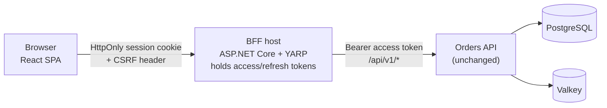

# PRD: Orders API web front end (Phase 2)

| Field | Value |
|---|---|
| Status | Approved 2026-10-30 |
| Owner | Product owner (Elmor Cabalfin) |
| Client / sponsor | Internal proof of concept |
| Last updated | 2026-10-30 |
| Inputs | prd.md (FR-001.., NFR-01.., D1-D16, P1-P10), endpoint-catalog.md (EP-01..57), permission-matrix.md, threat-model.md, ADR-0008, ADR-0010 |

## 1. Problem
The Orders API is built, but it can only be used through developer tools. Customers cannot register, shop or manage their account on their own. Admins manage data through Scalar. A web front end makes the API usable and proves the API contract with a real client, without changing the API.

## 2. Goals
- G1: A new customer completes register → confirm → sign in → place an order in ≤ 5 minutes, unaided (timed demo script, 3 runs by 3 people).
- G2: 100% of Customer portal screens meet the screen Definition of Done (section 10) at MVP. Same for Admin screens at Release 2.
- G3: 0 tokens reach the browser (security test FT-01 passes on every build).
- G4: 0 lines changed under `src/` of the API during Phase 2 (git diff check in CI).

## 3. Non-goals
- No API code changes. Gaps are logged in section 12 as "deferred - needs API change".
- No anonymous catalog (EP-22/23 return 401; decision of 2026-10-24 stands).
- No payments, addresses, shipping, product images, categories or wish lists (the API has no data for them).
- No internationalization: English (en-US) only.
- No native mobile app and no offline mode.
- No hosting beyond local Docker compose (same as Phase 1).

## 4. Users and roles
| Role | Area | Key needs |
|---|---|---|
| Anonymous | Sign-in pages only | Register, confirm email, sign in, reset password |
| Customer | Customer portal `/` | Browse the catalog, place, view and cancel own orders, manage profile, password and account erasure |
| Admin | Back office `/admin` (Release 2) | Manage products, customers, orders, Admin users; view reports and audit logs |

Rule: the UI hides what a role cannot do. The API stays the only enforcer (permission matrix). A Customer who opens `/admin` sees a "Not allowed" page. A Customer who opens another customer's order sees "Not found" (the API returns 404).

## 5. Scope
### In scope (MVP = Release 1: Foundation + Customer portal)
BFF sign-in and session, app shell, error handling, register, confirm, resend, sign in, forgot and reset password, catalog (list, search, filter, sort, page, detail), cart in the browser, place order, my orders (list, detail, cancel), profile (view, edit), change password, erase account, sign out.

### Release 2: Admin back office
Products (list incl. deleted, create, edit incl. stock, delete, restore), customers (list, detail, create, edit, delete, order history), orders (list, detail, create, replace items, status change, cancel), Admin users (list, detail, create, lock and unlock, assign and remove the Admin role), reports (sales, low stock, top products), audit logs.

### Later (needs API change or stretch endpoints)
Anonymous catalog, edit items of own Pending order (EP-49), stock adjustment with reason (EP-28), customer restore (EP-34), revoke sessions (EP-20), send reset link (EP-21), Idempotency-Key, email change.

### Context

## 6. Functional requirements
Release: MVP = R1, R2 = Admin. EP numbers come from the endpoint catalog.

### 6.1 Foundation and BFF
| ID | Requirement | EP | MoSCoW | Rel |
|---|---|---|---|---|
| FR-F001 | The browser calls only the BFF origin. The BFF forwards an allow-list of `/api/v1/*` routes to the API under the same path (so `Location` headers stay valid), adding `Authorization: Bearer`. `/scalar`, `/openapi`, `/health/*` and unknown paths are not forwarded (404). | all | Must | R1 |
| FR-F002 | BFF sign-in: the BFF calls EP-04, keeps the `TokenResponse` server-side, and returns only an HttpOnly session cookie and the user summary from EP-08. Login errors are passed on as ProblemDetails (401 `invalid-credentials`, 403 `email-not-confirmed`, 400, 429). | EP-04, EP-08 | Must | R1 |
| FR-F003 | Token refresh: the BFF refreshes the access token through EP-05 when it has ≤ 60 s left or after an API 401. Only one refresh runs per session at a time (single flight); requests that arrive meanwhile wait for it. If EP-05 returns 401, the BFF ends the session and returns 401 `session-ended` to the SPA. | EP-05 | Must | R1 |
| FR-F004 | Sign out: the BFF calls EP-06 with the stored refresh token, deletes the session and expires the cookie, even if EP-06 fails. Sign out everywhere calls EP-07. | EP-06, EP-07 | Must / Should | R1 |
| FR-F005 | Session bootstrap: on load, the SPA asks the BFF for the current user (EP-08: email, roles, customerId, emailConfirmed). No tokens are in that response. | EP-08 | Must | R1 |
| FR-F006 | Role routing: after sign-in, Customers land on the catalog and Admins on `/admin` (in R1, a "Back office coming soon" page). Routes are guarded by role. | EP-08 | Must | R1 |
| FR-F007 | Error handling maps ProblemDetails `type` slugs to user messages, `errors` keys to form fields, and shows `traceId` as a "reference" on 500/503 and unexpected errors (section 7, NFR-F20..F24). | all | Must | R1 |
| FR-F008 | BFF rate limits per browser IP: shared 10/min bucket for sign-in, register, confirm, resend, forgot, reset, change password and erase; 30/min for refresh. The BFF returns 429 ProblemDetails with `Retry-After`. The API's limits for these policies are raised through configuration (gap G1). | EP-01..05, 09..11, 37 | Must | R1 |
| FR-F009 | Configuration: set `Email__LinkBaseUrl` to the front-end origin so confirm and reset links open SPA routes `/confirm-email?userId&token` and `/reset-password?email&token`. Keep `Cors__AllowedOrigins` empty (the browser never calls the API directly). Add the BFF and SPA services to compose. | - | Must | R1 |

### 6.2 Customer portal (R1)
| ID | Requirement | EP | MoSCoW |
|---|---|---|---|
| FR-F020 | Register with email, password (15-128 code points, no composition rules), first name, last name and optional phone (E.164). It always shows the same "check your email" result (202). | EP-01 | Must |
| FR-F021 | The confirm-email page reads `userId` and `token` from the link, posts them once, and shows success (204) or a generic "link invalid or expired" with a resend option (400 `invalid-token`). | EP-02 | Must |
| FR-F022 | Resend confirmation from the sign-in page and after 403 `email-not-confirmed`. It always shows the same message. | EP-03 | Must |
| FR-F023 | Sign-in page with email and password. It shows one generic message for every 401. | EP-04 via BFF | Must |
| FR-F024 | Forgot password: enter an email and always see the same message. | EP-10 | Must |
| FR-F025 | Reset password page from the link. It removes the token from the address bar after reading it. On success it sends the user to sign in. | EP-11 | Must |
| FR-F026 | Catalog list: search (name or SKU, 2-100 chars), price range, in stock only, sort (name, price), page size 20 (max 100), paging with total count. | EP-22 | Must |
| FR-F027 | Product detail: name, SKU, description, price, stock state. | EP-23 | Must |
| FR-F028 | Cart in the browser: add, change quantity (1-1000), remove. Max 50 distinct products. The cart holds product IDs, quantities and the unit price the customer saw (for "Price updated", US-F029 AC2). It survives a session end and is cleared only on Sign out and Delete account (UX-D1, UX-D2). | - | Must |
| FR-F029 | Place order: re-read the cart's products, show current prices and an estimated total, submit once, then show the created order. Handle 409 `insufficient-stock` (mark `productIds`), 409 `too-many-pending-orders` (show `maxPending`), and 400 `items[i].productId` (product removed). | EP-23, EP-45 | Must |
| FR-F030 | My orders: list with status filter (multi), date range, sort (newest, total) and paging. | EP-46 | Must |
| FR-F031 | Order detail: status, items (product name looked up, unit price, line total), total + currency, status history. | EP-47, EP-23 | Must |
| FR-F032 | Cancel own order when the status is Pending, with an optional reason (≤ 500). 409 shows the current status. | EP-48 | Must |
| FR-F033 | Profile: view, then edit first name, last name and phone. Sends `If-Match`; handles 412 (section 7). Email is read-only. | EP-35, EP-36 | Must |
| FR-F034 | Change password: current and new password. On success the session ends (the API revokes all tokens) and the user signs in again. | EP-09 | Must |
| FR-F035 | Delete account (UI wording, UX-D3; the page explains that personal data is erased): explain the effect, ask for the current password, and confirm twice. 409 `customer-has-open-orders` links to My orders. On success the session ends. | EP-37 | Must |
| FR-F036 | Sign out everywhere from Profile. | EP-07 | Should |

### 6.3 Admin back office (R2)
| ID | Requirement | EP | MoSCoW |
|---|---|---|---|
| FR-F050 | Admin shell: navigation for Products, Customers, Orders, Reports, Users, Audit logs; landing page with low-stock count and last-30-days sales totals. | EP-52, EP-53 | Must |
| FR-F051 | Products list with search, filters, sort, paging and "include deleted" (deleted rows marked). | EP-22 | Must |
| FR-F052 | Create a product; 409 `duplicate-sku` shown on the SKU field. | EP-24 | Must |
| FR-F053 | Edit a product (full replace incl. stock quantity) with `If-Match`. | EP-23, EP-25 | Must |
| FR-F054 | Delete and restore a product (409 `not-deleted`, `duplicate-sku`). | EP-26, EP-27 | Must |
| FR-F055 | Customers list: search, created date range, include deleted, sort, paging. | EP-30 | Must |
| FR-F056 | Customer detail with order history and lock state; links to the user record. | EP-31, EP-51 | Must |
| FR-F057 | Create a customer (the reset link is sent by the API). | EP-29 | Should |
| FR-F058 | Edit a customer with `If-Match` (email read-only, D14). | EP-32 | Must |
| FR-F059 | Delete a customer (409 `customer-has-open-orders`). | EP-33 | Should |
| FR-F060 | Orders list with customer name, status (multi), customer, date and total filters. | EP-50 (list with names), EP-39 | Must |
| FR-F061 | Order detail with next-status buttons from `allowedNextStatuses`, and cancel with a reason. | EP-40, EP-42, EP-43 | Must |
| FR-F062 | Replace the items of a Pending order with `If-Match`. | EP-41 | Should |
| FR-F063 | Create an order for a customer (customer picker + product picker). | EP-30, EP-22, EP-38 | Should |
| FR-F064 | Sales report: date range ≤ 366 days, group by day, week or month, totals. | EP-52 | Must |
| FR-F065 | Low-stock report with a threshold. | EP-53 | Should |
| FR-F066 | Top-products report. | EP-54 | Could |
| FR-F067 | Users list and detail (roles, lock state, lock type). | EP-12, EP-13, EP-18 | Must |
| FR-F068 | Create an Admin user. | EP-19 | Should |
| FR-F069 | Lock (optional until date and reason) and unlock a user; 409 `admin-safeguard` and `user-deleted` explained. | EP-14, EP-15 | Must |
| FR-F070 | Assign and remove the Admin role (409 `user-is-customer`, `admin-safeguard`). | EP-16, EP-17 | Should |
| FR-F071 | Audit-log viewer with filters (entity type, entity ID, user, action, date range) and a field-change table. | EP-55 | Should |

## 7. Non-functional requirements
| ID | Category | Requirement (measurable) | Priority |
|---|---|---|---|
| NFR-F01 | Accessibility | WCAG 2.2 AA. Automated axe scan: 0 serious or critical issues on every screen. Manual keyboard-only pass on every screen: all actions reachable, visible focus, no traps. | Must |
| NFR-F02 | Accessibility | WCAG 2.2 specifics: targets ≥ 24×24 CSS px (2.5.8); focus not hidden by sticky headers (2.4.11); paste and password managers allowed in every password field, no CAPTCHA or cognitive test (3.3.8); data already entered is not asked again in the same flow (3.3.7). | Must |
| NFR-F03 | Accessibility | Form errors are announced (live region), linked to fields (`aria-describedby`), and the first invalid field gets focus. Status changes (order placed, cancelled) are announced. | Must |
| NFR-F04 | Performance | Core Web Vitals at p75 on a mid-range laptop over local compose: LCP ≤ 2.5 s, INP ≤ 200 ms, CLS ≤ 0.1. | Must |
| NFR-F05 | Performance | Initial JavaScript for the Customer portal ≤ 200 KB gzip. Admin code is loaded only on `/admin` routes. | Should |
| NFR-F06 | Performance | The BFF adds ≤ 30 ms at p95 to a proxied API call (measured against a direct call, 50 concurrent users). | Should |
| NFR-F07 | Performance | Any action with no response after 400 ms shows a loading state. Requests time out after 15 s with a retry option. | Must |
| NFR-F08 | Browsers and devices | The latest 2 major versions of Chrome, Edge, Firefox and Safari (desktop and iOS/Android). Customer portal responsive from 360 px wide; Admin from 1024 px (usable at 768 px). | Must |
| NFR-F09 | Security (tokens) | Access and refresh tokens never reach the browser: no response body, header, cookie or storage holds them (test FT-01 checks every BFF response for `accessToken` and `refreshToken`). | Must |
| NFR-F10 | Security (cookie) | One session cookie: `__Host-` prefix, `HttpOnly`, `Secure`, `SameSite=Strict`, `Path=/`. It holds only an opaque session ID. Assumption: browsers accept `Secure` cookies on `http://localhost`; otherwise HTTPS is used locally. | Must |
| NFR-F11 | Security (CSRF) | Every BFF request that changes state (POST, PUT, DELETE) must carry a custom header (for example `X-CSRF: 1`) and have a same-origin `Origin`. Otherwise the BFF answers 403 before forwarding. | Must |
| NFR-F12 | Security (session) | The session ends when an API refresh fails (7-day sliding, 30-day absolute; NFR-05) or after sign-out. Admin sessions also end after 30 minutes idle, with a warning dialog 2 minutes before (UX-D4). | Must |
| NFR-F13 | Security (headers) | The SPA is served with a strict CSP (`default-src 'self'`, no inline script, `frame-ancestors 'none'`), `X-Content-Type-Options: nosniff`, `Referrer-Policy: no-referrer`. | Must |
| NFR-F14 | Security (storage) | The browser stores no personal data and no tokens. The cart (product IDs, quantities, prices seen) is the only stored data; Sign out and Delete account clear it. | Must |
| NFR-F15 | Security (logging) | The BFF never logs tokens, passwords, cookies, reset or confirm tokens, or request bodies of auth routes. | Must |
| NFR-F16 | Security (rate limit) | BFF limits as in FR-F008; a test shows request 11 to the auth bucket within 60 s returns 429 with `Retry-After`. | Must |
| NFR-F17 | Privacy | Erase account and Admin delete show what is kept (orders) and what is anonymized, before confirming. | Must |
| NFR-F18 | Availability | When the API is down, the BFF readiness check (which calls EP-57) reports Unhealthy, and the SPA shows a "service unavailable, try again" banner within 5 s. | Should |
| NFR-F19 | Supportability | Every error screen shows the API `traceId` (copyable). BFF logs carry the same trace ID (W3C `traceparent` forwarded). | Must |
| NFR-F20 | Errors (ProblemDetails) | Every `type` slug in endpoint-catalog §1.8 that a screen can receive has a mapped user message. Unknown slugs fall back to `title` + `traceId`. | Must |
| NFR-F21 | Errors (validation) | Client-side validation mirrors the API rules (catalog §1.5) before submit. Server `errors` keys (`firstName`, `items[2].productId`) are still shown on the matching field. | Must |
| NFR-F22 | Concurrency | Every edit form keeps the `ETag` from GET and sends `If-Match`. 412: show "This record changed since you opened it", reload the latest data, keep the user's unsaved values visible for re-entry. 428: treated as a client bug, logged, shown as a generic error. | Must |
| NFR-F23 | Rate limits | On 429, show "Too many attempts. Try again in N seconds" from `Retry-After` and disable the submit button for that time. Writes are never retried automatically. A GET may be retried once after `Retry-After` if it is ≤ 10 s. | Must |
| NFR-F24 | Duplicate submit | Create actions (register, place order, create entity) disable the submit button until the response arrives. A network error after submit shows "Check My orders before trying again" (no Idempotency-Key, gap G6). | Must |
| NFR-F25 | Dates and money | Dates are shown in the browser's time zone and sent to the API as ISO 8601 with offset (D8). Money is shown with the `currency` from the response, or with the configured currency for products. | Must |
| NFR-F26 | i18n | Not in scope. English only. All UI text sits in one place per feature so a later translation does not need a rewrite. | Could |
| NFR-F27 | Report load | The Admin landing page loads at most 2 reports at the same time (API limit: 4 concurrent `/reports/*`). | Must |
| NFR-F28 | Compliance | No new personal data is collected. Data retention is unchanged from the API. | Must |
| NFR-F29 | Security (CSRF origins) | CSRF origins come from `Bff:AllowedOrigins` (`http://localhost:8081`; `https://localhost:8443` in the `https` profile; `http://localhost:5173` in Development only). Validated at startup: no `*`, no `null`, exact scheme/host/port. Non-safe request with missing Origin → 403. `Sec-Fetch-Site`, when present, must be `same-origin`. `Email:LinkBaseUrl` must be one of the allowed origins | Must |
| NFR-F30 | Security (session) | Session ID ≥ 128 bits from a CSPRNG. Encrypted entry bound to its key (session ID in the Data Protection purpose or checked in the payload); mismatch → delete and 401. Sign-in removes any existing session for that cookie and calls EP-06 for it | Must |
| NFR-F31 | Security (refresh) | A refresh result is saved only if the session still exists and its version is unchanged; logout and session end always win | Must |
| NFR-F32 | Security (proxy) | YARP routes use typed constraints (`{id:guid}`) and exact methods; encoded `/`, `\` or dot segments → 404. Request drops `Cookie`, `Authorization`, `Forwarded`, `X-Forwarded-*`, `X-Original-*`, `X-HTTP-Method-Override` before adding Bearer; response drops `Set-Cookie` and `Server`. Unknown `/api/*` and `/bff/*` → 404 ProblemDetails, never `index.html` | Must |
| NFR-F33 | Security (cache) | Proxied `/api/*` responses `Cache-Control: no-store` (ETag kept). `/bff/logout` and `/bff/logout-all` send `Clear-Site-Data: "cache", "storage"` (not `"cookies"`). The SPA clears the React Query cache on any session end | Must |
| NFR-F34 | Security (redirect) | `returnUrl` accepted only if it starts with a single `/`, has no `//`, `\`, scheme or control characters, resolves to the same origin, is not under `/api` or `/bff`, and the role may open it; otherwise role home. `reason` is a fixed code list | Must |
| NFR-F35 | Security (XSS) | ESLint bans `dangerouslySetInnerHTML`, `eval`, `new Function`, `innerHTML`, and `href`/`src` from server data unless an `http(s)`-only URL check passes. Server text (incl. ProblemDetails `detail`) shown as text only. No third-party scripts, fonts or CDNs. Trusted Types report-only, then enforced (S-D13) | Must |
| NFR-F36 | Security (headers) | Every BFF response (static, `/bff`, proxied, errors, 404, 429) carries CSP, `X-Frame-Options: DENY`, `nosniff`, `Referrer-Policy: no-referrer`, `Permissions-Policy`, `Cross-Origin-Opener-Policy: same-origin`. HSTS only on HTTPS and never for `localhost` | Must |
| NFR-F37 | Security (rate limit) | BFF anonymous limit 60/min per IP for unauthenticated `/bff/*` and `/api/*`. An API 429 on a proxied call is passed through and never triggers a refresh | Must |
| NFR-F38 | Security (Admin session) | No timed polling (`refetchInterval`) in `/admin`; `/bff/user` and health calls do not update `LastActivityAt`. Admin absolute lifetime 12 h (S-D10). Recent sign-in ≤ 15 min for EP-16 and EP-19, else 401 `reauth-required` (S-D11, R2) | Must |
| NFR-F39 | Security (errors, logs) | No developer exception page in the BFF (`UseExceptionHandler` + ProblemDetails in every environment). No HttpClient header logging; OTel captures no headers. `/bff/login` builds its own ProblemDetails from EP-04 and never passes the raw body. Query strings on `/confirm-email` and `/reset-password` redacted | Must |
| NFR-F40 | Security (supply chain) | `.npmrc` `ignore-scripts=true` (exceptions documented); `npm audit` high for prod and critical for dev dependencies; `npm audit signatures`; CycloneDX SBOM; Trivy on `demoapi/web`; Node image pinned by digest; review `overrides` on updates | Must |
| NFR-F41 | Security (cart) | Cart key `cart:{first 16 hex of SHA-256(userId)}`; content validated with Zod on read (bad → empty); max 50 lines; cleared on Sign out and Delete account | Must |
| NFR-F42 | Security (dev cert) | ASP.NET Core dev cert only (`localhost` SAN), no custom root CA; exported outside the repo or into a git-ignored folder; random export password in `dev-secrets`; gitleaks rule for `*.pfx`, `*.pem`, `*.key`; mounted read-only | Must |
| NFR-F43 | Security (links) | The confirm-email page removes `userId` and `token` from the address bar (`history.replaceState`) before posting | Must |

## 8. Integrations and data
| System | Direction | Method | Owner |
|---|---|---|---|
| Orders API `/api/v1` | BFF → API | HTTP JSON, Bearer token; configuration-only changes | Product owner |
| Fake email sender (API logs) | API → developer | Confirm and reset links point at the SPA (`Email:LinkBaseUrl`) | Product owner |
| Figma | Design → build | Frames linked from each story | product-designer |
| Azure DevOps Boards / Pipelines | Tracking, CI | New epics and stories; front-end and BFF build in the pipeline | azdo-boards-manager |

## 9. Success metrics
| Metric | Baseline | Target | How measured |
|---|---|---|---|
| Register → first order time | n/a | ≤ 5 min, 3 of 3 testers | Timed demo script |
| Screens meeting the screen DoD | 0 | 100% per release | DoD checklist per story |
| Tokens visible to the browser | n/a | 0 | FT-01 in CI |
| API source lines changed | 0 | 0 | `git diff --stat main -- src/` in CI |
| axe serious and critical issues | n/a | 0 | Automated scan per screen |

## 10. Definition of Done per screen
- [ ] Figma frame linked; built from shadcn/ui components and the shared design tokens.
- [ ] All states built: loading, empty, error, success, no permission (403) and not found (404).
- [ ] Every ProblemDetails slug the screen's endpoints can return (catalog §1.8 and the endpoint row) is mapped; `traceId` shown on unexpected errors.
- [ ] Client validation matches catalog §1.5; server field errors land on the right field.
- [ ] Edit screens send `If-Match` and handle 412; submit buttons handle 429 with `Retry-After`.
- [ ] Role guard: tested for anonymous, Customer and Admin (direct URL included).
- [ ] Accessibility: axe 0 serious or critical; keyboard pass; screen-reader check of the main task (NFR-F01..F03).
- [ ] Responsive at 360 px (Customer) or 1024 px (Admin); checked in Chrome and one other engine.
- [ ] Component tests for logic; one end-to-end test for the happy path and one for the main error path, tagged with the story and AC (`US-F0xx`, `ACn`).
- [ ] No token, password or personal data in browser storage or console logs.
- [ ] Performance budget (NFR-F04/F05) not broken.
- [ ] Fresh-context code review; security review when the BFF, cookies, auth or personal data are touched.
- [ ] PR references `AB#<id>`; green build.

## 11. Risks and dependencies
| Risk / dependency | Impact | Mitigation | Owner |
|---|---|---|---|
| All users share one API IP bucket behind the BFF | Sign-in fails for everyone after 10 calls/min | FR-F008 + configuration (gap G1) | Architect |
| Parallel refreshes revoke the token family (strict refresh, S-D6) | Random sign-outs | Single-flight refresh per session (FR-F003); concurrency test | Architect |
| Valkey restart or eviction ends sessions | Users signed out | Sessions in Valkey survive BFF restarts (FA-D1); Valkey restart accepted (S-D12) | Architect |
| Email links only appear in API logs | Demo friction | README step: `docker compose logs api` | Developer |
| Figma file not created yet | Build waits on design | Foundation stories (US-F001..F009) need no Figma | Product designer |

## 12. API gaps (no API code change allowed)
None of these needs an API code change to ship the MVP, except the items marked deferred. Deferred items go to the unscheduled "API v1.1 (deferred)" epic on the board.

None of these needs an API code change to ship the MVP, except the items marked deferred.

| # | Front-end need | Why the API cannot meet it | Workaround with no API change | Status |
|---|---|---|---|---|
| G1 | Per-user auth rate limits behind a proxy | `ClientIp` uses `RemoteIpAddress` only; no forwarded-headers code in `src`, so all BFF traffic is one IP (auth 10/min, refresh 30/min in total) | Raise `RateLimiting__AuthStrict__PermitLimit` and `RateLimiting__Refresh__PermitLimit` through configuration; enforce the real limits per browser IP in the BFF (FR-F008). Lockout still protects accounts | Workaround (config). Forwarded headers: deferred, needs API change |
| G2 | Anonymous catalog | EP-22/23 return 401 to anonymous users | Sign in to browse; landing page explains the shop | Deferred, needs API change |
| G3 | Product names on order lines | `OrderLineResponse` has only `productId`; deleted products return 404 to Customers | Look up names via EP-23 (cached per session); show "Product no longer available" on 404. Admins use EP-23 with `includeDeleted=true`. Up to 50 calls per order (inside the 300/min `general` limit) | Workaround; better fix deferred |
| G4 | Parallel refresh safety | Strict refresh revokes the family when the same token is used twice (S-D6); the "benign race" option is not built | Single-flight refresh per session in the BFF (FR-F003) | Workaround |
| G5 | Customer names in the Admin orders list | `OrderListItem` has only `customerId` | Use EP-50 (same filters, includes `customerName`); it shares the 4-at-a-time reports limit | Workaround |
| G6 | Safe retry of order create | `Idempotency-Key` (stretch) not built | Disable submit while in flight; never auto-retry POST; after a network error, tell the user to check My orders | Workaround (risk accepted) |
| G7 | Email links open the front end | Links default to `http://localhost:8080` (API) | Set `Email__LinkBaseUrl` to the SPA origin; SPA routes `/confirm-email` and `/reset-password` match the link paths in `FakeEmailSender` | Workaround (config) |
| G8 | Stock adjustment with a reason | EP-28 (stretch) not built | Edit `stockQuantity` through EP-25 (full replace, `If-Match`). No reason recorded; the audit log shows old and new values | Workaround; deferred for the reason |
| G9 | Customer edits items of a Pending order | EP-49 (stretch) not built | Cancel the order and order again | Deferred |
| G10 | Restore a deleted customer | EP-34 (stretch) not built | None (Admin creates a new customer) | Deferred |
| G11 | Customer changes email | No endpoint (D14) | Show email read-only with "Contact support" | Deferred, needs API change |
| G12 | Admin revokes a user's sessions or sends a reset link | EP-20 and EP-21 (stretch) not built | Revoke: lock then unlock (lock revokes tokens). Reset: the user uses "Forgot password" | Workaround |
| G13 | Dropdown of audit entity types | EP-55 takes free text, with no list endpoint | Fixed list in the UI from `data-model.md` table names (Assumption) | Workaround |
| G14 | Product images, categories, cross-origin calls | Not in the data model. CORS works but is not needed | Out of scope. Keep `Cors:AllowedOrigins` empty because the browser calls only the BFF | n/a |

## 13. Assumptions
- Assumption: the SPA is served by the BFF (same origin), so CORS on the API stays empty.
- Assumption: one SPA with role areas (Q3).
- Assumption: the cart lives in browser storage, keyed by the user ID, holds no personal data, and is cleared on sign-out.
- Assumption: email remains faked; links are read from the API logs.
- Assumption: T-shirt sizes are XS ≈ 0.5 day, S ≈ 1 day, M ≈ 2-3 days, L ≈ 4-5 days for one developer with Claude.
- Assumption: product names on order lines are looked up via EP-23 and cached for the session.
- Assumption: local Docker only, as in Phase 1.

## 14. Decisions (product owner, 2026-10-30)
| # | Question | Decision |
|---|---|---|
| FE-D1 | Anonymous catalog | Sign in to browse. `AllowAnonymous` on EP-22/23 is a deferred API change (G2). No technical catalog account |
| FE-D2 | Rate limits behind the BFF | Raise API `AuthStrict` and `Refresh` limits through configuration; the BFF enforces the real per-browser-IP limits (G1). Recorded in ADR-0015; threat model T-31 updated |
| FE-D3 | One app or two | One SPA with a role-gated `/admin` area, one BFF. Admin code loaded only for Admins |
| FE-D4 | Session lifetime | Follows the API (7-day sliding, 30-day absolute); Admin sessions also end after 30 minutes idle (warning 2 min before) and after 12 hours absolute (amended by S-D10) |
| FE-D5 | Deferred API changes | Phase 2 stays API-frozen. G2, G3, G8-G11 and forwarded headers go to an unscheduled "API v1.1 (deferred)" epic |

## 15. Open questions
- Closed 2026-10-30: `__Host-` cookies on localhost (Chromium/Firefox yes, Safari needs the `https` profile, FA-D2); session store = Valkey (FA-D1).
- Security requirements NFR-F29..F43 and tests FT-01..FT-20 come from [threat model §10](../05-security/threat-model.md).
