# Information architecture: Orders web front end

> Decisions (product owner, 2026-10-30): UX-D1 cart stores product ID, quantity and the price seen; UX-D2 cart survives session end, cleared on Sign out and Delete account; UX-D3 UI says "Delete account"; UX-D4 Admin idle warning dialog 2 minutes before the 30-minute sign-out; UX-D5 placeholder shop name "Orders Shop".

Last updated: 2026-10-30. Inputs: prd-frontend.md, user-stories/04-frontend.md, endpoint-catalog.md, permission-matrix.md.

## 1. Areas and roles
| Area | Who | Entry |
|---|---|---|
| Public pages | Anonymous | `/`, links in emails |
| Customer portal | Customer | `/products` after sign-in |
| Back office | Admin | `/admin` ("coming soon" in R1, full in R2) |

Rules:
- The UI hides what a role cannot do. The API is still the only enforcer.
- A Customer who opens `/admin/*` sees Not allowed, and no Admin API call is made.
- A Customer who opens another customer's order sees Not found (the API returns 404).
- A signed-in user who opens a public-only page (`/sign-in`, `/register`) is sent to their role home.
- `/confirm-email` and `/reset-password` work with or without a session.

## 2. Page inventory
| ID | Page | Route | Roles | Stories | EP | Rel |
|---|---|---|---|---|---|---|
| AN-1 | Landing | `/` | Anon (others redirected) | F006 | - | R1 |
| AN-2 | Sign in | `/sign-in?returnUrl&reason` | Anon | F002, F022, F023 | 04, 03 | R1 |
| AN-3 | Register | `/register` | Anon | F020 | 01 | R1 |
| AN-4 | Check your email | `/register/check-email` | Anon | F020 | - | R1 |
| AN-5 | Confirm email | `/confirm-email?userId&token` (fixed by the email link) | Any | F021 | 02 | R1 |
| AN-6 | Resend confirmation | `/resend-confirmation` | Anon | F022 | 03 | R1 |
| AN-7 | Forgot password | `/forgot-password` | Anon | F024 | 10 | R1 |
| AN-8 | Reset password | `/reset-password?email&token` (fixed) | Any | F025 | 11 | R1 |
| CU-1 | Products | `/products?search&minPrice&maxPrice&inStock&sort&page` | Customer | F026, F028 | 22 | R1 |
| CU-2 | Product detail | `/products/:productId` | Customer | F027, F028 | 23 | R1 |
| CU-3 | Cart (and checkout) | `/cart` | Customer | F028, F029 | 23, 45 | R1 |
| CU-4 | My orders | `/orders?status&from&to&sort&page` | Customer | F030 | 46 | R1 |
| CU-5 | Order detail (also "Order placed") | `/orders/:orderId` | Customer | F029, F031 | 47, 23 | R1 |
| CU-6 | Cancel order (dialog on CU-5) | - | Customer | F032 | 48 | R1 |
| CU-7 | My account | `/account` | Customer | F033, F036 | 35, 07 | R1 (F036 R2) |
| CU-8 | Edit profile | `/account/edit` | Customer | F033 | 35, 36 | R1 |
| CU-9 | Change password | `/account/password` | Customer | F034 | 09 | R1 |
| CU-10 | Delete account | `/account/delete` | Customer | F035 | 37 | R1 |
| SH-1 | Customer app shell | wraps CU-* | Customer | F004, F006 | 06, 08 | R1 |
| SY-1 | Page or item not found | `*` and in-page | All | F006, F027, F031 | - | R1 |
| SY-2 | Not allowed | in-page on guarded routes | All | F006 | - | R1 |
| SY-3 | Something went wrong | in-page | All | F007 | - | R1 |
| SY-4 | Service unavailable banner | in the shell | All | NFR-F18 | 57 via BFF | R1 |
| SY-5 | Back office coming soon | `/admin` | Admin | F006 | - | R1 only |
| AD-0 | Admin shell | wraps `/admin/*` | Admin | F050 | 08 | R2 |
| AD-1 | Dashboard | `/admin` | Admin | F050 | 52, 53 | R2 |
| AD-2 | Products list | `/admin/products?...&includeDeleted` | Admin | F051, F054 | 22, 26, 27 | R2 |
| AD-3 | New product | `/admin/products/new` | Admin | F052 | 24 | R2 |
| AD-4 | Product detail | `/admin/products/:id` | Admin | F053, F054 | 23 | R2 |
| AD-5 | Edit product | `/admin/products/:id/edit` | Admin | F053 | 23, 25 | R2 |
| AD-6 | Customers list | `/admin/customers?...` | Admin | F055 | 30 | R2 |
| AD-7 | New customer | `/admin/customers/new` | Admin | F057 | 29 | R2 |
| AD-8 | Customer detail (with order history) | `/admin/customers/:id` | Admin | F056, F059 | 31, 51, 33 | R2 |
| AD-9 | Edit customer | `/admin/customers/:id/edit` | Admin | F058 | 31, 32 | R2 |
| AD-10 | Orders list | `/admin/orders?...` | Admin | F060 | 50 | R2 |
| AD-11 | New order | `/admin/orders/new` | Admin | F063 | 30, 22, 38 | R2 |
| AD-12 | Order detail | `/admin/orders/:id` | Admin | F061 | 40, 42, 43 | R2 |
| AD-13 | Change order items | `/admin/orders/:id/items` | Admin | F062 | 40, 41 | R2 |
| AD-14 | Sales report | `/admin/reports/sales?from&to&groupBy` | Admin | F064 | 52 | R2 |
| AD-15 | Low stock report | `/admin/reports/low-stock?threshold&page` | Admin | F065 | 53 | R2 |
| AD-16 | Top products report | `/admin/reports/top-products?from&to&top` | Admin | F066 | 54 | Later (Could) |
| AD-17 | Users list | `/admin/users?...` | Admin | F067 | 12, 18 | R2 |
| AD-18 | New Admin user | `/admin/users/new` | Admin | F068 | 19 | R2 |
| AD-19 | User detail (lock, unlock, roles) | `/admin/users/:id` | Admin | F067, F069, F070 | 13, 14-17 | R2 |
| AD-20 | Audit log | `/admin/audit-logs?entityType&entityId&userId&action&from&to&page` | Admin | F071 | 55 | R2 |

## 3. Sitemap

```mermaid
flowchart TD
  root{"/ (route by role)"}
  root -->|"Anonymous"| AN1["Landing /"]
  root -->|"Customer"| CU1
  root -->|"Admin"| ADH

  subgraph Public["Public pages (anonymous)"]
    AN1 --> AN2["Sign in /sign-in"]
    AN1 --> AN3["Register /register"]
    AN3 --> AN4["Check your email /register/check-email"]
    AN2 --> AN6["Resend confirmation /resend-confirmation"]
    AN2 --> AN7["Forgot password /forgot-password"]
    EM1(["Email link"]) --> AN5["Confirm email /confirm-email"]
    EM2(["Email link"]) --> AN8["Reset password /reset-password"]
  end

  subgraph Customer["Customer portal (R1)"]
    CU1["Products /products"] --> CU2["Product detail /products/:productId"]
    CU3["Cart /cart"]
    CU4["My orders /orders"] --> CU5["Order detail /orders/:orderId"]
    CU5 -.-> CU6["Cancel order dialog"]
    CU3 -->|"Place order"| CU5
    CU7["My account /account"] --> CU8["Edit profile /account/edit"]
    CU7 --> CU9["Change password /account/password"]
    CU7 --> CU10["Delete account /account/delete"]
  end

  subgraph Admin["Back office /admin (R2; R1 shows Coming soon)"]
    ADH["Dashboard /admin"]
    ADH --> AO["Orders /admin/orders"] --> AO2["Order detail /admin/orders/:id"] --> AO3["Change items /admin/orders/:id/items"]
    AO --> AO1["New order /admin/orders/new"]
    ADH --> AP["Products /admin/products"] --> AP2["Product detail /admin/products/:id"] --> AP3["Edit /admin/products/:id/edit"]
    AP --> AP1["New product /admin/products/new"]
    ADH --> AC["Customers /admin/customers"] --> AC2["Customer detail /admin/customers/:id"] --> AC3["Edit /admin/customers/:id/edit"]
    AC --> AC1["New customer /admin/customers/new"]
    ADH --> AR["Reports"] --> AR1["Sales /admin/reports/sales"]
    AR --> AR2["Low stock /admin/reports/low-stock"]
    AR --> AR3["Top products /admin/reports/top-products (Later)"]
    ADH --> AU["Users /admin/users"] --> AU2["User detail /admin/users/:id"]
    AU --> AU1["New Admin user /admin/users/new"]
    ADH --> AL["Audit log /admin/audit-logs"]
  end

  subgraph System["System pages (all areas)"]
    S1["Not found"]
    S2["Not allowed"]
    S3["Something went wrong"]
    S4["Service unavailable banner"]
  end
```

## 4. Navigation model
### Customer (top bar, D1)
- At 768 px and wider, from left to right: shop name (links to `/products`), **Products**, **My orders**, then on the right: **Cart** with a count Badge, and an account `DropdownMenu` (the user's email; items **My account** and **Sign out**).
- Below 768 px: shop name, Cart icon button with count, and a menu button that opens a `Sheet` with Products, My orders, My account and Sign out.
- The current page is marked with `aria-current="page"`.
- Inside My account, a vertical list of links: Profile, Change password, Delete account (and Sign out everywhere in R2).

### Admin (Sidebar, D2)
- `Sidebar` items in order of use: **Dashboard, Orders, Products, Customers, Reports** (Sales, Low stock), **Users, Audit log**. Seven items.
- Header: `SidebarTrigger`, a `Breadcrumb`, the account menu (email, Sign out). Admins have no Customer area link, because an Admin has no customer record.
- The Sidebar collapses to icons below 1280 px and to a Sheet below 1024 px.

### Anonymous
- A minimal header: shop name, **Sign in**, **Create account**. No other navigation.
- Auth pages use one centred `Card`, about 400 px wide.

### Naming (in the users' words)
| UI label | Not | Why |
|---|---|---|
| Products | Catalog | The word customers use |
| My orders | Order history | Short, and covers open orders too |
| My account | Profile, Settings | Holds profile, password and deletion |
| Delete account | Erase account | More familiar; the page explains that personal data is erased (Q3) |
| Create account | Register | Common phrasing for consumers |

## 5. Deep links and return paths
- Any protected URL opened without a session goes to `/sign-in?returnUrl=<path>`. Only same-origin relative paths starting with `/` are accepted (prevents open redirects).
- After sign-in, the user returns to `returnUrl` if their role may see it. Otherwise they go to their role home.
- Email links: `/confirm-email` and `/reset-password` (G7).
- List state lives in the URL, so Back, refresh and shared links keep the filters.

## 6. Tree test (optional)
The naming risk is low: 3 Customer destinations. Skip the card sort. If time allows, run a 5-person tree test of the Admin sidebar in R2 with tasks such as "Find why stock for SKU X changed" (expected: Audit log) and "Unlock a customer who is locked out" (expected: Users).
