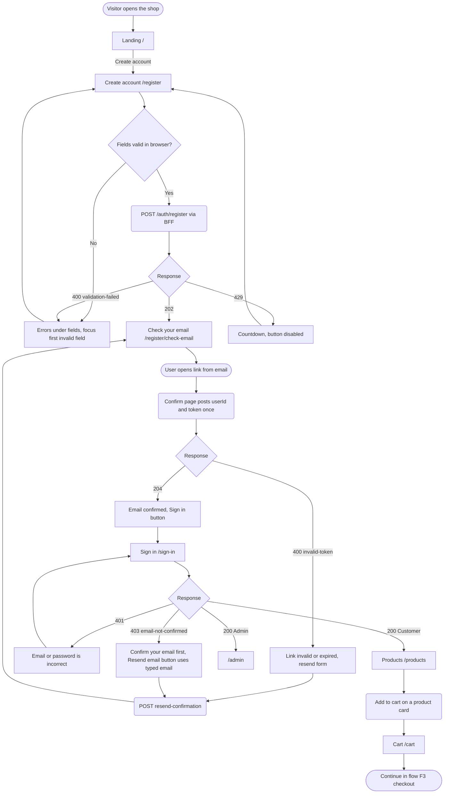
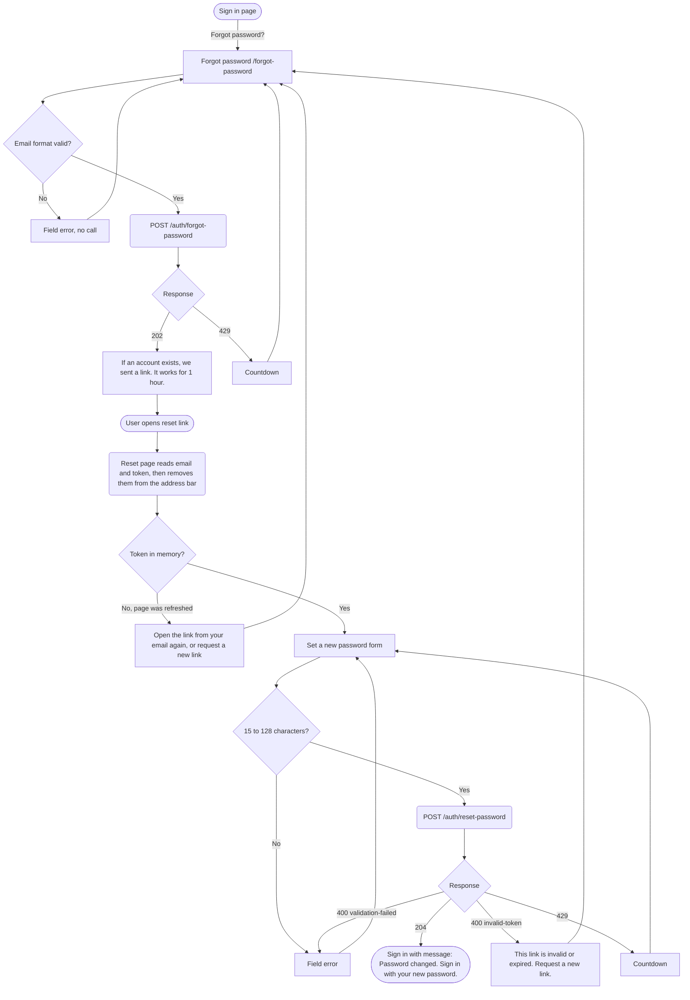
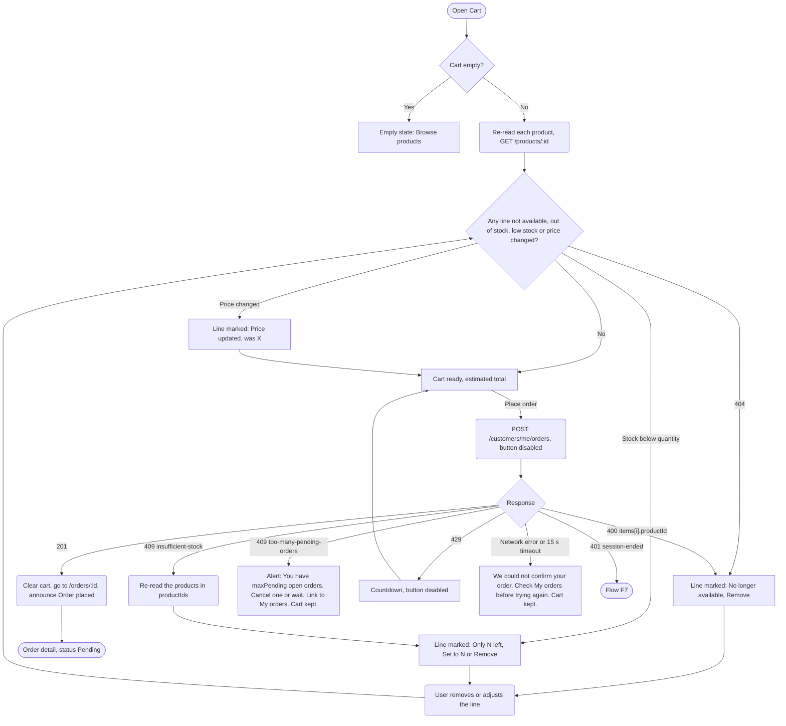
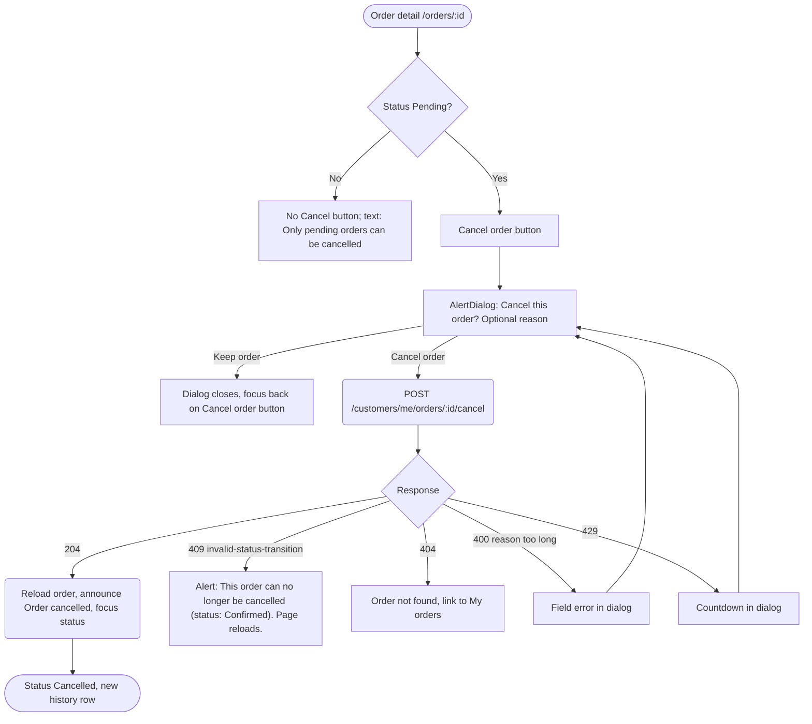
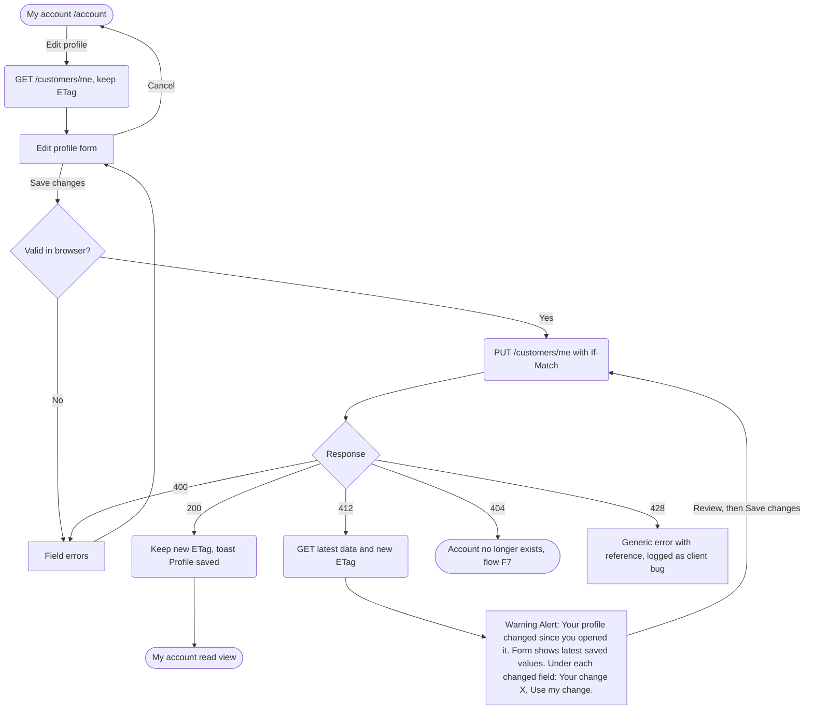
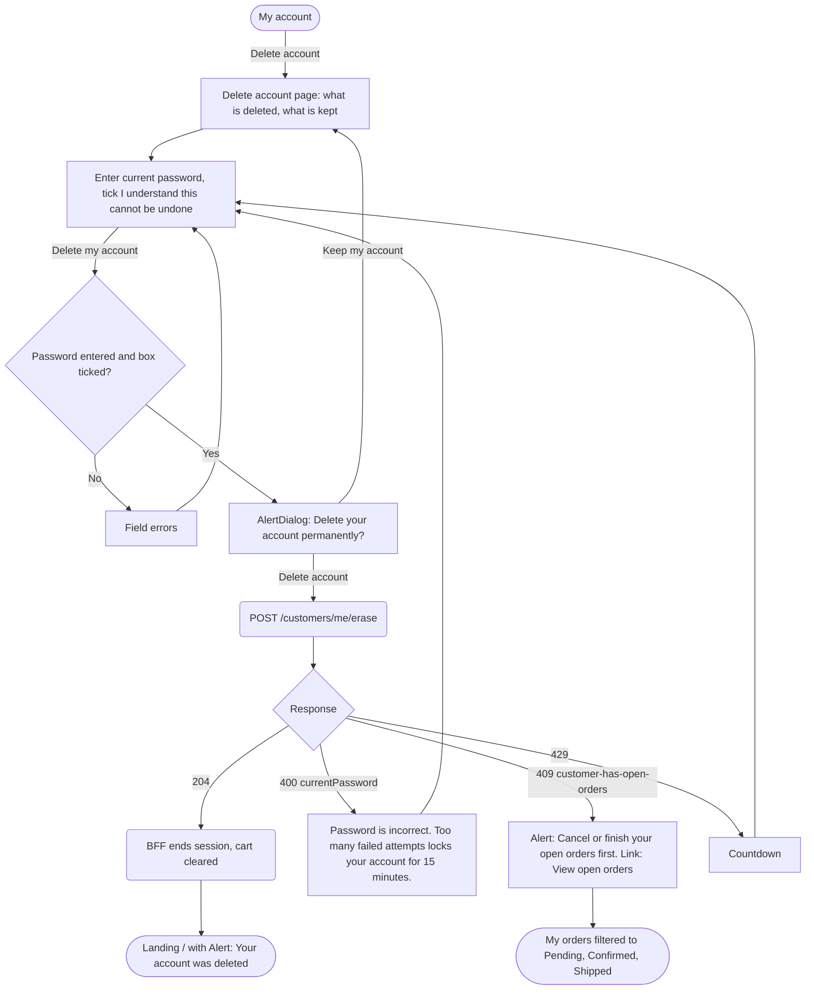
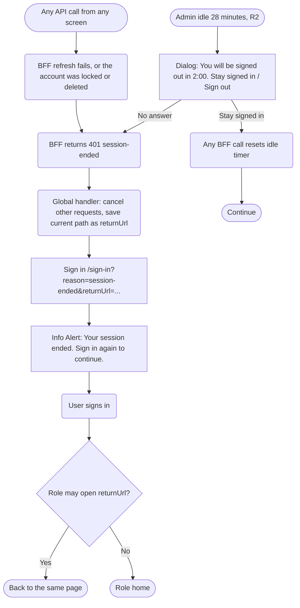
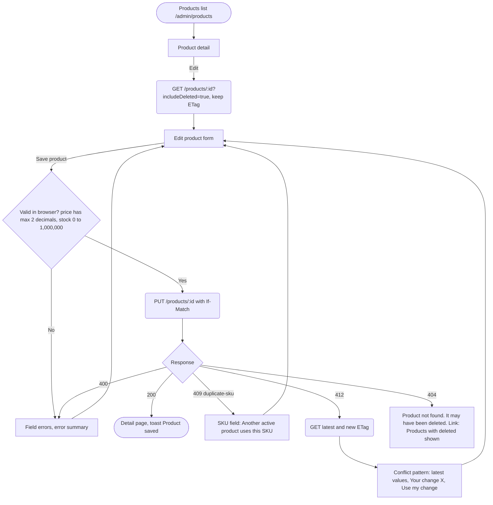
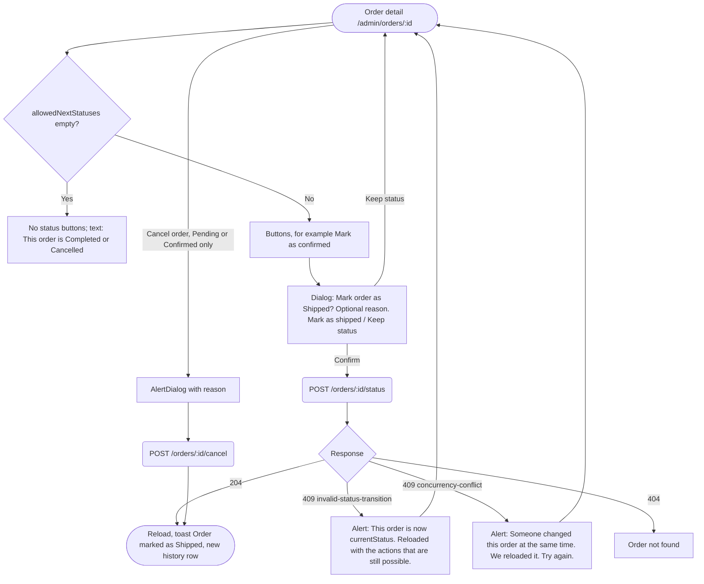

# User flows: Orders web front end

> Decisions (product owner, 2026-10-30): UX-D1 cart stores product ID, quantity and the price seen; UX-D2 cart survives session end, cleared on Sign out and Delete account; UX-D3 UI says "Delete account"; UX-D4 Admin idle warning dialog 2 minutes before the 30-minute sign-out; UX-D5 placeholder shop name "Orders Shop".

Last updated: 2026-10-30. Shapes: rectangle = screen, diamond = decision, rounded box = system action, stadium = start or end.
Shared behaviour that is not drawn in every flow:
- Any 401 `session-ended` follows flow F7.
- Any 429 shows the countdown pattern.
- A 500 or 503 shows the error with its reference (traceId).

## F1. Register, confirm, sign in, first order (US-F020, F021, F022, F023, F026, F028, F029)

Steps for a new customer: 9 user actions (register, open email, sign in, search, add, open cart, place order).
How steps were cut:
- Add to cart works from the list, so the detail page is optional.
- The cart is the checkout (D4).
- "Resend" reuses the email already typed.
- After confirming, the Sign in button goes straight to `/sign-in`.

Prefilling the email after confirmation is not possible: the link has only `userId`, and NFR-F14 forbids storing personal data.

## F2. Forgot and reset password (US-F024, F025)

## F3. Checkout (US-F028, F029; NFR-F24)

## F4. Cancel own order (US-F032)

## F5. Edit profile with a 412 conflict (US-F033; NFR-F22)

## F6. Delete account (US-F035; NFR-F17)

Note: the API route for EP-37 is taken from the catalog name. Use the exact path from the endpoint catalog index when building.

## F7. Session ended (US-F003; FR-F003; NFR-F12)

Unsaved form data is lost when the session ends. The cart is kept (Q2). For Admins, the idle warning reduces this loss.

## F8. Admin: edit product with a 412 conflict (US-F053, R2)

## F9. Admin: change order status (US-F061, R2)

