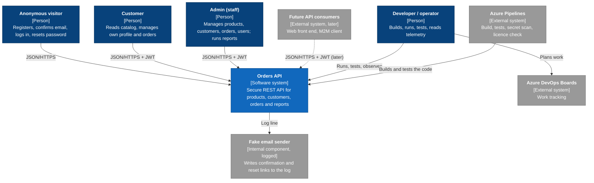
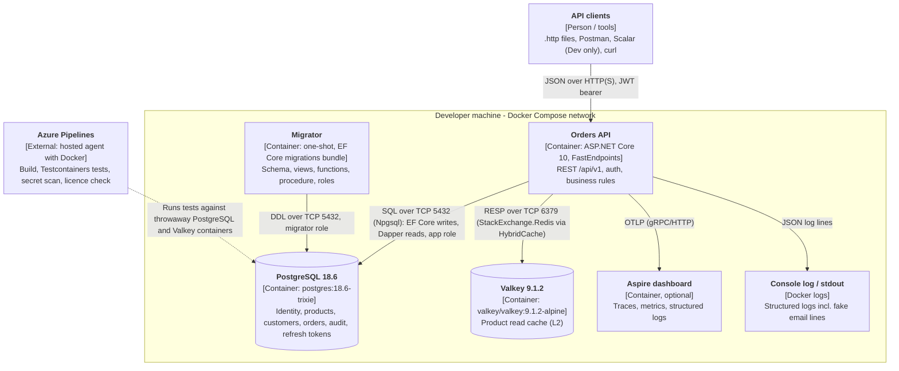
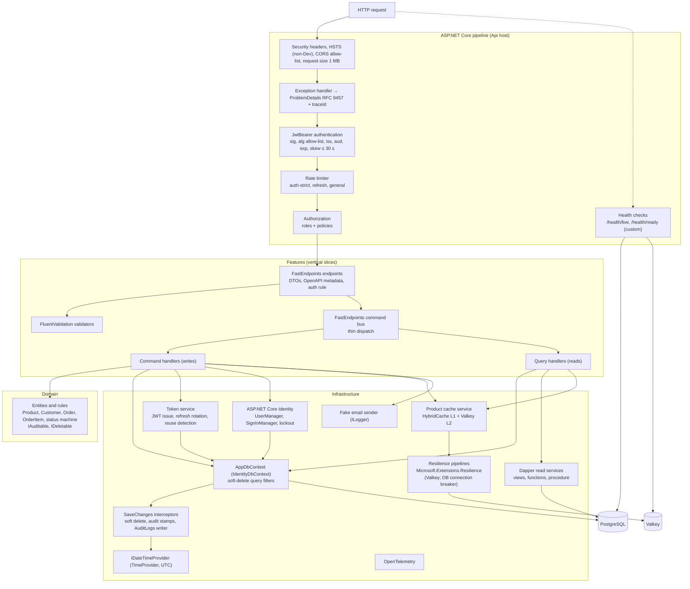
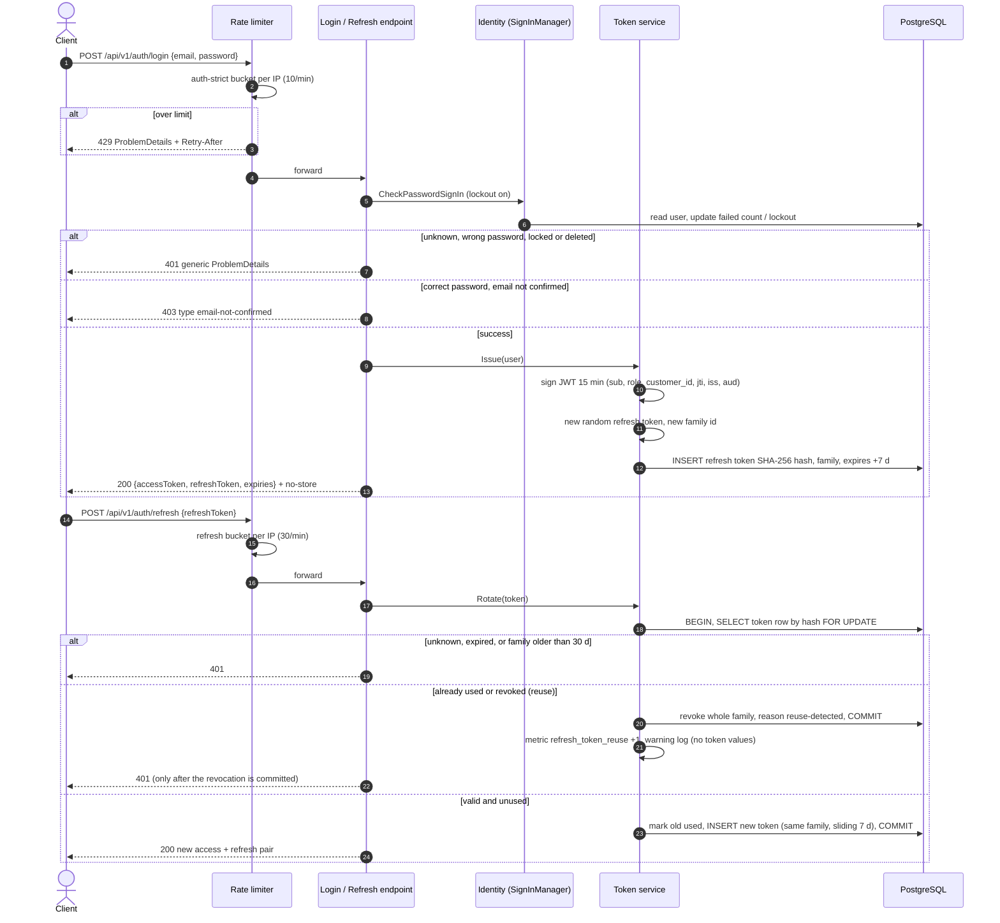
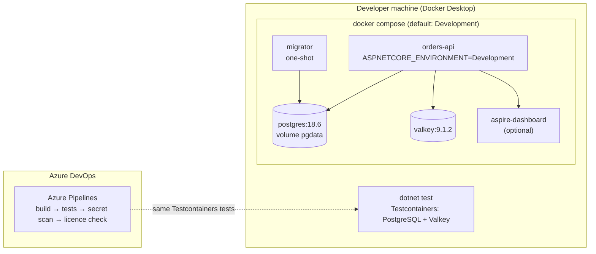

# Architecture overview: Orders API

Last updated: 2026-10-27 (architecture review R-1..R-5 and security decisions S-D1..S-D8 applied) | Status: Approved (Phase 6) | Mode: Standard
Related: [summary](../00-summary.md) · [PRD](../02-requirements/prd.md) · [endpoint list](../02-requirements/endpoint-list.md) · [permission matrix](../02-requirements/permission-matrix.md) · [pre-mortem](../02-requirements/pre-mortem.md) · [stack versions](../stack-versions-2026-10-24.md) · [data model](data-model.md) · [solution structure](solution-structure.md) · [endpoint catalog](endpoint-catalog.md) · [ADRs](adr/)

## 1. Summary and quality priorities

The Orders API is one .NET 10 REST API, deployed as a single modular monolith with no UI. It runs locally in Docker next to PostgreSQL 18.6 and Valkey 9.1.2.

The product is a reusable reference template; the order domain is the proof case. The architecture therefore favours clear, testable, easy-to-copy patterns over raw scale.

- Clean Architecture layers, with feature folders (vertical slices) inside them.
- CQRS: separate command and query handlers on one database.
- The FastEndpoints command bus is a thin dispatch layer only.

No microservices, message broker or event sourcing: nothing in the requirements needs them.

### Quality attribute scenarios (ranked)

| Rank | Attribute | Scenario (stimulus → response → measure) | Source |
|---|---|---|---|
| 1 | **Security** | A Customer calls a `/me` resource with another customer's ID → 404. 100% of `/me` resource endpoints have a BOLA test; 100% of endpoints are tested for Admin, Customer and anonymous | NFR-04, G1 |
| 1 | Security (tokens) | A used refresh token is presented again → whole family revoked, 401, reuse metric incremented | FR-011, NFR-12 |
| 2 | **Template-ability** | A developer bootstraps the next API from the extracted `dotnet new` template. BuildingBlocks have no domain references; architecture tests pass at 100%. Measure: hours to bootstrap | G5, NFR-17, P7 |
| 3 | **Testability** | Full suite with Testcontainers ≤ 5 min locally; every write endpoint has an audit-row integration test | NFR-16 |
| 4 | Rebuildability | Fresh clone → `docker compose up` → running API with seed Admin in ≤ 15 min, no manual steps | NFR-15, P4 |
| 5 | Resilience | Valkey down → product reads 200 from PostgreSQL, 0 × 5xx, p95 ≤ 300 ms. PostgreSQL down → 503 ProblemDetails within 5 s | NFR-01, NFR-03 |
| 6 | Performance | Local, warm, 50 users, 2 min: product get/list p95 ≤ 20 ms cached, ≤ 100 ms uncached; other reads ≤ 200 ms, writes ≤ 300 ms, reports ≤ 1 s | NFR-01, NFR-02 |
| – | Observability | 100% of error responses carry a `traceId` matching logs and the OTel trace | NFR-12, NFR-13 |
| – | Cost | Local only; no hosting cost this phase | Concept §8 |

Security, template-ability and testability drive the design.

### Trade-offs
- **Security vs simplicity.** Own JWT issuing with rotating refresh tokens is the riskiest code. Accepted because the template must show token handling; mitigated by writing token tests first and a fresh-context security review.
- **Template-ability vs feature depth.** Special cases (`asp_net_user_roles` DELETE exception, stretch customer restore) make the template harder to copy. New special cases need an ADR.
- **Correctness vs throughput on stock.** `SELECT … FOR UPDATE` makes parallel orders for one product queue. Fine at POC scale; removes flaky optimistic retry loops (F3).
- **Performance vs consistency on cache.** Invalidation runs after commit. If Valkey is down during a write, L2 can stay stale until its TTL ends; a short TTL limits this.
- **Audit completeness vs speed.** All writes go through EF Core so the interceptor sees them; `ExecuteUpdate`/`ExecuteDelete` are banned. No bulk writes are in scope.
- **Testability vs real-time limits.** Built-in rate limiters have no `TimeProvider`; tests use 1-2 s windows from configuration (P8).

## 2. Level 1: System context



Legend: dark blue = person, blue = this system, grey = external or supporting, dashed = future.

| Element | Type | Responsibility |
|---|---|---|
| Anonymous visitor | Person | Register, confirm, resend, log in, refresh, forgot/reset password, health |
| Customer | Person | Catalog; own profile, orders and erasure. Customer ID always from the token |
| Admin | Person | Everything else: products, customers, orders, users and roles, reports, audit log |
| Developer / operator | Person | Rebuild, run, test (`.http`, Postman, Scalar in Development), read telemetry |
| Future API consumers | External (later) | Web front end and M2M client; not built this phase |
| Orders API | This system | Business rules, authn, authz, audit, caching, rate limiting |
| Fake email sender | Supporting | Logs recipient, subject and link; never passwords |
| Azure Pipelines | External | CI: build, Testcontainers tests, secret scan (NFR-07), licence check (NFR-18) |
| Azure DevOps Boards | External | Tracker; no runtime link |

Trust boundary: every HTTP call into the API is untrusted. No external runtime dependencies (email is faked, no identity provider).

## 3. Level 2: Containers



| Container | Technology | Responsibility | Data |
|---|---|---|---|
| Orders API | .NET 10.0.13, FastEndpoints 8.3.0, EF Core, Dapper, Identity, HybridCache, OTel | All endpoints, auth, validation, audit, cache, rate limits, health. `Development` by default; a production-like compose profile is deferred to Security/Release (headers and HSTS are proven by integration tests) | Stateless; signing key from secrets |
| Migrator | EF Core migrations bundle + SQL | One-shot before the API: schema, views, functions, the procedure (P9), role grants. Admin seeding stays in the API (FR-021) | None |
| PostgreSQL | 18.6 | System of record. App role: no DDL, no DELETE (except `asp_net_user_roles`), `AuditLogs` INSERT/SELECT only | Business data, PII, token hashes, audit |
| Valkey | 9.1.2 (BSD-3) | L2 cache for product get-by-ID and list | Product DTOs only, no PII |
| Aspire dashboard | Aspire 13.6.3 standalone | Local OTel traces, metrics, logs | Telemetry (IDs only, masked emails) |
| Console log | stdout | Structured logs, fake email lines (links only in Development) | Masked emails, no tokens |
| Azure Pipelines | Hosted agent | CI gates for NFR-07, 16, 17, 18 | None kept |

Aspire dashboard: UI on 18888, OTLP on 18889 (ADR-0012, ADR-0013).

## 4. Level 3: Components of the API container



| Component | Responsibility | Detail in |
|---|---|---|
| Pipeline middleware | Headers, CORS, body limits (413/415), exceptions → ProblemDetails, then authn → rate limits → authz (so `general` can key on the user and still answer 429 before 401) | ADR 0002, 0008, 0010 |
| Endpoints | One class per endpoint: DTOs, explicit auth rule, OpenAPI summary, no business logic | endpoint-catalog.md |
| Validators | Field limits, paging, sort allow-lists → 400 with `errors` | ADR 0002 |
| Command bus + handlers | Plain, framework-light handler classes (exit path, R6/F7). Commands use EF Core; queries use EF `AsNoTracking` or Dapper | ADR 0003, 0004 |
| Domain | Invariants: status machine, line rules, stock ≥ 0, money `numeric(12,2)` | data-model.md |
| AppDbContext + interceptors | One `IdentityDbContext` (F5). Delete → soft delete, audit stamps, `AuditLogs` in the same transaction, PII as `"changed"` (P1) | ADR 0006 |
| Dapper read services | Views, functions, one procedure; explicit `is_deleted = false` filters | ADR 0004, 0005 |
| Product cache service | Per-ID keys + list generation key; invalidate after commit; DB fallback | ADR 0009 |
| Token service + Identity | Login, lockout, own JWT, hashed refresh-token families | ADR 0008 |
| Resilience | Valkey: timeout, retry, breaker. PostgreSQL: exactly one retry layer (`EnableRetryOnFailure`) plus a connection-level breaker (`DbConnectionInterceptor`) that counts only connection failures and timeouts, never business errors | ADR 0011 |
| Health | Small custom checks (Xabaril packages are stale). Valkey down = Degraded 200; PostgreSQL down = 503 | ADR 0013 |

Dependency rule: Domain ← Application (features) ← Infrastructure, with the Api host outside. BuildingBlocks hold no domain references. Architecture tests enforce both. See [solution-structure.md](solution-structure.md).

## 5. Key runtime flows

### 5a. Login and refresh with rotation and reuse detection



The reuse revocation **commits before the 401 is returned**: the transaction runner rolls back on a failure result, so the token service returns a successful internal outcome (`ReuseDetected`), commits, and the endpoint then maps it to 401 (ADR-0008; a test reads the family from a fresh context after the 401). The token row lock makes parallel refreshes run one after the other; without a grace window the second looks like reuse and revokes the family (open for the Security phase). Logout, logout-all, password change/reset, lock, role change and delete all revoke through the same service (FR-015).

### 5b. Customer places an order

```mermaid
sequenceDiagram
    autonumber
    actor C as Customer
    participant P as Pipeline (rate limit, JwtBearer, authz)
    participant EP as POST /customers/me/orders
    participant V as Validator
    participant H as CreateOwnOrder handler
    participant EF as AppDbContext + execution strategy
    participant I as Audit / soft-delete interceptor
    participant DB as PostgreSQL
    participant CA as Product cache

    C->>P: POST /api/v1/customers/me/orders {items}
    P->>P: general limit, validate JWT, role Customer
    alt no or bad token
        P-->>C: 401
    else Admin token
        P-->>C: 403
    end
    P->>EP: request + claims
    EP->>V: validate (1-50 lines, unique products, qty 1-1000)
    alt invalid
        V-->>C: 400 ProblemDetails with errors
    end
    EP->>H: command (customerId from token claim only)
    H->>EF: ExecuteAsync (single retry layer for transient errors)
    EF->>DB: BEGIN
    H->>DB: SELECT products WHERE id IN (...) ORDER BY id FOR UPDATE
    alt product missing or deleted
        H->>DB: ROLLBACK
        H-->>C: 400 field error
    else not enough stock
        H->>DB: ROLLBACK
        H-->>C: 409 with short product IDs
    end
    H->>H: Order (Pending), items with price snapshot, totals, stock decrement, history row
    H->>EF: SaveChanges
    EF->>I: SavingChanges
    I->>I: CreatedAt/By (IDateTimeProvider, user id), AuditLogs rows, PII as "changed"
    EF->>DB: INSERT order, items, history, audit; UPDATE products
    EF->>DB: COMMIT
    H->>CA: invalidate product IDs + bump list generation (after commit)
    alt Valkey down
        CA->>CA: L1 removed; L2 failure logged and counted; write still succeeds
    end
    EP-->>C: 201 Location /api/v1/customers/me/orders/{id} + ETag
```

Cancel and Admin item replace use the same lock order and invalidation (ADR 0007).

### 5c. Product read: cache hit, miss, Valkey down

```mermaid
sequenceDiagram
    autonumber
    actor U as Admin or Customer
    participant EP as GET /products/{id}
    participant H as GetProduct query handler
    participant HC as HybridCache
    participant L1 as L1 in-memory
    participant VK as Valkey (L2, via resilience pipeline)
    participant DB as PostgreSQL

    U->>EP: GET /api/v1/products/{id} (JWT)
    EP->>H: query
    H->>HC: GetOrCreate product:{id}
    HC->>L1: lookup
    alt L1 hit
        L1-->>HC: DTO
    else L1 miss
        HC->>VK: GET (timeout 250 ms, retry, breaker)
        alt L2 hit
            VK-->>HC: DTO, fill L1
        else L2 miss
            HC->>DB: read product (not deleted)
            HC->>VK: SET with TTL
            HC->>L1: set
        else Valkey down or breaker open
            VK--xHC: error or timeout
            HC->>DB: read product (fallback)
            HC->>HC: count cache_failure; ready = Degraded
        end
    end
    HC-->>H: DTO
    EP-->>U: 200 + ETag (never 5xx because of the cache)
```

Admin `includeDeleted=true` bypasses the cache. An S1 spike confirms HybridCache behaviour when L2 fails (F10).

### 5d. Customer erases own account

```mermaid
sequenceDiagram
    autonumber
    actor C as Customer
    participant P as Pipeline (auth-strict, JwtBearer)
    participant H as EraseMe handler
    participant ID as Identity (UserManager)
    participant DB as PostgreSQL
    participant I as Interceptors
    participant TS as Token service

    C->>P: POST /api/v1/customers/me/erase {currentPassword}
    P->>H: command (customerId and userId from token)
    H->>ID: CheckPassword
    alt wrong password
        H->>ID: AccessFailed (counts toward lockout)
        H-->>C: 400 generic
    end
    H->>DB: any order Pending, Confirmed or Shipped?
    alt yes
        H-->>C: 409 customer-has-open-orders
    end
    H->>DB: BEGIN
    H->>H: anonymize name, email, phone; soft delete Customer
    H->>ID: soft delete + lock user, update security stamp
    H->>TS: revoke all refresh tokens, reason account-deleted
    H->>DB: SaveChanges
    I->>DB: AuditLogs SoftDelete rows, PII fields as "changed"
    H->>DB: COMMIT
    H-->>C: 204 + no-store
    Note over C,H: Refresh now returns 401. Access token valid up to 15 min (R1)
```

Admin delete (EP-33) runs the same logic without the password step.

## 6. Cross-cutting concerns

| Concern | Approach | Where | ADR |
|---|---|---|---|
| Authentication | Own JWT (HMAC, key ≥ 256 bits from secrets). JwtBearer checks signature, alg allow-list, `iss`, `aud`, `exp`, skew ≤ 30 s. Rotating hashed refresh-token families. Identity for passwords and lockout. No `MapIdentityApi` | Infrastructure/Auth, Api host | 0008 |
| Authorization (role) | Every endpoint declares roles or anonymous; architecture test fails otherwise | Endpoint config | 0001, 0002 |
| Authorization (own data, BOLA) | ID routes Admin only (Customer 403). `/me` routes take `customer_id` only from the token into the query predicate; other customers' data → 404. Table-driven tests from the permission matrix | Handlers, tests | 0001; permission-matrix.md |
| Validation | FluentValidation for shape and limits; domain invariants; business conflicts → 409 | Features, Domain | 0002 |
| Errors | RFC 9457 ProblemDetails with `traceId`, stable `type` URIs, no stack traces outside Development | Exception handler | 0002 |
| Audit | SaveChanges interceptor writes `AuditLogs` in the same transaction; PII as `"changed"`; append-only; `ExecuteUpdate`/`ExecuteDelete` banned | Persistence | 0006 |
| Soft delete | Interceptor Delete → Update; query filters; partial unique indexes; explicit Dapper filters; no DELETE grant | Persistence, migrations, roles | 0006 |
| Concurrency | ETag from `xmin`, `If-Match` on PUT (428/412); product rows `FOR UPDATE` in ID order; `Order` domain methods call `order.Touch(now)` on every change, so the order ETag always changes | Domain, Handlers, Persistence | 0007 |
| Data access | EF Core for writes and CRUD reads; Dapper for views, functions, one procedure | Persistence, read services | 0004, 0005 |
| Time | `IDateTimeProvider` over `TimeProvider`, UTC; `FakeTimeProvider` in tests | BuildingBlocks | 0001 |
| Caching | HybridCache L1 + Valkey L2 for product reads only; per-ID keys + list generation key; invalidate after commit; DB fallback | Infrastructure/Caching | 0009 |
| Rate limiting | `auth-strict` (shared per IP), `refresh`, `general` (per user or IP); 429 + `Retry-After`; configurable windows | Api host | 0010 |
| Resilience | Microsoft.Extensions.Resilience. Valkey: timeout 250 ms total, retry with jitter, breaker. PostgreSQL: one retry layer (plain `EnableRetryOnFailure`, `ChangeTracker.Clear()` per attempt) + connection-level breaker interceptor (connection failures and timeouts only); 1 s connect timeout; DB down → 503 within 5 s | BuildingBlocks | 0011 |
| Observability | OTel traces (HTTP, Npgsql, cache), metrics (requests, cache hit ratio, 429s, login failures, refresh reuse), structured logs with trace and user ID; emails masked; no tokens | Api host, BuildingBlocks | 0013 |
| Configuration and secrets | Options with startup validation; user-secrets or env vars; generated dev-only secrets on first compose run; `.env.example`; CI secret scan | Api host, compose, pipeline | 0012 |
| CORS and headers | Allow-list (empty = no CORS); `nosniff`, `X-Frame-Options: DENY`, `Referrer-Policy: no-referrer`, `no-store` on auth/PII, no `Server` header, HSTS + HTTPS outside Development | Api host | 0012; Security phase |
| API conventions | `/api/v1`, paging/sort/filter rules (FR-120..123), DTOs only, camelCase, enums as strings, FastEndpoints.OpenApi + Scalar (Development) | Features, BuildingBlocks | 0002; endpoint-catalog.md |
| Health | Custom live/ready checks, no rate limit, no detail outside Development | Api host | 0013 |

## 7. Deployment view and environments



| Environment | Purpose | How | Notes |
|---|---|---|---|
| Local Development (default) | Daily work; ≤ 15 min rebuild | `docker compose up`: migrator first, then the API seeds the Admin | Dev secrets generated on first run (P4); Scalar on; fake email links logged |
| Local production-like | Deferred to Security/Release | Not built now | HTTPS redirect, HSTS, headers, no Scalar and no error detail are proven by integration tests with the `Production` environment |
| Test (local and CI) | Unit, integration, authz, BOLA, concurrency, erasure | Testcontainers, shared containers + Respawn | Rate-limit windows 1-2 s |
| CI | Quality gates | Azure Pipelines hosted agent with Docker | Fails on secrets, non-permissive licence, architecture tests; warns over 5 min |
| Production | Out of scope | – | See cost note |

Startup order: PostgreSQL healthy → migrator succeeds (`depends_on: condition: service_completed_successfully`) → API. Valkey is not a hard dependency. No backups this phase (rebuildable seed data).

## 8. ADR index

| ADR | Title | Status | Decision (one line) |
|---|---|---|---|
| [0001](adr/0001-solution-structure.md) | Solution structure (Clean Architecture + VSA + CQRS) | Accepted | Clean Architecture projects with feature folders inside; thin BuildingBlocks with no domain references; enforced by architecture tests |
| [0002](adr/0002-fastendpoints-and-openapi.md) | FastEndpoints and OpenAPI | Accepted | FastEndpoints 8.3; OpenAPI 3.1 via FastEndpoints.OpenApi + Scalar (Development only); not FastEndpoints.Swagger |
| [0003](adr/0003-cqrs-command-bus.md) | CQRS with FastEndpoints command bus | Accepted | Separate command/query handlers on one database, dispatched as plain classes; no MediatR |
| [0004](adr/0004-ef-core-and-dapper.md) | EF Core and Dapper | Accepted | EF Core for writes, CRUD, migrations; Dapper for views, functions, procedure; one connection and transaction when needed |
| [0005](adr/0005-postgresql-functions-vs-procedures.md) | PostgreSQL functions vs procedures | Accepted | Functions for set-returning reads; at least one real procedure; all created by migrations |
| [0006](adr/0006-soft-delete-audit-and-no-delete-role.md) | Soft delete, audit and no-DELETE role | Accepted | Interceptors for soft delete and audit (PII as `"changed"`); no DELETE except Identity join tables; append-only `AuditLogs` |
| [0007](adr/0007-stock-concurrency-and-etags.md) | Stock concurrency and ETags | Accepted | `FOR UPDATE` on products in ID order; `xmin` ETags with `If-Match`; order row touched on every change |
| [0008](adr/0008-jwt-and-refresh-tokens.md) | JWT and refresh tokens | Accepted (revised 2026-10-27) | Own issuer: 15 min access; 7 d rotating hashed refresh tokens in families, 30 d cap; reuse revokes the family; per-request security-stamp check (S-D1); confirm 24 h / reset 1 h |
| [0009](adr/0009-caching-products.md) | Caching products | Accepted (revised 2026-10-27) | HybridCache + Valkey L2 for product reads only; per-ID keys + list generation key; DB fallback; `search` lists not cached; size limits; Valkey ACL |
| [0010](adr/0010-rate-limiting.md) | Rate limiting | Accepted (revised 2026-10-27) | Built-in limiter: `auth-strict` (incl. EP-09), `refresh`, `general`; reports concurrency 4; 429 + `Retry-After` |
| [0011](adr/0011-resilience.md) | Resilience | Accepted (revised 2026-10-27) | Microsoft.Extensions.Resilience; Valkey timeout/retry/breaker; one retry layer for PostgreSQL (`EnableRetryOnFailure`) plus a connection-level breaker |
| [0012](adr/0012-local-setup-and-secrets.md) | Local setup and secrets | Accepted (revised 2026-10-27) | Compose in Development with generated dev secrets and a one-shot migrator; production-like profile deferred |
| [0013](adr/0013-observability.md) | Observability | Accepted (revised 2026-10-27) | OTel traces, metrics, logs to the optional Aspire dashboard; custom health checks; masked PII; security events with fixed IDs |
| [0014](adr/0014-authorization-model.md) | Authorization model | Accepted | Deny by default; four named policies; ID routes Admin only; `/me` ownership only from the token via `OwnedBy`; not owned = 404 |

Security decisions S-D1..S-D8: [threat model](../05-security/threat-model.md) section 9.

## 9. Risks, open questions and cost

| ID | Risk / question | Impact | Proposed handling | Phase |
|---|---|---|---|---|
| R1 | Access tokens valid up to 15 min after lock, role change or delete | Removed user keeps access | **Decided (S-D1):** per-request security-stamp check, in-process 30 s cache, fails closed (ADR-0008) | Security (done) |
| SEC-2 | Parallel refreshes look like reuse and revoke the family | Random logouts for a future web front end | **Decided (S-D6):** strict now, documented; "benign race" option recorded in ADR-0008 for a browser client | Security (done) |
| SEC-3 | Timing differences on register/forgot/resend reveal registered emails | Enumeration despite 202 | **Decided (S-D6):** equal work + response floor; password checked before confirmed/locked (ADR-0008) | Security (done) |
| A1 | Cache invalidation fails while Valkey is down | Stale L2 until TTL | Short L2 TTL (no replay list); count invalidation failures; writes never fail because of cache | S1a spike |
| A2 | Retries on retries | Flaky concurrency tests (F3) | One PostgreSQL retry layer; transactions inside the execution strategy | ADR 0011, S3 |
| A3 | Identity saves outside the audit transaction (F5) | Missing audit rows | One `IdentityDbContext`, explicit transactions, `ChangeTracker.Clear()` per retry attempt; S1a spike incl. forced rollback | S1a |
| A4 | FastEndpoints goes bugfix-only (R6) | Template looks dated | Plain handlers; exit path in ADR 0002/0003 | Ongoing |
| A5 | Tables grow forever (R4) | Slow queries later | Indexes on query paths; retention before production | Before production |
| A6 | Migrator vs app role grants drift | No-DELETE rule silently broken | Integration test asserting app role grants | S1 |

**S1 split (R-2).** S1 is split into **S1a walking skeleton** (compose, CI, product create/get end to end with audit, cache and an authz test, plus four spikes: compose chain on Windows, Identity + audit, HybridCache with L2 down, `EFCore.NamingConventions`) and **S1b auth**. Time-boxes are set in the Delivery phase; more than 2 days over → pre-mortem cut rule. Details: [solution-structure.md](solution-structure.md) section 14.

**Cost.** No hosting cost this phase (local Docker, Azure Pipelines). Main cost is developer time and Claude usage. A later production deployment would need a container host (for example Azure Container Apps), managed PostgreSQL, a managed Redis-compatible cache, Key Vault, a telemetry backend, a real email provider, TLS and backups; price these in the Release phase.

## Assumptions
- Assumption: a one-shot migrator container is part of the "one compose command" rebuild.
- Assumption: JWT signed with HMAC; asymmetric keys later if other services must validate tokens.
- Assumption: refresh tokens travel in the JSON body this phase (PRD §12).

## 10. Architecture decisions (approved 2026-10-27)

| ID | Decision |
|---|---|
| A-D1 | Aspire dashboard is opt-in (compose profile `observability`); plain `docker compose up` stays light |
| A-D2 | Template samples keep Auth, AdminUsers and Products; strip guide removes Customers, Orders, Reports and AuditLogs |
| A-D3 | Six source projects accepted; strip guide notes a small app can merge Domain and Application |
| A-D4 | Money is `numeric(12,2)`; a line or order total above the limit returns 400 `order-total-too-large` |
| A-D5 | Customer email stored only on the Identity user; `customers` holds name and phone |
| A-D6 | Each order stores `currency_code char(3)` |
| A-D7 | Retention before production: purge refresh tokens 30 days after family expiry; keep audit logs 2 years; separate purge role (R4) |
| A-D8 | DELETE grant only on `asp_net_user_roles`; `asp_net_user_tokens` unused |
| A-D9 | `PUT /customers/{id}` with the current email ignores it; 409 only for a different, taken email |
| A-D10 | Shared office IP shares the `auth-strict` 10/min bucket; lockout protects each account |
| A-D11 | Up to 1 min stale product data accepted if more instances run later; add an invalidation channel first |
| A-D12 | No `If-None-Match`/304 on product GETs now (additive later) |
| A-D13 | Admin `includeDeleted` product reads bypass the cache |
| A-D14 | DB circuit breaker kept (P10). Revised 2026-10-27 (R-1): a connection-level `DbConnectionInterceptor` that counts only connection failures and timeouts; plain `EnableRetryOnFailure` is the only retry layer |
| A-D15 | Optional Aspire AppHost not built before S4; compose is the only supported local path |
| A-D16 | Root namespace `DemoApi`; DB roles `demoapi_app` / `demoapi_migrator` |
| A-D17 | New audit action `SessionsRevoked` (stretch EP-20) added to the FR-128 list |

Security phase done (2026-10-27): R1, SEC-2 and SEC-3 decided (S-D1, S-D6); ADR 0014 Authorization model written.
