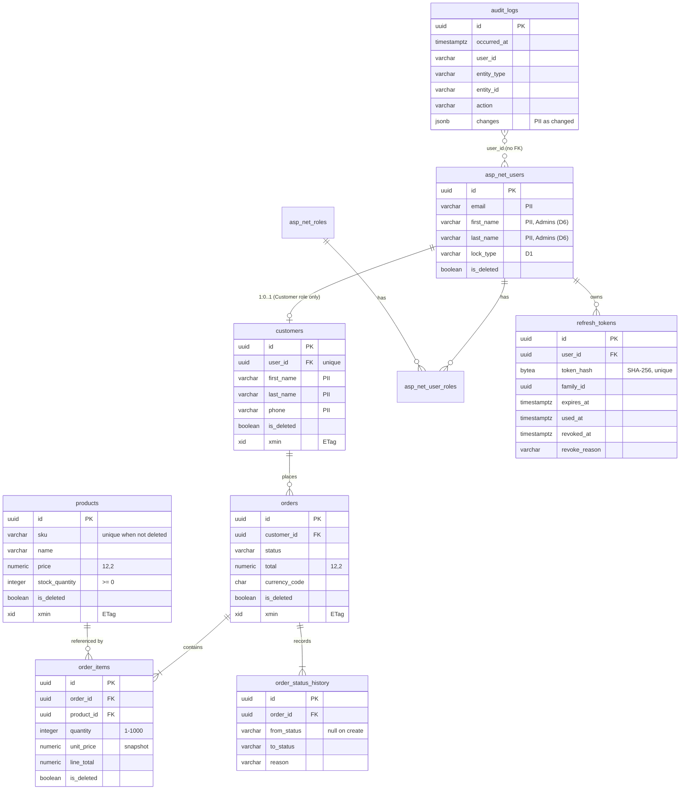

# Data model: Orders API

| Field | Value |
|---|---|
| Status | **Approved** |
| Date | 2026-10-24 (revised 2026-10-27, architecture review R-3, R-4, R-5; security S-D2, S-D7: role timeouts, grant snapshot test, `SessionsRevoked` action, enforced Dapper SQL allow-list) |
| Engine | PostgreSQL 18.6 (`postgres:18.6-trixie`), one database, schema `public` |
| Access | EF Core 10 + Npgsql 10 (writes, CRUD, migrations); Dapper 2.1 (views, functions, procedure). ADR-0004 |
| Related | [ADR-0004](adr/0004-ef-core-and-dapper.md) · [ADR-0005](adr/0005-postgresql-functions-vs-procedures.md) · [ADR-0006](adr/0006-soft-delete-audit-and-no-delete-role.md) · [ADR-0007](adr/0007-stock-concurrency-and-etags.md) · ADR-0011 resilience · ADR-0012 local setup · [solution structure](solution-structure.md) · PRD sections 6, 7, 16, 17 |

## 1. Conventions

| Topic | Rule |
|---|---|
| Naming | snake_case for tables, columns, constraints and indexes, applied by `EFCore.NamingConventions` (`UseSnakeCaseNamingConvention()`). Fallback if no EF Core 10 build exists: a 20-line model convention in BuildingBlocks. Identity tables become `asp_net_users`, `asp_net_roles`, ... Table names are plural. Constraint prefixes: `pk_`, `fk_`, `ix_`, `ux_` (unique), `ck_`. |
| IDs | `uuid`, UUID **version 7**, made in the app with `Guid.CreateVersion7()` inside domain factories (`Product.Create(...)`). See 1.1. Identity claim tables keep their `integer` identity keys (unused). |
| Time | `timestamptz`, always UTC, from `IDateTimeProvider` (FR-135). No `now()` defaults: the app sets every timestamp so tests control time. |
| Money | `numeric(12,2)` (NFR-20). One currency from config (`USD` default), copied to each order as `currency_code` (Assumption, see 4.5). |
| Text | `varchar(n)` with the PRD limits (D5, FR-040). Free text uses `varchar(500)` / `varchar(2000)`. No `citext`; case-insensitive search uses `ILIKE` with escaped input + trigram indexes. |
| Enums | `varchar(20)` + `CHECK (... IN (...))`, mapped with `HasConversion<string>()`. Not PostgreSQL `ENUM` types: values cannot be removed and need special migration steps. |
| Audit columns (`IAuditable`) | `created_at timestamptz NOT NULL`, `created_by uuid NULL`, `last_modified_at timestamptz NULL`, `last_modified_by uuid NULL`. `NULL` user = `system` or `anonymous` (the audit log keeps the label). No FK to users (avoids cycles and keeps erased users joinable). |
| Soft delete (`IDeletable`) | `is_deleted boolean NOT NULL DEFAULT false`, `deleted_at timestamptz NULL`, `deleted_by uuid NULL`, plus `ck_<table>_deleted_consistent CHECK ((is_deleted AND deleted_at IS NOT NULL) OR (NOT is_deleted AND deleted_at IS NULL AND deleted_by IS NULL))`. Restore clears `deleted_at`/`deleted_by` (history stays in `audit_logs`). |
| Concurrency | `xmin` system column mapped as `uint Version` with `.IsRowVersion()` plus explicit `.HasColumnName("xmin").HasColumnType("xid")` (so the naming convention cannot rename it). Used on `products`, `customers`, `orders`. ETag = `"<xmin>"`. ADR-0007. |
| Foreign keys | All `ON DELETE RESTRICT` (`DeleteBehavior.Restrict`). Nothing is deleted, so cascades would only hide bugs. Every FK column has an index (directly or as the leading column of another index). |
| Unique rules | Partial unique indexes `WHERE is_deleted = false` (SKU, user email/user name). |
| Index rollout | **S1 migrations create PK, unique and FK indexes only.** The other indexes in section 3 (sort, filter, trigram) are the target design: each is added in the slice that needs it, after `EXPLAIN (ANALYZE, BUFFERS)` shows a benefit (architecture review R-4). |
| Extensions | `pg_trgm` (trusted extension; the migrator creates it) for `search` contains filters, added with the first trigram index (not in S1). |

### 1.1 Why UUID v7 (`Guid.CreateVersion7()`)

- Routes need opaque IDs (PRD section 12). Sequential `bigint` IDs invite enumeration and leak volume.
- v7 starts with a millisecond timestamp, so new keys land at the right edge of the B-tree. Random v4 keys split pages all over the index and bloat it. Npgsql writes `Guid` in RFC byte order, and PostgreSQL compares `uuid` bytewise, so v7 values **are** time-ordered in PostgreSQL (unlike SQL Server).
- The domain creates the ID, so `Location` and audit rows know it before `SaveChanges`, and aggregates can link children without a round trip. Npgsql EF Core also generates v7 values for unset `Guid` keys (fallback only).
- `ORDER BY id` is a stable, roughly time-ordered tiebreaker (FR-122).
- Trade-off: the ID reveals its creation time to the millisecond. Accepted: IDs are not secrets; access is protected by authorization (BOLA tests), not by guessing.
- Not chosen: PostgreSQL 18 `uuidv7()` as a column default (the app would not know the ID before insert), `bigint` identity + public UUID (two keys per table for no gain at this size).

## 2. Entity overview



| Table | `IAuditable` | `IDeletable` | ETag (`xmin`) | Audited (FR-128) | App role (section 5) |
|---|---|---|---|---|---|
| `asp_net_users` | Yes | Yes | No (Identity `concurrency_stamp`) | Yes (D4 events) | S I U |
| `asp_net_roles` | No (seeded, fixed) | No | No | No | S |
| `asp_net_user_roles` | No | No | No | Yes, as `RoleAssigned`/`RoleRemoved` on the user | S I **D** (only exception) |
| `asp_net_user_claims`, `asp_net_role_claims`, `asp_net_user_logins`, `asp_net_user_tokens` | No | No | No | n/a (unused) | S (see 3.1) |
| `customers` | Yes | Yes | Yes | Yes | S I U |
| `products` | Yes | Yes | Yes | Yes | S I U |
| `orders` | Yes | Yes | Yes | Yes | S I U |
| `order_items` | Yes | Yes | No (root `orders` is touched) | Yes | S I U |
| `order_status_history` | Yes (`created_*` = by/at) | Yes (never set in core) | No | Yes | S I U |
| `refresh_tokens` | No | No | No | **No** (logged and measured) | S I U |
| `audit_logs` | No | No | No | n/a | **S I only** |

## 3. Tables

Columns marked **PII** are personal data: marked once with `[PersonalData]` (or `.IsPersonalData()` for inherited Identity properties), written to `audit_logs` as `"changed"` (P1), anonymized on erase (FR-064), and seeded by the erasure test (R3).

### 3.1 Identity tables (ASP.NET Core Identity, `Guid` keys)

`AppDbContext : IdentityDbContext<AppUser, AppRole, Guid>`.

**Which Identity tables are used**

| Table | Used? | Why |
|---|---|---|
| `asp_net_users` | Yes | Accounts, password hash, lockout, security stamp. |
| `asp_net_roles` | Yes | Two seeded rows: `Admin`, `Customer` (fixed IDs, `HasData` in the first migration). |
| `asp_net_user_roles` | Yes | `RemoveFromRoleAsync` **deletes** the row (FR-035). This is the only DELETE grant. |
| `asp_net_user_tokens` | **No** | Email-confirm and reset tokens come from `DataProtectorTokenProvider` and are **not stored**. The table holds only authenticator keys, recovery codes and external-login tokens: no MFA and no external login this phase. Refresh tokens have their own table. So no DELETE grant is needed (narrower than the 00-summary note). Answered by A-D8: DELETE only on `asp_net_user_roles`. |
| `asp_net_user_claims`, `asp_net_role_claims`, `asp_net_user_logins` | No | Not used. Kept because the Identity model expects them; app role has SELECT only, so any accidental write fails loudly. |

**`asp_net_users`** (`AppUser : IdentityUser<Guid>, IAuditable, IDeletable`)

| Column | Type | Null | Default | Notes |
|---|---|---|---|---|
| id | uuid | No | | PK `pk_asp_net_users`. v7, set in `AppUser` constructor. |
| user_name / normalized_user_name | varchar(256) | Yes (Identity) | | **PII**. `user_name` = email. |
| email / normalized_email | varchar(256) | Yes (Identity) | | **PII**. D5 ≤ 256. Single source of a customer's email (not copied to `customers`). |
| email_confirmed | boolean | No | false | |
| password_hash | text | Yes | | Value never audited; a change is recorded as `"changed"` (EP-09 needs an Update row). Set to NULL on erase. NULL for Admin-created users until reset (FR-037, FR-060). |
| security_stamp, concurrency_stamp | text | Yes | | Never audited. Stamp rotated on password, role, lock, erase. |
| phone_number, phone_number_confirmed, two_factor_enabled | Identity | | | Unused (customer phone lives on `customers`). `phone_number` is still marked **PII**. |
| lockout_end | timestamptz | Yes | | Admin lock with no end = `DateTimeOffset.MaxValue` (Assumption: Npgsql maps it to `infinity`; verify in the S2 spike). |
| lockout_enabled | boolean | No | true | |
| access_failed_count | integer | No | 0 | Not audited (FR-128). |
| first_name, last_name | varchar(100) | Yes | | **PII**. D6: set for Admins. NULL for Customer users (the customer profile is the one source). |
| lock_type | varchar(20) | Yes | | D1. `ck_asp_net_users_lock_type CHECK (lock_type IN ('failed-logins','admin'))`. The `restored-customer` value is added by the stretch FR-066 migration, not in the core schema (C7). Reset password clears the lock only when `lock_type = 'failed-logins'`. |
| lock_reason | varchar(500) | Yes | | Free text (FR-032). Out of erasure scope (FR-065). |
| created_at … deleted_by | audit + soft delete | | | See section 1. |

Check: `ck_asp_net_users_lock_consistent CHECK (lock_type IS NULL OR lockout_end IS NOT NULL)`.

Indexes:
| Name | Definition | Serves |
|---|---|---|
| `ux_asp_net_users_normalized_user_name` | `(normalized_user_name) WHERE is_deleted = false` | Replaces Identity's `UserNameIndex`. Login, FindByName. |
| `ux_asp_net_users_normalized_email` | `(normalized_email) WHERE is_deleted = false` | Duplicate email 409 (FR-037, FR-060), FindByEmail. Erased rows hold unique ID-derived values, so both indexes stay safe even for stretch restore. |
| `ix_asp_net_users_normalized_email_trgm` | `GIN (normalized_email gin_trgm_ops)` | FR-030 `email` contains; FR-061 customer search by email. |
| `ix_asp_net_users_created_at` | `(created_at, id)` | FR-030 sort `createdAt`. |
| `ix_asp_net_user_roles_role_id` | Identity default | FR-030 `role` filter, FR-036 user count. |

Erase (FR-064): `email`, `user_name` → `erased-{id:N}@erased.invalid` (normalized upper-case), `first_name`/`last_name`/`phone_number` → NULL, `password_hash` → NULL, new security stamp, `lockout_end` = no end with `lock_type = 'admin'` (Assumption: no separate `erased` value is needed; `admin` already stops a password reset from unlocking), `is_deleted = true`. Refresh tokens are revoked with the procedure in 4.2 (#7).

### 3.2 `customers` (1:0..1 with `asp_net_users`)

| Column | Type | Null | Default | Notes |
|---|---|---|---|---|
| id | uuid | No | | PK `pk_customers`. Goes into the `customer_id` claim. |
| user_id | uuid | No | | FK `fk_customers_asp_net_users_user_id` → `asp_net_users(id)` RESTRICT. |
| first_name | varchar(100) | No | | **PII**. 1-100 (D5). Erased → `'Erased'`. |
| last_name | varchar(100) | No | | **PII**. Erased → `'Customer'`. |
| phone | varchar(20) | Yes | | **PII**. E.164. Erased → NULL. |
| created_at … deleted_by | | | | Section 1. |
| xmin | xid | (system) | | ETag (FR-129). |

Checks: `ck_customers_first_name_len CHECK (length(first_name) BETWEEN 1 AND 100)`, same for `last_name`; `ck_customers_phone CHECK (phone ~ '^\+[1-9][0-9]{1,18}$')`; deleted-consistent.

Email: not stored here. Customer responses read it from `asp_net_users` (join on `user_id`). One copy means one place to anonymize. Answered by A-D5.

Test (C10): Admin get of a deleted customer (`includeDeleted=true`) returns the customer **with its (anonymized) email**. The join to `asp_net_users` must ignore the `SoftDelete` filter too, or the soft-deleted user drops the row or the email silently.

Indexes:
| Name | Definition | Serves |
|---|---|---|
| `ux_customers_user_id` | `(user_id)` (full, not partial) | One customer per user, ever. FK index. Token issue (`customer_id` claim). |
| `ix_customers_last_name` | `(last_name, first_name, id) WHERE is_deleted = false` | FR-061 default sort. |
| `ix_customers_created_at` | `(created_at, id) WHERE is_deleted = false` | FR-061 `createdFrom/To`, sort `createdAt`. |
| `ix_customers_name_trgm` | `GIN ((first_name || ' ' || last_name) gin_trgm_ops)` | FR-061 `search` by name. |

Sort by `email` uses the join to `asp_net_users` (`ux_asp_net_users_normalized_email`). `includeDeleted=true` reads scan the table: fine at 1,000 rows.

### 3.3 `products`

| Column | Type | Null | Default | Notes |
|---|---|---|---|---|
| id | uuid | No | | PK `pk_products`. |
| sku | varchar(50) | No | | Stored upper-case. `ck_products_sku CHECK (sku ~ '^[A-Z0-9-]{1,50}$')`. |
| name | varchar(200) | No | | `ck_products_name_len CHECK (length(name) BETWEEN 1 AND 200)`. |
| description | varchar(2000) | Yes | | |
| price | numeric(12,2) | No | | `ck_products_price CHECK (price >= 0.01)` (upper bound = type limit 9,999,999,999.99). |
| stock_quantity | integer | No | 0 | `ck_products_stock CHECK (stock_quantity BETWEEN 0 AND 1000000)` (NFR-20). |
| created_at … deleted_by | | | | |
| xmin | xid | (system) | | ETag. Changes on every stock change too (ADR-0007). |

Indexes:
| Name | Definition | Serves |
|---|---|---|
| `ux_products_sku` | `(sku) WHERE is_deleted = false` | FR-040 duplicate SKU 409 (race-safe), FR-045 restore conflict, sort `sku`. |
| `ix_products_name` | `(name, id) WHERE is_deleted = false` | FR-041 default sort. |
| `ix_products_price` | `(price, id) WHERE is_deleted = false` | `minPrice`/`maxPrice`, sort `price`. |
| `ix_products_stock` | `(stock_quantity, id) WHERE is_deleted = false` | Sort `stockQuantity`, `inStock`, **low-stock report** (FR-103). |
| `ix_products_created_at` | `(created_at, id) WHERE is_deleted = false` | Sort `createdAt`. |
| `ix_products_name_trgm`, `ix_products_sku_trgm` | `GIN (name gin_trgm_ops)`, `GIN (sku gin_trgm_ops)` | `search` (2-100 chars, `ILIKE '%' || @term || '%'` with `%`, `_`, `\` escaped). |

Note: at the NFR-02 seed size (1,000 products) the planner will often pick a sequential scan. The indexes are cheap and follow the query paths; only `ux_products_sku` is created in S1; add the others when `EXPLAIN (ANALYZE, BUFFERS)` at load-test volume shows a benefit, and drop any that are never used (`pg_stat_user_indexes.idx_scan = 0`).

### 3.4 `orders` (aggregate root)

| Column | Type | Null | Default | Notes |
|---|---|---|---|---|
| id | uuid | No | | PK `pk_orders`. |
| customer_id | uuid | No | | FK `fk_orders_customers_customer_id` → `customers(id)` RESTRICT. |
| status | varchar(20) | No | | `ck_orders_status CHECK (status IN ('Pending','Confirmed','Shipped','Completed','Cancelled'))`. Transitions enforced in the domain (FR-088). |
| total | numeric(12,2) | No | | Sum of non-deleted line totals. `ck_orders_total CHECK (total >= 0)`. |
| currency_code | char(3) | No | | From config at create. `ck_orders_currency CHECK (currency_code ~ '^[A-Z]{3}$')`. |
| created_at … deleted_by | | | | Soft delete only via stretch FR-093. |
| xmin | xid | (system) | | ETag. The row is **always updated** on item or status change: `Order` domain methods call `Touch(now)` (ADR-0007). |

Indexes:
| Name | Definition | Serves |
|---|---|---|
| `ix_orders_customer_created` | `(customer_id, created_at DESC, id DESC) WHERE is_deleted = false` | FK index; FR-091 own list; FR-085 `customerId`; order-history function (FR-101). |
| `ix_orders_customer_open` | `(customer_id) WHERE is_deleted = false AND status IN ('Pending','Confirmed','Shipped')` | Erase/delete open-order check (FR-064, FR-069). |
| `ix_orders_created` | `(created_at DESC, id DESC) INCLUDE (status, total, customer_id) WHERE is_deleted = false` | FR-085 default sort and date range; sales report and top products range scans. |
| `ix_orders_status_created` | `(status, created_at DESC, id DESC) WHERE is_deleted = false` | FR-085 `status` (multi) filter. |
| `ix_orders_total` | `(total, id) WHERE is_deleted = false` | `minTotal`/`maxTotal`, sort `total`. |

**Money limit (answered by A-D4):** a line can be 1,000 × 9,999,999,999.99, which does not fit `numeric(12,2)`. Decision: keep `numeric(12,2)`; a domain rule returns 400 `order-total-too-large` when a line total or the order total is above 9,999,999,999.99.

### 3.5 `order_items`

| Column | Type | Null | Default | Notes |
|---|---|---|---|---|
| id | uuid | No | | PK `pk_order_items`. |
| order_id | uuid | No | | FK → `orders(id)` RESTRICT. |
| product_id | uuid | No | | FK → `products(id)` RESTRICT. Deleted products stay referenced (FR-044). |
| quantity | integer | No | | `ck_order_items_quantity CHECK (quantity BETWEEN 1 AND 1000)`. |
| unit_price | numeric(12,2) | No | | Snapshot (FR-083, FR-092). `CHECK (unit_price >= 0.01)`. |
| line_total | numeric(12,2) | No | | `ck_order_items_line_total CHECK (line_total = quantity * unit_price)`. |
| created_at … deleted_by | | | | Item replace soft-deletes removed lines (US-203). |

Indexes:
| Name | Definition | Serves |
|---|---|---|
| `ux_order_items_order_product` | `(order_id, product_id) WHERE is_deleted = false` | FR-080 "each product at most once"; FK index for `order_id`; loading lines. |
| `ix_order_items_product` | `(product_id) INCLUDE (quantity, line_total, order_id) WHERE is_deleted = false` | FK index; top products (FR-105). |

1-50 lines per order is a domain rule (cannot be a row check).

### 3.6 `order_status_history`

| Column | Type | Null | Default | Notes |
|---|---|---|---|---|
| id | uuid | No | | PK. |
| order_id | uuid | No | | FK → `orders(id)` RESTRICT. |
| from_status | varchar(20) | Yes | | NULL for the first row (none → Pending). Same CHECK list as `orders.status`. |
| to_status | varchar(20) | No | | Same CHECK list. |
| reason | varchar(500) | Yes | | Free text, out of erasure scope. |
| created_at, created_by | | | | Used as "at" and "by" (FR-088). `last_modified_*` always NULL (append-only in practice). |
| is_deleted, deleted_at, deleted_by | | | | Present for the uniform `IDeletable` rule; never set in core. |

Check: `ck_order_status_history_change CHECK (from_status IS DISTINCT FROM to_status)`.
Index: `ix_order_status_history_order` `(order_id, created_at, id)`.

### 3.7 `refresh_tokens`

Not a business entity: no `IAuditable`/`IDeletable`, not audited (FR-128, D4). Rows are never deleted (retention, section 8).

| Column | Type | Null | Default | Notes |
|---|---|---|---|---|
| id | uuid | No | | PK. |
| user_id | uuid | No | | FK → `asp_net_users(id)` RESTRICT. |
| token_hash | bytea | No | | SHA-256 of the token (FR-012). `ck_refresh_tokens_hash_len CHECK (octet_length(token_hash) = 32)`. Never logged or audited. |
| family_id | uuid | No | | First token's ID starts the family. |
| issued_at | timestamptz | No | | |
| expires_at | timestamptz | No | | 7-day sliding (FR-010). |
| family_expires_at | timestamptz | No | | 30-day absolute limit; copied from the first token. `CHECK (expires_at <= family_expires_at)`. |
| used_at | timestamptz | Yes | | Set on rotation. |
| replaced_by_id | uuid | Yes | | Next token in the family (self-FK, RESTRICT). Helps reuse forensics. |
| revoked_at | timestamptz | Yes | | |
| revoke_reason | varchar(32) | Yes | | `CHECK (revoke_reason IN ('logout','logout-all','password-changed','password-reset','admin-lock','role-changed','account-deleted','reuse-detected','admin-revoked'))` (no `lockout`: automatic lockout does not revoke sessions, S-D2); `CHECK ((revoked_at IS NULL) = (revoke_reason IS NULL))`. |

Assumption: no IP address or user agent is stored (they would be PII and need erasure).

Indexes:
| Name | Definition | Serves |
|---|---|---|
| `ux_refresh_tokens_token_hash` | `(token_hash)` | Refresh lookup (FR-010). |
| `ix_refresh_tokens_user_active` | `(user_id) WHERE revoked_at IS NULL AND used_at IS NULL` | Revoke-all (FR-014, FR-015) via the procedure (4.6). Also FK index for live rows. |
| `ix_refresh_tokens_user` | `(user_id)` | FK index for all rows (erasure checks, future purge). |
| `ix_refresh_tokens_family` | `(family_id) WHERE revoked_at IS NULL` | Reuse detection revokes the family (FR-011). |

### 3.8 `audit_logs` (append-only)

Written only by the `AuditingInterceptor` in the same transaction as the change (ADR-0006). Not `IAuditable`/`IDeletable`; never audited itself.

| Column | Type | Null | Default | Notes |
|---|---|---|---|---|
| id | uuid | No | | PK. v7, so ID order ≈ time order. |
| occurred_at | timestamptz | No | | From `IDateTimeProvider`. |
| user_id | varchar(36) | No | | User GUID, or `anonymous`, or `system` (FR-128). Pseudonymous; kept after erasure. |
| trace_id | varchar(32) | Yes | | W3C trace ID. |
| entity_type | varchar(100) | No | | CLR name, e.g. `Product`, `AppUser` (FR-104 `entityType`). |
| table_name | varchar(128) | No | | e.g. `products`. |
| entity_id | varchar(100) | No | | Key as text; composite keys joined with `:` (`userId:roleId`). |
| action | varchar(20) | No | | `CHECK (action IN ('Insert','Update','SoftDelete','Restore','RoleAssigned','RoleRemoved','SessionsRevoked'))`. `SessionsRevoked` is in the core CHECK (A-D17), so stretch EP-20 needs no schema change. |
| changes | jsonb | No | `'{}'` | `{"price":{"old":"10.00","new":"12.00"},"email":"changed"}`. PII never has values (P1). Hashes, stamps and token hashes never appear. |

Indexes:
| Name | Definition | Serves |
|---|---|---|
| `ix_audit_logs_occurred` | `(occurred_at DESC, id DESC)` | FR-104 default order, `from`/`to`. |
| `ix_audit_logs_entity` | `(entity_type, entity_id, occurred_at DESC)` | `entityType` + `entityId`; integration tests that check the audit row. |
| `ix_audit_logs_user` | `(user_id, occurred_at DESC)` | `userId` filter. |

`action` filter alone is low-selectivity; it rides on the others. Revisit with BRIN on `occurred_at` or monthly partitions when the table passes a few million rows (section 8).

## 4. Database objects used through Dapper

### 4.1 Function, procedure, stored procedure: plain words

| | PostgreSQL FUNCTION | PostgreSQL PROCEDURE (PG 11+) | SQL Server stored procedure |
|---|---|---|---|
| How you call it | Inside a query: `SELECT * FROM fn_x(@a)` | `CALL proc_x(@a, NULL)` | `EXEC proc_x @a` |
| Returns | A value, a row, or a **set of rows** (`RETURNS TABLE`), usable like a table: join, filter, `LIMIT` | No result set. Only `INOUT` parameters (one row of values) or a `refcursor` you then `FETCH` | Any number of result sets, output parameters, return code |
| Transactions | Runs inside the caller's transaction. Cannot `COMMIT` | Can `COMMIT`/`ROLLBACK` **only** when called outside an explicit transaction block. Inside our EF transaction it behaves like a function | Can open and commit its own transactions |
| Typical use | Reads and reports; computed values | Commands that change data; long batch jobs that commit in chunks | Both (SQL Server has no separate set-returning concept) |

So a "stored procedure" in the SQL Server sense maps to a PostgreSQL **function** when it returns rows, and to a **procedure** when it is a command. **Reads use functions** because only functions return sets that Dapper reads with `QueryAsync<T>` and that compose with `WHERE`/`ORDER BY`/`LIMIT`. The one procedure is a command (ADR-0005).

### 4.2 Shared rules for every view, function and procedure

- **D2 / FR-106 deleted-data rule:** exclude `orders.is_deleted = true` and `order_items.is_deleted = true` explicitly in SQL. Do **not** filter deleted customers (anonymized values show) or deleted products (history and revenue stay complete). Each object has an integration test with deleted rows of every kind present.
- Sales and top-products count on `orders.created_at` (UTC). Statuses counted: `Confirmed`, `Shipped`, `Completed`.
- Schema-qualified names (`public.orders`), `SECURITY INVOKER` (default), views with `WITH (security_invoker = true)`, functions `STABLE` (reads) with `SET search_path = public, pg_temp`.
- Inputs are validated by the API first (400). Functions validate again and raise `SQLSTATE 22023` (`invalid_parameter_value`) as a guard; the handler maps that to 500 because it means the API validator missed a case.
- Dapper calls use `CommandDefinition` with parameters, timeout and `CancellationToken` (reports: 10 s; others: 5 s).
- **Enforced SQL allow-list (S-D7, threat model item 9, T-19).** SQL text is a `const` string or an embedded `.sql` file, or is built only from `const` fragments chosen by allow-list: each sort token maps to a constant `ORDER BY` fragment (`"createdAt" → "o.created_at DESC, o.id DESC"`), each filter to a constant predicate (`"AND o.status = ANY(@Statuses)"`). User values are always parameters, never concatenated. Contains search: escape `\`, `%` and `_` in the term, then `ILIKE @Search ESCAPE '\'` with `@Search = '%' + escaped + '%'`. An architecture test fails when a Dapper call gets SQL that is not a constant or an allow-listed fragment build (ST-11 covers the runtime side).

| # | Object | Kind | Endpoint | Signature / shape |
|---|---|---|---|---|
| 1 | `v_order_summaries` | VIEW | EP-50 (FR-100) | Columns: `order_id uuid, customer_id uuid, customer_first_name, customer_last_name, customer_is_deleted boolean, status, item_count int, total_units int, total numeric(12,2), currency_code, created_at timestamptz`. Body: `orders o` (`WHERE o.is_deleted = false`) `JOIN customers c` (no deleted filter) + `LEFT JOIN LATERAL (SELECT count(*), sum(quantity) FROM order_items WHERE order_id = o.id AND is_deleted = false)`. The handler adds FR-085 filters, sort allow-list (`createdAt`, `total`, `status`), and paging: `SELECT count(*) …; SELECT … ORDER BY … LIMIT @PageSize OFFSET @Offset` in one `QueryMultiple`. Predicates on `orders` columns push down through the view to the `orders` indexes. |
| 2 | `fn_customer_order_history(p_customer_id uuid, p_page int, p_page_size int)` | FUNCTION, `plpgsql STABLE` | EP-51 (FR-101) | `RETURNS TABLE (total_count bigint, order_id uuid, status varchar, item_count int, total_units int, total numeric(12,2), currency_code char(3), created_at timestamptz)`. Fixed order `created_at DESC, id DESC` (D8). Built as `total` CTE `LEFT JOIN LATERAL (page)` so it **always returns at least one row**: a page past the end returns one row with `total_count` and NULL `order_id` (the handler drops it). This keeps `totalCount` correct on empty pages (FR-120). Guards: `p_page >= 1`, `p_page_size BETWEEN 1 AND 100`. The handler checks "customer exists and not deleted" first (404); the function itself does not filter the customer's `is_deleted`. |
| 3 | `fn_sales_report(p_from timestamptz, p_to timestamptz, p_group_by text)` | FUNCTION, `plpgsql STABLE` | EP-52 (FR-102) | `RETURNS TABLE (period_start timestamptz, period_end timestamptz, order_count bigint, units bigint, revenue numeric(14,2))`. Buckets from `generate_series(date_trunc(p_group_by, p_from, 'UTC'), p_to - interval '1 microsecond', ('1 ' || p_group_by)::interval)`; `LEFT JOIN` to per-order aggregates so empty periods return zeros; first and last buckets cut to `[p_from, p_to)` (D2). `date_trunc('week', …)` gives ISO weeks starting Monday. Units = sum of non-deleted line quantities; revenue = sum of `orders.total`. Guards: `p_group_by IN ('day','week','month')`, `p_from < p_to`, `p_to - p_from <= interval '366 days'`. Grand totals are summed in the handler (`decimal`, exact). Output `numeric(14,2)` because sums can exceed the column type. |
| 4 | Low-stock query | Inline Dapper SQL (no DB object) | EP-53 (FR-103) | `SELECT count(*) FROM products WHERE is_deleted = false AND stock_quantity <= @Threshold; SELECT id, sku, name, stock_quantity, price FROM products WHERE … ORDER BY stock_quantity, id LIMIT @PageSize OFFSET @Offset` in one `QueryMultiple`. Uses `ix_products_stock`. Kept as plain SQL on purpose: it shows the third pattern (Dapper on tables) and needs no migration. Deleted products are excluded here because the report is about what can be sold (FR-103). |
| 5 | `fn_top_products(p_from timestamptz, p_to timestamptz, p_top int)` | FUNCTION, `sql STABLE` | EP-54 (FR-105, Could) | `RETURNS TABLE (product_id uuid, sku varchar, name varchar, product_is_deleted boolean, units bigint, revenue numeric(14,2))`. Non-deleted lines of non-deleted orders with status Confirmed/Shipped/Completed and `created_at` in `[p_from, p_to)`. Order `units DESC, revenue DESC, product_id`. Assumption: same status rule as the sales report. Guard: `p_top BETWEEN 1 AND 50`. |
| 6 | Audit-log query | Inline Dapper SQL | EP-55 (FR-104, Should) | Filters built from constant SQL fragments (`AND entity_type = @EntityType`, …), values as parameters, `ORDER BY occurred_at DESC, id DESC`, count + page via `QueryMultiple`. Returns `changes` as raw JSON text. |
| 7 | `revoke_refresh_tokens(p_user_id uuid, p_family_id uuid, p_reason varchar, p_at timestamptz, INOUT p_revoked_count integer DEFAULT NULL)` | **PROCEDURE**, `plpgsql` (P9) | Used by auth flows, not by a report | `UPDATE refresh_tokens SET revoked_at = p_at, revoke_reason = p_reason WHERE user_id = p_user_id AND (p_family_id IS NULL OR family_id = p_family_id) AND revoked_at IS NULL; GET DIAGNOSTICS p_revoked_count = ROW_COUNT;`. Called with `CALL public.revoke_refresh_tokens(@UserId, @FamilyId, @Reason, @At, NULL)` through Dapper (`QuerySingleAsync<int>` reads the `INOUT` value) on the **shared EF connection and transaction**, so it commits or rolls back with the triggering change (FR-064 AC9, FR-019). Callers: logout-all, password change and reset, admin lock (not automatic lockout, S-D2), role change, erase, admin revoke-sessions (FR-015, FR-038), and reuse detection (with `p_family_id`, FR-011). `p_at` comes from `IDateTimeProvider` (FR-135), not `now()`. Guard: `p_reason` must be one of the `revoke_reason` values (the table CHECK enforces it anyway). |

**Why the procedure is a good fit (P9):** revoke-all is a set-based command on a table that is deliberately not audited (FR-128). Loading every token into EF just to set two columns is wasteful, and `ExecuteUpdate` is banned (D11). A procedure gives one round trip, no result set, explicit columns, and it cannot be misused inside a `SELECT`. It is the only raw-SQL write in the app; an architecture test pins Dapper `Execute`/`CALL` usage to `RefreshTokenStore` (ADR-0004, ADR-0006). Not chosen: a procedure that refreshes a `daily_sales` summary table (adds a stale copy and a scheduler for 10,000 orders that the function reads in milliseconds), and a consistency-check procedure (no endpoint or caller in the PRD).

### 4.3 How these objects are created and versioned (EF Core migrations)

- EF Core migrations own the whole schema, including views, functions, the procedure, the `pg_trgm` extension and grants (ADR-0004).
- SQL text lives in versioned, embedded files: `Infrastructure/Persistence/Sql/Functions/fn_sales_report.v1.sql`, `…v2.sql`. A file is **never edited** after a migration that uses it is merged; a change adds `v2` and a new migration. Old migrations then replay the exact old SQL.
- Migration pattern:

```csharp
protected override void Up(MigrationBuilder mb)
    => mb.Sql(SqlResource.Read("Functions/fn_sales_report.v2.sql"));   // CREATE OR REPLACE FUNCTION ...
protected override void Down(MigrationBuilder mb)
    => mb.Sql(SqlResource.Read("Functions/fn_sales_report.v1.sql"));   // first version: DROP FUNCTION IF EXISTS ...
```

- `CREATE OR REPLACE` works only when the signature and return type stay the same (views: only new columns at the end). Otherwise the migration does `DROP FUNCTION IF EXISTS public.fn_x(arg types);` then `CREATE FUNCTION`, inside the migration's transaction. Grants on a dropped and re-created routine are lost, so every routine file ends with its own `GRANT EXECUTE … TO demoapi_app;`.
- Review with `dotnet ef migrations script --idempotent` before merge. The migrator container applies the EF **migration bundle** as `demoapi_migrator` (ADR-0012); the API never migrates at startup.
- Integration tests run the same bundle against Testcontainers PostgreSQL 18.6, then connect as the app role.

## 5. Database roles and grants

Roles are cluster objects, so `deploy/compose/postgres/01-roles.sh` creates them on first container start (passwords from secret files, ADR-0012). Everything else is in migrations. Names are an Assumption until ADR-0012 fixes them.

| Role | Login | Owns | Used by |
|---|---|---|---|
| `demoapi_migrator` | Yes | The database, schema `public`, all tables, views, routines | One-shot `migrator` container (EF bundle) and the test fixture's migration step. |
| `demoapi_app` | Yes | Nothing | The API. No DDL, no `CREATE` on the schema, no `TRUNCATE`, no `REFERENCES`, no `DELETE` except one table. |

First migration (as `demoapi_migrator`):

```sql
REVOKE ALL ON SCHEMA public FROM PUBLIC;
GRANT USAGE ON SCHEMA public TO demoapi_app;
REVOKE EXECUTE ON ALL ROUTINES IN SCHEMA public FROM PUBLIC;          -- PUBLIC gets EXECUTE by default
ALTER DEFAULT PRIVILEGES FOR ROLE demoapi_migrator IN SCHEMA public REVOKE EXECUTE ON ROUTINES FROM PUBLIC;
ALTER DEFAULT PRIVILEGES FOR ROLE demoapi_migrator IN SCHEMA public GRANT SELECT, INSERT, UPDATE ON TABLES TO demoapi_app;
ALTER DEFAULT PRIVILEGES FOR ROLE demoapi_migrator IN SCHEMA public GRANT USAGE ON SEQUENCES TO demoapi_app;
ALTER ROLE demoapi_app SET statement_timeout = '10s';
ALTER ROLE demoapi_app SET lock_timeout = '2s';
ALTER ROLE demoapi_app SET idle_in_transaction_session_timeout = '15s';
```

**Timeouts (S-D7, threat model item 15, T-21).** Role settings above are the database backstop. In the app: EF Core command timeout **5 s**, Dapper report commands **10 s**, request timeout 15 s; the Npgsql pool max stays below PostgreSQL `max_connections`. Assumption: starting values; tune in the S3 load test. Test ST-18: a slow query and a lock wait end within budget with ProblemDetails.

Per-table exceptions, set explicitly in the migration that creates the table (defaults are a convenience, not the control):

| Table / object | `demoapi_app` grants |
|---|---|
| `products`, `customers`, `orders`, `order_items`, `order_status_history`, `refresh_tokens`, `asp_net_users` | SELECT, INSERT, UPDATE |
| `asp_net_roles` | SELECT (roles are seeded by migration) |
| `asp_net_user_roles` | SELECT, INSERT, **DELETE** (only DELETE in the database; ADR-0006). No UPDATE. |
| `asp_net_user_claims`, `asp_net_role_claims`, `asp_net_user_logins`, `asp_net_user_tokens` | SELECT only (unused) |
| `audit_logs` | **SELECT, INSERT** only (`REVOKE UPDATE`) |
| `__EFMigrationsHistory` | none |
| `v_order_summaries` | SELECT |
| `fn_customer_order_history`, `fn_sales_report`, `fn_top_products`, `revoke_refresh_tokens` | EXECUTE |

An integration test connects as `demoapi_app` and asserts that `DELETE FROM products`, `UPDATE audit_logs`, `TRUNCATE` and `CREATE TABLE` all fail with `42501` (insufficient privilege).

**Grant snapshot test (S-D7, threat model item 14, ST-12).** A second integration test reads the actual privileges from the catalog (`information_schema.role_table_grants`, `role_routine_grants`, `has_schema_privilege`) and the role attributes (`pg_roles`: `rolsuper`, `rolcreaterole`, `rolcreatedb`, `rolbypassrls` must all be false for both roles; `demoapi_app` has no `CREATE` on schema `public`), and compares them with a committed file `tests/DemoApi.IntegrationTests/Security/expected-grants.txt`. Any difference fails, so a new grant needs a reviewed change to that file. Role passwords: ≥ 32 random characters, SCRAM-SHA-256; the migrator is not a superuser.

Assumption: `lock_timeout = 2s` keeps a lock wait well inside NFR-03 ("DB unavailable → 503 within 5 s"); `55P03` is transient for Npgsql, so the single retry layer may retry it (ADR-0007).

## 6. EF Core and Dapper on one connection and transaction

- One `NpgsqlDataSource` per app (`NpgsqlDataSourceBuilder`, pooling on, `Npgsql.OpenTelemetry` tracing). `AddDbContext<AppDbContext>(o => o.UseNpgsql(dataSource, npgsql => npgsql.EnableRetryOnFailure(3, TimeSpan.FromMilliseconds(250), null)).AddInterceptors(postgresCircuitBreakerInterceptor, …))`. Connection string `Timeout=1` (1 s connect timeout, ADR-0011).
- `ISqlRunner` (SharedKernel) is implemented by `SqlRunner` (BuildingBlocks) and uses **the DbContext's connection**: `db.Database.GetDbConnection()`, opened with `db.Database.OpenConnectionAsync(ct)` if closed, and `db.Database.CurrentTransaction?.GetDbTransaction()` passed in every `CommandDefinition`. Dapper never opens a second connection, so it sees uncommitted changes of the same unit of work and takes no extra pool slot.
- `ITransactionRunner` (interface in SharedKernel next to `ISqlRunner`; implementation `TransactionRunner` in BuildingBlocks) = `db.Database.CreateExecutionStrategy().ExecuteAsync(async () => { db.ChangeTracker.Clear(); await using var tx = await db.Database.BeginTransactionAsync(ct); …; await db.SaveChangesAsync(ct); commit on a success Result, roll back on a failure Result })`. `ChangeTracker.Clear()` at the start of each attempt means a retry never re-saves entities or audit rows from a failed attempt (C3; test with a forced transient failure). Used by register, admin create customer, order create/cancel/item replace/status, erase, and the auth flows that call the procedure.

### 6.1 One retry layer (decided)

**The EF Core Npgsql execution strategy is the only PostgreSQL retry layer** (NFR-03: 3 retries, exponential backoff with jitter; ADR-0011). Microsoft.Extensions.Resilience is **not** used to retry database calls (it is used for Valkey and future HTTP). The database circuit breaker from ADR-0011 is a `DbConnectionInterceptor`: it fails fast on connection open while open, counts only connection failures and timeouts, and never retries.

Rules:
- User transactions always run inside `CreateExecutionStrategy().ExecuteAsync(...)`; the whole unit of work (locks, reads, `SaveChanges`, `CALL`) is retried, never a single statement.
- `SqlRunner` outside a transaction wraps its call in the same strategy. Inside a transaction it runs directly (the outer strategy already covers it; EF throws if a retrying strategy starts inside a user transaction).
- Retried errors: Npgsql `IsTransient` (connection failures, `40001`, `40P01` deadlock, `55P03` lock timeout, too many connections). Constraint violations (`23505`, `23514`) are never retried; they map to 409/400 and are never counted by the breaker (test: 10 duplicate SKUs leave the breaker closed).
- Known gap: a connection drop **during COMMIT** can make a retry repeat a committed order. Accepted locally; the stretch `Idempotency-Key` (FR-095) is the fix if needed.

## 7. Seed data

| Data | How | When |
|---|---|---|
| Roles `Admin`, `Customer` | `HasData` with fixed IDs and fixed `concurrency_stamp` in the first migration (migrator role). | Every environment. |
| Seed Admin (FR-021) | `SeedAdminHostedService` at startup, as `demoapi_app`, through `UserManager` (needs password hashing), so the audit interceptor writes `Insert` + `RoleAssigned` with user `system`. Runs only if no non-deleted user has the Admin role. Email/password from config (user-secrets, env, compose secret files; generated in dev by P4). Missing config and no Admin → startup fails with a clear log line. One instance this phase; the partial unique email index guards against a double seed (no advisory lock, C8). | Every environment. |
| Dev sample data (S3/S4) | Built in S3/S4 for the load tests, not in S1. `Seed:SampleData=true` (Development only): Bogus with a fixed seed, generated data only (no real people), through EF so audit rows exist. Volumes for NFR-02: 1,000 products, 1,000 customers, 10,000 orders. `AutoDetectChangesEnabled = false`, batches of 500. | Development and load tests only. |
| Test data | Builders per test; Respawn resets between classes, excluding `__EFMigrationsHistory` and `asp_net_roles` (Respawn runs as the migrator role because the app role cannot DELETE). | Integration tests. |

## 8. Retention

NFR-19: nothing is purged this phase. `audit_logs`, `refresh_tokens` and `order_status_history` grow forever (R4). Before any production use the PO decides retention. Proposed starting point: refresh tokens purged 30 days after `family_expires_at`; audit logs kept 2 years, then archived. A purge job will need a separate role with DELETE on those tables only, and is a good fit for a **procedure that commits in batches** (`CALL purge_expired_refresh_tokens(p_batch_size)`), which is exactly what PostgreSQL procedures are for. Indexes `ix_refresh_tokens_user` and `ix_audit_logs_occurred` already support such a job.

## 9. Points from the architecture review

- Answered (A-D16): role names `demoapi_migrator` / `demoapi_app`.
- Answered (A-D4, A-D5, A-D8): money limit, customer email location, DELETE grant (sections 3.1, 3.2, 3.4).
- Assumption: `DateTimeOffset.MaxValue` ↔ `infinity` behaviour in Npgsql 10 (S2 spike).
- Verify an `EFCore.NamingConventions` build for EF Core 10 exists: S1a day-1 spike; fallback is a small model convention.
- Add non-unique indexes only when `EXPLAIN (ANALYZE, BUFFERS)` at load-test volume (S3/S4 sample data) shows a benefit.
