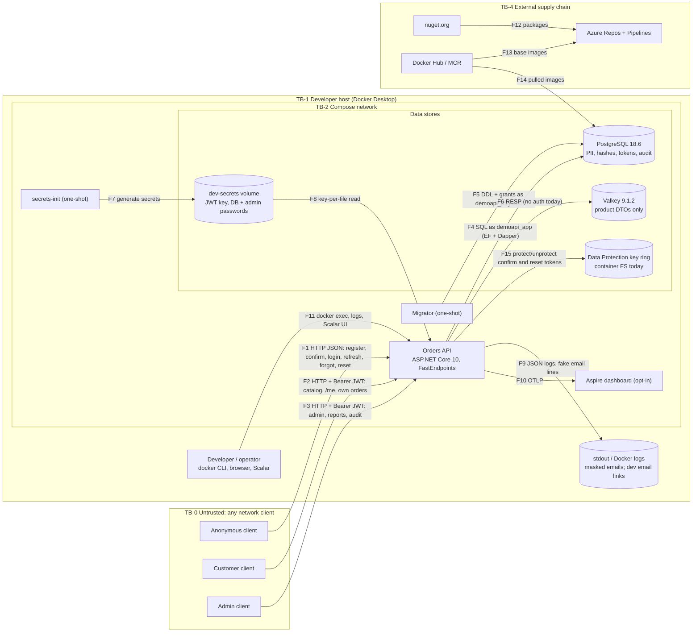
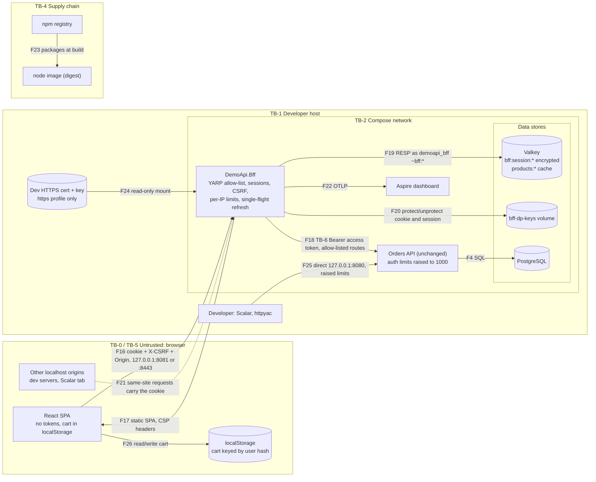

# Threat model: Orders API

| Field | Value |
|---|---|
| Date | 2026-10-27 |
| Status | Approved 2026-10-27 (decisions S-D1..S-D8 below) |
| Mode | Standard (full STRIDE) |
| Scope | Orders API v1 as designed in Phase 6: 57 endpoints (51 core, 6 stretch), local Docker Compose (API, migrator, secrets-init, PostgreSQL 18.6, Valkey 9.1.2, optional Aspire dashboard), CI on Azure Pipelines, and the `dotnet new` template that comes from it. Out of scope: real email, payments, cloud hosting |
| Participants | security-privacy-reviewer (author); product owner (sign-off) |
| Based on | [architecture](../04-architecture/architecture.md), [architecture review §4](../04-architecture/architecture-review.md), [data model](../04-architecture/data-model.md), [endpoint catalog](../04-architecture/endpoint-catalog.md), [solution structure](../04-architecture/solution-structure.md), ADR [0006](../04-architecture/adr/0006-soft-delete-audit-and-no-delete-role.md), [0008](../04-architecture/adr/0008-jwt-and-refresh-tokens.md), [0009](../04-architecture/adr/0009-caching-products.md), [0010](../04-architecture/adr/0010-rate-limiting.md), [0011](../04-architecture/adr/0011-resilience.md), [0012](../04-architecture/adr/0012-local-setup-and-secrets.md), [0013](../04-architecture/adr/0013-observability.md), [PRD](../02-requirements/prd.md), [permission matrix](../02-requirements/permission-matrix.md) |
| Standards | OWASP API Security Top 10:2023 (still the current edition), OWASP ASVS 5.0.0, NIST SP 800-63B-4, OWASP Password Storage Cheat Sheet |

**Target level: ASVS 5.0 Level 2.** The API stores personal data (names, emails, phones) and credentials. It is also a template that client APIs will copy, so a flaw here repeats in every copy. Level 3 is not justified. Most relevant chapters: V4 API and Web Service, V6 Authentication, V7 Session Management, V8 Authorization, V9 Self-contained Tokens, V11 Cryptography, V13 Configuration, V14 Data Protection, V15 Secure Coding and Architecture, V16 Security Logging and Error Handling. Mostly not applicable: V3 Web Frontend, V5 File Handling, V10 OAuth/OIDC (we are not an OAuth server), V17 WebRTC.

## 1. Scope, assets and trust boundaries

### 1.1 Assets and classification

| ID | Asset | Class | Where | Why it matters |
|---|---|---|---|---|
| A1 | JWT signing key (HS256) | Secret: critical | `dev-secrets` volume; user-secrets | Anyone holding it can create a valid Admin token |
| A2 | Password hashes, security stamps | Credential | `asp_net_users` | Offline cracking; the stamp protects token validity |
| A3 | Access tokens (15 min) | Credential | Client memory, `Authorization` header | Bearer access to every role |
| A4 | Refresh tokens (7 d, 30 d family) | Credential | Client; DB holds SHA-256 hashes only | Long-lived session |
| A5 | Confirm and reset tokens, Data Protection key ring | Credential | Links in fake email logs (Development); key ring in the container filesystem today | Account takeover via the reset flow |
| A6 | DB role passwords, seed Admin password, Valkey password (new) | Secret | `dev-secrets` volume | Direct data access, Admin login |
| A7 | Customer PII: email, first and last name, phone | PII | `asp_net_users.email`, `customers` | Privacy harm, erasure duty |
| A8 | Admin PII: email, names | PII | `asp_net_users` | Same; there is no erase path today |
| A9 | Orders, prices, stock | Business-confidential, integrity | PostgreSQL; product DTOs in Valkey | Fraud, wrong stock, wrong revenue |
| A10 | Audit logs | Audit (pseudonymous user IDs) | `audit_logs` (append-only) | Accountability; must not hold PII values |
| A11 | Logs and traces | Internal (user IDs, masked emails) | stdout, Docker logs, Aspire dashboard | PII and token leak path |
| A12 | Admin role | Privilege | `asp_net_user_roles` | Full control of all data and users |
| A13 | Availability of auth and DB | Availability | API, PostgreSQL | Lockout, DoS |
| A14 | Source, pipeline, packages, template | Integrity | Azure Repos, nuget.org, registries | A flaw or compromise spreads to every client API built from the template |

### 1.2 Trust boundaries

| ID | Boundary | Crossing flows |
|---|---|---|
| TB-0 | Any HTTP client → API. Always untrusted, including tools on the same laptop | F1-F3 |
| TB-1 | Developer host → containers (docker CLI, volumes, published ports). Whoever controls the host controls everything | F11, port publishing |
| TB-2 | API → data stores (different privilege: `demoapi_app` vs `demoapi_migrator`, Valkey user) | F4-F6, F15 |
| TB-3 | Secrets volume → consumers | F7, F8 |
| TB-4 | External supply chain → build and images | F12-F14 |

### 1.3 Data flow diagram

Note: with ports published on `0.0.0.0`, TB-0 includes the whole local network (for example café Wi-Fi). Section 3 fixes this.

## 2. STRIDE threats

Rating: likelihood/impact (L/M/H) → resulting risk. "Doc" points to where the existing control is described.

### 2.1 Auth endpoints (F1) and identity

| ID | STRIDE | Threat | L/I | Existing (doc) | Gap | Recommended control | Refs |
|---|---|---|---|---|---|---|---|
| T-01 | S | Credential stuffing or guessing on login | M/H → **High** | `auth-strict` 10/min/IP, lockout 5 → 15 min (ADR-0010, FR-008); length 15-128 (FR-003) | No blocklist of common or breached passwords (NIST 800-63B-4 asks for one). Identity default PBKDF2-SHA512 at 100,000 iterations; OWASP now says 220,000 | Local blocklist (e.g. top-100k list, MIT) on register, change and reset → 400. `PasswordHasherOptions.IterationCount = 220_000`; old hashes upgrade on next login | API2; ASVS V6 |
| T-02 | I | Account enumeration through response-time differences on register, forgot, resend and login (SEC-3) | M/M → **Medium** | Same 202 body; generic 401 (FR-002, FR-007) | New email = hash + insert; existing = no work. Unknown user at login = no hash | Section 3, SEC-3 | API2; ASVS V6 |
| T-03 | I | Identity `SignInManager.CheckPasswordSignInAsync` runs pre-checks (confirmed email, lockout) **before** the password check: 403 `email-not-confirmed` for any password, fast "locked" path | M/M → **Medium** | FR-007 says 403 only with the correct password | Identity default behaviour (Assumption; confirm in S1b) | Verify the password first (`UserManager.CheckPasswordAsync`, or a dummy hash for unknown users), then check confirmed/locked. Keep `SignIn.RequireConfirmedEmail = false` and enforce in our handler. Test: unconfirmed + wrong password → 401 | API2 |
| T-04 | D | Lockout abuse: 5 bad passwords lock a victim, and FR-015 also **revokes all the victim's sessions**. Seed Admin email `admin@demo.local` is guessable | M/M → **Medium** | A-D10 accepted; lockout per account | Automatic lockout increases the damage | No refresh-token revoke on automatic `failed-logins` lockout; keep it on Admin lock (Q2). Non-guessable Admin usernames outside Development. Metric and alert on lockouts per minute | API4, API6 |
| T-05 | S/E | Stolen access token used to brute-force the current password on EP-09 (300/min on `general`; wrong password not counted), then account takeover | M/H → **High** | EP-09 needs the current password (FR-017) | Not rate-limited strictly, not counted toward lockout | EP-09 on `auth-strict`; wrong current password calls `AccessFailedAsync` (same as EP-37) | API2; ASVS V6 |
| T-06 | S | Reset or confirm token stolen or replayed within 24 h; Data Protection keys lost or unprotected | L/H → **Medium** | Tokens bound to security stamp; generic 400; links logged only in Development (FR-018, FR-020) | Reset lives 24 h; key ring not persisted or encrypted | Reset 1 h, confirm 24 h, separate providers (Q3). Persist keys (dev: named volume; production: Blob + Key Vault). Links only from `Email:LinkBaseUrl`, never the `Host` header | ASVS V6, V11 |

### 2.2 Tokens (F2, F3)

| ID | STRIDE | Threat | L/I | Existing (doc) | Gap | Recommended control | Refs |
|---|---|---|---|---|---|---|---|
| T-07 | S | Forged JWT (`alg: none`, algorithm confusion, unknown `kid`, `jku`/`x5u`) | L/H → Medium | Allow-list `HS256`, `typ at+jwt`, `iss`, `aud`, `exp`, 30 s skew (ADR-0008) | None in design | Resolve `kid` only from configured keys; negative tests ST-04 | API2; ASVS V9 |
| T-08 | S/E | HS256 key leak → attacker creates Admin tokens | L/H(crit) → **Medium** | ≥ 256-bit key from secrets, key ring with `kid` (ADR-0008) | No custody or rotation runbook | Section 3, item 1 | API2; ASVS V11, V13 |
| T-09 | E | Locked, deleted or demoted user keeps access ≤ 15 min; stale `customer_id` after erase (R1) | M/H → **High** | Refresh revoked (FR-015); architecture §5d | Access token not checked against current account state | Section 3, R1 | API5; ASVS V7, V9 |
| T-10 | S | Stolen refresh token replayed | M/H → Medium | Rotation, reuse revokes family (commit before 401), SHA-256 at rest, 30 d cap, `no-store` (ADR-0008) | Parallel refresh = false reuse (SEC-2) | Section 3, SEC-2 | API2; ASVS V7 |
| T-11 | I | Tokens leak via logs, URLs or traces | L/H → Medium | Never in URLs or logs (NFR-10, ADR-0013) | Not proven by a test | Log-scan test for `eyJ` and 43-char base64url values (ST-14). HttpLogging off. JwtBearer must not accept query-string tokens | API8; ASVS V16 |

### 2.3 Authorization and business flows (F2, F3)

| ID | STRIDE | Threat | L/I | Existing (doc) | Gap | Recommended control | Refs |
|---|---|---|---|---|---|---|---|
| T-12 | E | BOLA: a Customer reads or cancels another customer's order | M/H → **High** | ID routes Admin only; `/me` uses `customer_id` from token; 404; 100% BOLA tests (permission matrix, NFR-04) | Each handler adds the predicate by hand | ADR 0014; one `OwnedBy(ICurrentUser)` query helper; test fails when a new `/me/{id}` route has no BOLA case | API1; ASVS V8 |
| T-13 | E | BFLA: endpoint without role rule, or Customer reaches Admin route | L/H → Medium | Architecture test; FastEndpoints deny by default | Matrix must cover unlisted endpoints | Matrix test built from `EndpointDataSource`; endpoint missing from the permission matrix fails | API5; ASVS V8 |
| T-14 | T/I | Mass assignment (`customerId`, `status`, `unitPrice`, `isDeleted`, `role`), or Admin-only fields shown to a Customer | L/M → Low | Settable-only request DTOs; role DTOs (endpoint catalog §1.1) | Not tested | ST-03 | API3; ASVS V8 |
| T-15 | E | Compromised Admin creates Admins, reads all PII; Admin login is password-only | M/H → **High** (production) / Medium (POC) | Role-change audit, last-Admin rule (FR-032..037) | No MFA (non-goal); no signal on Admin creation | Security event + metric on `RoleAssigned` and EP-19. Before production: MFA or Entra ID for staff | API5 |
| T-16 | D | Inventory hoarding: many Pending orders hold all stock | M/M → Medium | 1-50 lines, qty ≤ 1000 (FR-080) | No limit on open orders | Configurable cap on open Pending orders per customer (default 5 → 409) (Q4). Before production: expire old Pending orders | API6 |
| T-17 | D | Bot registrations fill `asp_net_users` | M/L → Low | `auth-strict`; confirmation required | No purge (NFR-19) | Purge unconfirmed accounts after 7 days; CAPTCHA only if public | API6 |
| T-18 | T | Order price from a poisoned cache or from the client | L/H → Medium | Price read from DB under `FOR UPDATE`; no price in request (FR-083, ADR-0007) | Not tested | ST-15 | API3, API6 |

### 2.4 Data access (F4, F5)

| ID | STRIDE | Threat | L/I | Existing (doc) | Gap | Recommended control | Refs |
|---|---|---|---|---|---|---|---|
| T-19 | T/I | SQL injection via Dapper sort or filter; `ILIKE` wildcard abuse | L/H → Medium | Parameters, sort allow-lists, escaping (data model §4.2, FR-122) | Rule is prose only | Section 3, item 9 | API8; ASVS V1 |
| T-20 | E | App role grants drift | L/H → Medium | Negative grant tests (data model §5) | No positive allow-list | Section 3, item 14 | API8; ASVS V13 |
| T-21 | D | Expensive queries hold connections; 30 s `statement_timeout` | M/M → Medium | Range ≤ 366 d, `pageSize` ≤ 100, role timeouts | Timeouts too long for 5 s / 503; no report concurrency limit | Section 3, item 15; concurrency limiter on `/reports/*` (e.g. 4) | API4 |
| T-22 | R/T | Audit rows changed by DB owner or superuser | L/H → Medium | App role INSERT/SELECT only (ADR-0006) | Owner can still change rows | Accept for POC. Production: ship audit to an append-only store | ASVS V16 |

### 2.5 Cache (F6)

| ID | STRIDE | Threat | L/I | Existing (doc) | Gap | Recommended control | Refs |
|---|---|---|---|---|---|---|---|
| T-23 | T/I/D | Valkey with no password: poisoned data, `FLUSHALL`, `CONFIG` | M/M → **Medium** | Product DTOs only (ADR-0009) | No auth; port may be published | ACL user with generated password; block `@dangerous`; no published port | API8 |
| T-24 | I | Admin-scope DTO served to a Customer | L/M → Low | `scope` in key; `includeDeleted` bypasses cache | — | Scope only from validated role claim; ST-15 | API3 |
| T-25 | D | Cache flooding via distinct `search` values; unbounded L1 | M/M → Medium | Search hashed; 2 min TTL | No size limit | Do not cache list queries with `search`; `MemoryCache.SizeLimit`; Valkey `maxmemory` + `allkeys-lru` | API4 |

### 2.6 Logs, observability, platform (F9-F11), supply chain (F12-F14)

| ID | STRIDE | Threat | L/I | Existing (doc) | Gap | Recommended control | Refs |
|---|---|---|---|---|---|---|---|
| T-26 | I | PII in logs: "Request starting" lines include query strings (`?search=smith`); EF sensitive data logging; Npgsql error detail | M/M → **Medium** | Emails masked, bodies not logged (ADR-0013, NFR-10) | Query strings not addressed | `Microsoft.AspNetCore.Hosting.Diagnostics` at Warning; no `EnableSensitiveDataLogging`/`Include Error Detail` in compose; verify OTel `url.query` redaction; ST-14 | ASVS V16 |
| T-27 | I | OTLP or dashboard port open | L/M → Low | Profile opt-in (A-D1) | Port binding | Do not publish 18889; bind 18888 to `127.0.0.1`; keep dashboard browser-token auth | API8 |
| T-28 | R | No record of security events or Admin PII reads | M/M → Medium | Audit covers writes; metrics (ADR-0013) | No security-event schema | Structured security events with fixed IDs (login, lockout, refresh reuse, role change, Admin create, audit-log query, erase); IDs only | ASVS V16 |
| T-29 | I/E | Compose publishes API (Development: Scalar, detailed errors), PostgreSQL and Valkey on all interfaces | M/H → **High** | Local only (ADR-0012) | Port binding not specified | Section 3, item 3 | API8 |
| T-30 | I | Development behaviour leaks into a client deployment built from the template | M/H → **High** (template) | Production-env tests for headers and HSTS (ADR-0012) | Scalar and OpenAPI 404 not tested | ST-10 | API8, API9 |
| T-31 | S/D | Rate-limit bypass via spoofed `X-Forwarded-For`, or one bucket behind a proxy | L now / M later | `ForwardedHeaders` only when proxies configured (ADR-0010) | No startup guard | Section 3, item 5 | API4 |
| T-32 | I | CORS set to `*` later | L/M → Low | Allow-list (NFR-06) | — | Startup validation rejects `*` and non-HTTPS origins outside Development | API8 |
| T-33 | D | `/health/ready` anonymous, not rate-limited, hits DB and Valkey | L/L → Low | D10 | — | Cache readiness result 2 s | API4 |
| T-34 | T | Malicious or vulnerable package, dependency confusion, tampered image, spread via the template | M/H → **High** | Locked restore, vulnerable-package check, licence check | No SBOM, image scan, digest pins, source mapping | Section 5 | API10 (analogy); ASVS V15 |
| T-35 | I | Secret committed (`.env`, Postman environment with token) | M/H → Medium | gitleaks full history; `.gitignore` (NFR-07) | No local hook | Section 5 | ASVS V13 |
| T-36 | I | Erasure misses data (unmarked field, free text, logs, Admin accounts) | M/M → Medium | PII marked once; erasure test (FR-065) | Logs, free text, Admins out of scope | Section 4 | ASVS V14 |

### 2.7 Ranked top 10
1. T-09 R1 window
2. T-05 EP-09 brute force
3. T-29 compose exposure
4. T-01 credential stuffing
5. T-12 BOLA regressions
6. T-34 supply chain
7. T-30 Development leaks into the template
8. T-02/T-03 enumeration
9. T-15 Admin compromise
10. T-23 unauthenticated Valkey

### 2.8 OWASP API Security Top 10:2023 mapping (NFR-04)

| Item | Threats | Main controls | Tests |
|---|---|---|---|
| API1 BOLA | T-12 | `/me` + token `customer_id`, 404, ADR 0014, `OwnedBy` helper | ST-02 |
| API2 Broken authentication | T-01..T-08, T-10, T-11 | JWT validation, rotation and reuse detection, lockout, blocklist, timing floor, EP-09 limit | ST-04, 05, 07, 08, 17 |
| API3 BOPLA | T-14, T-18, T-24 | Settable-only DTOs, role DTOs, cache scope | ST-03, ST-15 |
| API4 Unrestricted resource consumption | T-21, T-25, T-31, T-33 | Rate limits, 1 MB body, `pageSize` ≤ 100, DB timeouts, report concurrency, cache bounds | ST-09, 16, 18 |
| API5 BFLA | T-09, T-13, T-15 | Deny by default, matrix from endpoint metadata, stamp check | ST-01, ST-06 |
| API6 Sensitive business flows | T-04, T-16, T-17 | Pending-order cap, lockout tuning, unconfirmed purge | ST-07, ST-16 |
| API7 SSRF | none (no outbound HTTP; link base URL from config) | Future `HttpClient` host allow-list | — |
| API8 Security misconfiguration | T-19, T-20, T-26, T-27, T-29, T-30, T-32 | Headers, CORS guard, localhost binding, Production-env tests, grant snapshot | ST-10, 11, 12 |
| API9 Improper inventory management | T-30 | `/api/v1`, committed OpenAPI + drift test, Scalar Development only, stretch mapped only when built | ST-01, ST-10 |
| API10 Unsafe consumption of APIs | T-18, T-23, T-34 | Valkey auth; never trust cached data for prices or authz | ST-15 |

## 3. Decisions needed

### R1: Access token after lock, demote or erase

| Option | Good | Bad |
|---|---|---|
| **A. Security-stamp check per request** (`sst` claim = 16-byte SHA-256 of the stamp; `JwtBearerEvents.OnTokenValidated` reads stamp hash + `is_deleted` by `sub`; in-process cache 30 s, cleared locally on change; fails closed) | Window ≈ 0 on one instance, ≤ 30 s across instances; fixes stale `customer_id`; one PK lookup per user per 30 s | Small exception to "no user-keyed cache" (FR-130, ADR-0009): in-process, no PII. DB down → 401/503 for authenticated calls |
| B. Access TTL 5 min | No code | Window still 5 min; 3× refresh load |
| C. Accept 15 min | Nothing to build | Demoted Admin keeps rights 15 min |
| D. Deny list in Valkey | Shared across instances | Valkey optional (G3): fails open or becomes a hard dependency |

**Recommendation: A.** Identity rotates the stamp on password change/reset but not on role or lockout changes (Assumption; test it), so call `UpdateSecurityStampAsync` explicitly on lock/unlock, role assign/remove, erase/delete, logout-all and Admin revoke-sessions. Update ADR-0008; note in ADR-0009.

### SEC-2: Parallel refresh

| Option | Good | Bad |
|---|---|---|
| **A. Strict (today)** | Strongest reuse detection; no code | Two refreshes at once lose the session |
| B. Grace window issuing a sibling pair | Smooth | Family branches; thief gets a window |
| C. "Benign race": within N s of `UsedAt`, 401 `refresh-superseded` without revoking | No random logouts | Weaker detection inside N s |

**Recommendation: A now** (developer-tool clients; document "one refresh at a time"). Record C in ADR-0008 for when a browser client arrives.

### SEC-3: Timing leaks (register, forgot, resend, login)

| Option | Good | Bad |
|---|---|---|
| A. Equal work: hash on both register paths; dummy hash at login for unknown users; same DB lookups | Removes the big gap | Small differences remain |
| B. Fixed response floor (register 500 ms, forgot/resend 250 ms) via `TimeProvider` | Covers residuals | Slightly slower responses |
| C. Background queue | Constant time | Errors invisible; audit outside request; lost on restart |

**Recommendation: A + B**, plus the T-03 fix. Test: 30 calls per path in the serial collection; all ≥ floor; median difference < 50 ms.

### ADR 0014 "Authorization model (roles + `/me` ownership)": needed

Outline:
1. **Context.** Two roles; BOLA is the top API risk; the template must copy cleanly (CustomerOnly is a strip point).
2. **Decision.** Deny by default; endpoints declare `Anonymous`, `Authenticated`, `AdminOnly` or `CustomerOnly`. ID routes Admin only. `/me` ownership only from the token via `OwnedBy(ICurrentUser)`. Not owned = 404; wrong role = 403; status order as the permission matrix. Role-specific response DTOs; cache scope by role. Security-stamp check (R1).
3. **Tests.** Matrix from `EndpointDataSource`, BOLA per `/me/{id}` route, DTO snapshots, architecture test.
4. **Alternatives.** Resource-based `IAuthorizationHandler`; permissions instead of roles; PostgreSQL row-level security. Revisit for multi-tenant or sharing.
5. **Strip guide.** How to remove the Customer concept.

### Architecture review §4 items

| # | Item | Recommendation and reason |
|---|---|---|
| 1 | HS256 key custody and rotation | **POC:** 64-byte key per machine, unique per environment. Runbook: add new key as current (new `kid`), keep old as previous ≥ 16 min, then remove. Emergency: replace both (access tokens die; refresh keeps working). **Production:** Key Vault + managed identity, rotate every 90 days (Assumption) and on suspicion. ES256/JWKS only when another service validates tokens |
| 2 | Dev secrets readable via `docker compose exec` | **Accept** (host is the trust root) plus per-service mounts, files `0440`, generated `POSTGRES_PASSWORD`, README note |
| 3 | Compose ports | **API and dashboard on `127.0.0.1:`; do not publish PostgreSQL, Valkey or OTLP.** Commented `compose.override.yaml` example for DB tools (also `127.0.0.1`) |
| 4 | Scalar in Development | **Keep, Development only** with the OpenAPI route; Production test `/scalar` and `/openapi/*` → 404; fake examples only |
| 5 | Rate-limit IP keying behind a proxy | **Keep ADR-0010** plus a startup guard (forwarded headers on ⇒ `KnownProxies`/`KnownNetworks` not empty); test `X-Forwarded-For` ignored by default |
| 6 | Lockout as DoS on shared IP (A-D10) | **Accept for POC** plus T-04 changes. Production: higher per-IP auth limit + per-account limiter keyed by hashed normalized email |
| 7 | Stale `customer_id` after erase | **R1-A**, and `/me` handlers treat missing/deleted customer as 404; order create rejects an erased customer |
| 8 | Cache scope separation | **Keep ADR-0009**; scope only from validated role; drop `includeDeleted` for Customers before building the key; Valkey ACL; ST-15 |
| 9 | Dapper sort allow-lists and `ILIKE` escaping | **Enforce:** sort tokens map to constant SQL fragments; values as parameters; `ILIKE @p ESCAPE '\'` after escaping `\ % _`; architecture test that Dapper SQL is constant or built from allow-listed fragments |
| 10 | Refresh token in body vs cookie | **Body now.** Browser front end later: BFF (preferred) or HttpOnly, Secure, `SameSite=Strict` cookie scoped to `/api/v1/auth` + antiforgery header. Never `localStorage` |
| 11 | Confirm and reset lifetimes | **Confirm 24 h, reset 1 h** (Q3), separate providers; persist the key ring |
| 12 | Who reads audit logs | **All Admins now** (Q5), each query logged as a security event; `Auditor` permission per client later |
| 13 | Erasure incl. logs | DB tested (FR-065). Names/phones never logged; emails masked; Docker `json-file` rotation; production log retention ≤ 30 days |
| 14 | DB role passwords and grant drift | **Snapshot test** of table grants, routine EXECUTE and role attributes (`rolsuper`, `rolcreaterole`, `rolcreatedb`, `rolbypassrls` false; no `CREATE` on schema) vs a committed list. Passwords ≥ 32 random chars, SCRAM-SHA-256, migrator not superuser |
| 15 | `statement_timeout` / `lock_timeout` | **Tighten** (Assumption; tune in S3 load test): `statement_timeout 10s`, `lock_timeout 2s`, `idle_in_transaction_session_timeout 15s`; EF command timeout 5 s, reports 10 s; request timeout 15 s; pool below `max_connections` |

## 4. Privacy

### 4.1 PII inventory

| Data | Stored | Logged | Cached | Audited | In token | On erase |
|---|---|---|---|---|---|---|
| Customer email | `asp_net_users.email`, `user_name` (+ normalized) | Masked; full only in Development fake-email lines | No | `"changed"` | No | `erased-{id}@erased.invalid` |
| Customer first/last name | `customers` | Never | No | `"changed"` | No | `Erased` / `Customer` |
| Customer phone | `customers.phone` | Never | No | `"changed"` | No | NULL |
| Admin email, names | `asp_net_users` | Masked email | No | `"changed"` | No | **No erase path** (offboarding = lock + remove role) |
| Password hash, stamp | `asp_net_users` | Never | No | Never | Stamp hash if R1-A | Hash NULL, new stamp |
| User ID, customer ID | Everywhere | Yes | No | Yes | `sub`, `customer_id` | Kept |
| IP address | Rate limiter memory | Masked | No | No | No | n/a |
| Search terms | Not stored | **Risk: request-start log** (T-26) | Hashed in key | No | No | n/a |
| Free-text reasons | `lock_reason`, `order_status_history.reason` | No | No | With value | No | Out of scope (FR-065); document "no personal data in reasons" |

Lawful basis: the POC uses generated data only, so GDPR is not engaged. For a client deployment: contract (accounts, orders); legitimate interest (audit and security logs, pseudonymous IDs); privacy notice and DPIA owned by the client; access requests covered by `GET /customers/me` and `/me/orders` (Assumption: no export endpoint needed).

### 4.2 Erasure path
EP-33 and EP-37 (architecture §5d): anonymize, soft-delete and lock the user, rotate the stamp (R1-A), revoke tokens, audit rows without values. Not covered: logs (age out by rotation), free text, backups (none this phase; production: expire within retention and re-apply erasures after restore), Admin accounts.

### 4.3 Retention (extends A-D7; before production)

| Data | Retention | Method |
|---|---|---|
| Refresh tokens | Purge 30 days after `family_expires_at` | Batch procedure, purge role |
| Audit logs | 2 years, then archive | Purge role |
| Unconfirmed accounts | 7 days | New job (T-17) |
| App logs and traces | ≤ 30 days | Log platform; Docker rotation locally |
| Erased customers | Anonymized row kept with orders | n/a |
| Data Protection keys | 90-day default key lifetime | Framework |

### 4.4 Logging and masking rules
1. Never log passwords, access or refresh tokens, token hashes, reset/confirm tokens (except Development fake-email lines), request or response bodies, `Authorization` headers.
2. Emails masked by one helper (`j***@example.com`); names and phones never logged.
3. `Microsoft.AspNetCore.Hosting.Diagnostics` at Warning; OTel URL query redaction on (verify).
4. EF `EnableSensitiveDataLogging` and Npgsql `Include Error Detail` only in tests.
5. ProblemDetails `instance` without the query string.
6. ST-14 proves all of this with seeded PII values.

### 4.5 Test-data rules
- Bogus with a fixed seed only; never production data.
- Emails on `example.com`, `example.org` or `.invalid` (RFC 2606); override Bogus's real-looking domains.
- Phones from fictional ranges (e.g. `+1 555 01xx`).
- `.http`, Postman and OpenAPI examples are fake; Postman environments hold no tokens.

## 5. Supply chain (Azure Pipelines)

| Control | Tool / setting | Gate | Status |
|---|---|---|---|
| Lock files | `packages.lock.json`, `restore --locked-mode` | Drift fails | Exists |
| Source mapping | `nuget.config` with `<clear/>`, nuget.org only, `packageSourceMapping` | Unknown source fails | **Add** |
| Vulnerable packages | NuGetAudit (`NuGetAuditMode=all`, high/critical as errors) + `dotnet list package --vulnerable --include-transitive` | Fail high/critical | Extend |
| SBOM | CycloneDX .NET tool (spec 1.7); image SBOM via Syft or `docker buildx --sbom` | Pipeline artifact | **Add** |
| Image scan | Trivy (Apache-2.0) on API and pinned third-party images | Fail critical/high with fix | **Add** |
| Image pinning | Pin by digest, keep tag for readability; API base `aspnet:10.0-*-chiseled` (non-root) | Review on update | **Add** |
| Update flow | Renovate in a scheduled pipeline (AGPL build tool, not shipped; Assumption acceptable) or monthly manual review | PRs | **Decide** |
| Secret scan | gitleaks pinned, full history, `--redact`, pre-commit hook; include `api-tests/` | Any finding fails; rotate first | Extend |
| Licence | `nuget-license` allow-list (NFR-18) | Fail outside list | Exists |
| CI hardening | Pin `vmImage: ubuntu-24.04` and task majors; branch policy on `main`; job token scoped to project; no secret variables | Policy | **Add** |
| Provenance | SLSA Build L1 now (log + SBOM tied to commit); L2 before production (signed provenance, image signing) | — | Plan |

NIST SSDF (SP 800-218) is the framework reference if a client asks.

## 6. Security tests (must exist)

| ID | Test | Threats |
|---|---|---|
| ST-01 | Authz matrix: every endpoint from `EndpointDataSource` × anonymous / Customer / Admin vs the permission matrix; unlisted endpoint fails | T-13, T-09 |
| ST-02 | BOLA: every `/me/{id}` route with another customer's ID → 404 | T-12 |
| ST-03 | Mass assignment: forbidden body fields have no effect; per-role DTO snapshot | T-14 |
| ST-04 | JWT negatives: `alg none`, HS/RS confusion, unknown or removed `kid`, previous key accepted, wrong `typ`/`iss`/`aud`, expired + 31 s, `nbf`, `jku`/`x5u` ignored | T-07, T-08 |
| ST-05 | Refresh: rotation, reuse revokes family (fresh-context read after 401), parallel = strict, 30 d cap, locked/deleted user → 401 | T-10 |
| ST-06 | Stamp check: after lock, role remove, erase, password change, logout-all → old access token 401 | T-09 |
| ST-07 | Lockout: 5 failures lock; EP-09 and EP-37 wrong passwords count; reset clears `failed-logins` only; automatic lockout keeps sessions | T-04, T-05 |
| ST-08 | Enumeration: identical status, body, headers; timing floor and median diff < 50 ms; unconfirmed + wrong password → 401 | T-02, T-03 |
| ST-09 | Rate limits: each policy, shared `auth-strict` bucket, 429 before 401, `X-Forwarded-For` ignored by default | T-01, T-31 |
| ST-10 | `Production` env: headers, HSTS, no `Server`, `no-store`, CORS rejects unknown origin, `/scalar` and `/openapi` → 404, health without detail, no stack trace | T-29, T-30, T-32 |
| ST-11 | Injection: sort tokens and `search` with `% _ \ ' ;--` and Unicode → 400 or literal match; Dapper SQL architecture rule | T-19 |
| ST-12 | DB grant snapshot and role attributes | T-20 |
| ST-13 | Erasure: seed every PII field, erase, search all tables, captured logs and Valkey keys → 0 matches | T-36 |
| ST-14 | Log hygiene: no password, JWT, refresh token, unmasked email, phone or search term in logs | T-11, T-26 |
| ST-15 | Cache: scope separation, `includeDeleted` bypass, poisoned Valkey price ignored for orders, `search` lists not cached, no PII in values | T-18, T-23, T-24, T-25 |
| ST-16 | Limits: 413/415, `pageSize`, report range, order lines/quantity, Pending-order cap, 1024-char password at login | T-16, T-21 |
| ST-17 | Tokens: reset expires at 1 h, confirm at 24 h; links valid after API restart (key ring persisted); reset single-use | T-06 |
| ST-18 | Timeouts: slow query cancelled within budget → ProblemDetails; lock wait ends within budget | T-21 |
| ST-19 | Security events for role assign, Admin create, audit-log query, refresh reuse, lockout | T-15, T-28 |
| ST-20 | CI gates: secret scan, vulnerable packages, licence, SBOM, image scan | T-34, T-35 |

## 7. Residual risks

### 7.1 Accepted for the POC

| Risk | Why accepted | Review |
|---|---|---|
| HS256 key is a mint key | Single issuer = single validator (ADR-0008) | Before a second service |
| Password-only Admin, no MFA | Non-goal (PRD §3) | Before production |
| Strict refresh can log out parallel clients | Dev-tool clients only (SEC-2) | With a browser front end |
| ≤ 30 s revocation window across instances (R1-A) | One instance | On scale-out |
| Plain HTTP inside compose; host users can read dev secrets | Host is the trust root; localhost binding | Release phase |
| Shared-IP auth bucket; fixed-window edge bursts | A-D10; lockout backs it up | Real traffic |
| Audit rows changeable by the DB owner | Local only | Before production |
| Development email lines hold full emails and token links | Fake sender, Development only | Real sender |
| UUIDv7 reveals creation time | Data model §1.1 | — |
| Free-text reasons may hold PII | FR-065 scope | Before production |
| Commit-time retry can duplicate an order | Data model §6.1; stretch Idempotency-Key | S3 |
| No backups | Rebuildable seed data | Before production |

All accepted by the product owner at sign-off.

### 7.2 Before any production use
1. TLS end to end; HSTS proven in a deployed environment.
2. Key Vault + managed identity; key rotation runbook tested.
3. Persisted, encrypted Data Protection keys.
4. MFA or Entra ID for Admins; Admin offboarding and PII erase path.
5. Real email sender; tokens never logged.
6. Retention jobs (4.3); log retention ≤ 30 days; backups that respect erasure.
7. Gateway or distributed rate limiting; per-account limiter.
8. Pending-order expiry; CAPTCHA if registration is public.
9. Alerts on refresh reuse, lockout spikes, new Admins.
10. SLSA Build L2, signed images.
11. DAST (e.g. OWASP ZAP API scan from the OpenAPI file) and a fresh-context review of `JwtTokenIssuer` and `RefreshTokenStore`.
12. Privacy notice and DPIA by the client's security owner.

## 8. Questions for the product owner

| # | Question | Recommendation |
|---|---|---|
| Q1 | R1: adopt the per-request security-stamp check (option A)? | **Yes** |
| Q2 | Automatic failed-login lockout does not revoke sessions; EP-09 moves to `auth-strict` with wrong passwords counted toward lockout? | **Yes** (closes T-04, T-05) |
| Q3 | Reset-token lifetime 1 h (FR-018 says 24 h); confirm stays 24 h? | **Yes** |
| Q4 | Cap open Pending orders per customer (default 5, configurable)? | **Yes** |
| Q5 | Audit log readers: all Admins (now) or a separate Auditor role? | **All Admins now**, log each query |

## 9. Security decisions (approved 2026-10-27)

| ID | Decision |
|---|---|
| S-D1 | R1: per-request security-stamp check (option A): `sst` claim, `OnTokenValidated` check, in-process 30 s cache cleared on change, fails closed; stamp rotated explicitly on lock/unlock, role change, erase/delete, logout-all, revoke-sessions |
| S-D2 | Automatic failed-login lockout no longer revokes sessions (Admin lock still does); EP-09 change password on `auth-strict`, wrong current password counts toward lockout |
| S-D3 | Reset token 1 h, confirm token 24 h, separate providers; Data Protection key ring persisted (dev: named volume) |
| S-D4 | Cap of 5 open Pending orders per customer (configurable) → 409 `too-many-pending-orders` |
| S-D5 | All Admins read audit logs; each audit-log query is a security event |
| S-D6 | SEC-2 strict refresh now; "benign race" option recorded in ADR-0008 for a browser client. SEC-3 equal work + response floor; password verified before confirmed/locked checks (T-03) |
| S-D7 | Section 3 recommendations adopted: localhost-only ports, no published DB/Valkey/OTLP ports, Valkey ACL password, per-service secret mounts, password blocklist + 220,000 PBKDF2 iterations, query strings out of logs, tighter DB timeouts, grant snapshot test, enforced Dapper SQL allow-list, cache bounds, report concurrency limit, security events, ADR 0014 |
| S-D8 | Supply chain per section 5; dependency updates via Renovate in a scheduled pipeline (build tool, not shipped) |

## Follow-up actions
- [ ] Revise ADR-0008 (R1-A, SEC-2 strict + option C noted, key runbook); note in ADR-0009 (stamp cache exception)
- [ ] Write ADR 0014 Authorization model
- [ ] Update PRD: FR-015, FR-017/EP-09 rate limit, FR-018 lifetime, FR-003 blocklist, Pending cap
- [ ] Compose: localhost binding, Valkey ACL, per-service secret mounts, generated `POSTGRES_PASSWORD`, log rotation, Data Protection key volume (S1a)
- [ ] Data model §5: new timeout values; grant snapshot test; `audit_logs.action` CHECK gets `SessionsRevoked` (A-D17) (S1a)
- [ ] Pipeline additions in section 5 (S1a)
- [ ] ST-01..ST-20 added to the Definition of Done and the Quality plan

## Open questions
- [ ] Which client project will reuse the template, and does it have its own security owner and compliance needs (GDPR, ISO 27001)?

## Assumptions
- Identity's `CheckPasswordSignInAsync` runs pre-checks before the password check; role and lockout changes do not rotate the security stamp (from Identity source; confirm in S1b/S2).
- Compose currently publishes ports on all interfaces; Docker can bypass host firewall rules for published ports.
- Timeout values in item 15 are starting points; tune in the S3 load test.
- OTel ASP.NET Core instrumentation redacts URL query strings by default; verify.
- 90-day key rotation is a sensible default, not a client rule.

## Sources
- [OWASP API Security Top 10](https://api-security.owasp.org/)
- [OWASP ASVS project (5.0.0)](https://owasp.org/projects/asvs?tab=main)
- [OWASP Password Storage Cheat Sheet](https://cheatsheetseries.owasp.org/cheatsheets/Password_Storage_Cheat_Sheet.html)
- [Microsoft: PasswordHasherOptions](https://learn.microsoft.com/en-us/dotnet/api/microsoft.aspnetcore.identity.passwordhasheroptions)
- [NIST SP 800-63B-4](https://pages.nist.gov/800-63-4/sp800-63b.html)
- [CycloneDX / ECMA-424](https://ecma-international.org/publications-and-standards/standards/ecma-424/)
- [SLSA specification](https://slsa.dev/spec/v1.1/)

---

## 10. Phase 2: web front end and BFF

| Field | Value |
|---|---|
| Date | 2026-10-30 |
| Status | Approved 2026-10-30 (S-D9..S-D13 accepted by the product owner) |
| Scope | React SPA in the BFF `wwwroot`, `DemoApi.Bff` (ASP.NET Core 10 + YARP 2.3.0), Valkey session store, `bff-dp-keys` volume, `https` compose profile, npm build chain, browser storage. The API is unchanged (G4) |
| Based on | [ADR-0015](../04-architecture/adr/0015-web-front-end-bff.md), [frontend-architecture.md](../04-architecture/frontend-architecture.md), [prd-frontend.md](../02-requirements/prd-frontend.md), [user-flows.md](../03-design/ux/user-flows.md), ADR-0008, ADR-0010 |
| Standards | OWASP ASVS 5.0.0 (Level 2; **V3 Web Frontend Security now in scope**), OWASP Top 10:2025, OWASP API Security Top 10:2023 for the API |
| Author | `security-privacy-reviewer` (draft), main session (saved) |

### 10.1 New assets

| ID | Asset | Class | Where |
|---|---|---|---|
| A15 | BFF session cookie `__Host-demoapi` (opaque, Data Protection protected) | Credential | Browser cookie jar |
| A16 | Session entries: access and refresh tokens, user summary | Credential (critical) | Valkey `bff:session:*`, encrypted |
| A17 | BFF Data Protection key ring | Secret | `bff-dp-keys` volume, not encrypted at rest locally |
| A18 | Dev HTTPS certificate private key | Secret | Host file system, mounted read-only (`https` profile) |
| A19 | Cart (product IDs, quantities, prices seen), keyed by a hash of the user ID | Internal | Browser `localStorage` |
| A20 | SPA bundle integrity | Integrity | `wwwroot`, built from npm |

### 10.2 Trust boundaries (new)

| ID | Boundary | Crossing flows |
|---|---|---|
| TB-5 | Browser runtime → BFF. SPA code runs in an untrusted browser. Other `localhost` ports are the **same site** (cookies ignore ports), so `SameSite` does not separate them | F16, F17, F21, F26 |
| TB-6 | BFF → API. The BFF holds tokens; the API still checks every request (roles, BOLA) | F18 |

### 10.3 Data flow diagram (Phase 2)

### 10.4 STRIDE threats (Phase 2)

Rating is likelihood/impact (L/M/H) → risk. Requirements NFR-F29..F43 are in prd-frontend.md §7.

| ID | STRIDE | Element / flow | Threat | L/I → risk | Mitigation | Verification |
|---|---|---|---|---|---|---|
| T-37 | S | A15, F16 | Session cookie stolen and replayed (malware, extension, shared computer, another localhost port) | L/H → **Medium** | HttpOnly, Secure, `__Host-`, opaque ID (NFR-F10); server-side session deleted on logout/logout-all (FR-F004); Admin idle 30 min (NFR-F12); Admin 12 h absolute (S-D10) | FT-02, FT-13 |
| T-38 | S | `/bff/login`, F21 | Session fixation or cookie tossing from another localhost app | L/M → Low | New session ID on every sign-in; existing session deleted and EP-06 called; sessions created only by `/bff/login`; IDs ≥ 128 bits CSPRNG (NFR-F30) | FT-02 |
| T-39 | T/E | F16, F21 | CSRF on state-changing routes; `SameSite=Strict` does not block other localhost ports | L/H → **Medium** | `X-CSRF: 1` + exact Origin match against an allow-list (NFR-F11, NFR-F29); missing or `null` Origin → 403; `Sec-Fetch-Site` must be `same-origin` when present; no CORS; no state change on GET | FT-03 |
| T-40 | S | `/bff/login` | Login CSRF | L/M → Low | Same check on `/bff/login` | FT-03 |
| T-41 | E/I | SPA, F16 | XSS becomes session riding: script calls any allow-listed route as the victim; as Admin it can create Admins (EP-19), assign roles (EP-16) or read all PII | M/H → **High** (Admin), Medium (Customer) | React escaping only; lint bans and safe links (NFR-F35); strict CSP (NFR-F13); Trusted Types (S-D13); recent sign-in for EP-16/EP-19 (S-D11); API asks current password on EP-09 and EP-37 | FT-10 |
| T-42 | S/T | `/sign-in?returnUrl=` | Open redirect; `reason` reflected | M/M → **Medium** | NFR-F34: relative SPA paths only; `reason` is a fixed code list | FT-11 |
| T-43 | E | YARP, F18 | Confused deputy or allow-list bypass (encoded/dot segments, case, `//`, method override, never-proxied routes, unknown `/api/*` → `index.html`, header injection) | L/H → **Medium** | Exact allow-list and methods (ADR-0015); typed constraints and header stripping (NFR-F32); fixed destination. The API stays the enforcer | FT-04 |
| T-44 | I/T/S | Valkey, F19 | Session store compromise, including copying a victim's encrypted blob under the attacker's key | L/H → **Medium** | ACL `demoapi_bff` `~bff:*` `-@dangerous`; API user has no `bff:*`; Valkey port not published; Data Protection; payload bound to session ID (NFR-F30) | FT-06 |
| T-45 | S/D | Refresh coordinator | Refresh races: logout during refresh writes session back; crash after EP-05 before save; retried EP-05 | L/M → Low | Single flight, `CancellationToken.None`, no retry, replay only after 401; conditional save (NFR-F31). Residual: crash window signs out (accepted) | FT-05 |
| T-46 | D/S | BFF limiter | Rate-limit bypass: spoofed `X-Forwarded-For`, rotating IPv6, anonymous floods | L/M → Low | `RemoteIpAddress` only, IPv6 /64; anonymous limit (NFR-F37); lockout per account | FT-07 |
| T-47 | I | BFF logs, traces, errors | Tokens, cookies, passwords, reset/confirm tokens leak (developer exception page, YARP/HttpClient logging, OTel headers, raw upstream bodies, SPA route query strings) | M/H → **High** | NFR-F15, NFR-F39; `Referrer-Policy: no-referrer`; tokens removed from address bar (FR-F025, NFR-F43) | FT-01, FT-08, FT-16, FT-18 |
| T-48 | T | F17 | Clickjacking | L/M → Low | `frame-ancestors 'none'`; `X-Frame-Options: DENY` on every response (NFR-F36) | FT-09 |
| T-49 | T | F23, A20 | npm supply chain: malicious/typosquatted package, install scripts, `overrides`, build tool injecting script | M/H → **High** | Lockfile + `npm ci`; `.npmrc` `min-release-age=7`, `allow-git=none`, `save-exact`; NFR-F40 | FT-15 |
| T-50 | I | A19, browser | Shared computer: cart survives session end; history keeps links; cache/bfcache shows PII after sign-out | M/L → Low | NFR-F14; hashed cart key and schema check (NFR-F41); `no-store` and `Clear-Site-Data` (NFR-F33); NFR-F43 | FT-14, FT-19 |
| T-51 | S/E | Admin idle (NFR-F12) | Idle timeout defeated by background refetch/polling or client-only timer | M/M → **Medium** | Server-side check with `TimeProvider`; `/bff/user` does not count; no timed polling in `/admin` (NFR-F38) | FT-12 |
| T-52 | D/I | A17 | Data Protection key loss or exposure | L/M → Low | Own volume; `SetApplicationName`. Production: Blob + Key Vault | FT-06 |
| T-53 | I/S | A18 | Dev cert key committed or shared; custom root CA; HSTS on localhost | L/M → Low | NFR-F42 | FT-17 |
| T-54 | D | Valkey | Eviction or restart ends sessions; cache flooding evicts sessions; Valkey down → 503 | L/M → Low | S-D12; fail closed; metric on session ends by reason | FT-06 |
| T-55 | R | BFF | BFF security events not recorded | M/L → Low | Security events with fixed IDs; hashed session ID; masked IP | FT-08 |

**Ranked (Phase 2):** T-41, T-47, T-49, T-39, T-43, T-42, T-51, T-44, T-37, T-31 (updated).

### 10.5 Updates to existing threats

| ID | Change | New status |
|---|---|---|
| **T-31** | **Rewritten.** Behind the BFF the API sees one IP. API `auth-strict` and `refresh` raised to 1000/min by configuration (FE-D2, G1); per-browser-IP limits move to the BFF (FR-F008). Residual: (a) direct calls to `127.0.0.1:8080` get 1000/min (lockout caps each account; S-D9 accepts locally); (b) the API's anonymous `general` bucket (60/min per IP) is shared by all BFF users, and 429 comes before 401, so the BFF never refreshes on an API 429; (c) `X-Forwarded-For` still ignored. Low locally; **High if deployed as is**. Before hosting: API v1.1 forwarded headers with `KnownProxies` = the BFF, then restore 10 and 30 | Partly mitigated; ST-09, FT-07 |
| T-01 | Through the BFF unchanged (10/min per browser IP); directly against the API weaker (T-31) | Unchanged in BFF path |
| T-06 | Links open SPA routes; FR-F025 and NFR-F43 remove tokens from the URL; `no-referrer` | Mitigated |
| T-10 | SEC-2 parallel refresh solved by BFF single flight; benign race not adopted. Residual: crash window (T-45) | Mitigated; remove "strict refresh can log out parallel clients" from residual risks 7.1 |
| T-11 | Now also covers the BFF (FT-01, FT-08) | Extended |
| T-15 | XSS session riding raises Admin misuse likelihood; S-D10, S-D11 reduce it. MFA still a production item | New controls |
| T-23 | Impact M → **H** (Valkey holds encrypted tokens); ACL `demoapi_bff`; negative ACL tests both ways | Re-rated; FT-06 |
| T-25 | Cache flooding now also evicts sessions | Re-rated M/M; S-D12 |
| T-26 | SPA routes with `email`/`token` in query reach BFF logs; same redaction applies | Extended; FT-08 |
| T-28 | Adds BFF events (T-55) | Extended |
| T-29 / T-30 | New ports 8081 and 8443 on `127.0.0.1`; no developer exception page in the BFF; Vite dev server has no CSP (Development only) | Extended; FT-09, FT-18 |
| T-32 | CORS stays empty on API and BFF; **no CORS on the BFF is now a CSRF control**; startup test fails if a policy is added | Extended |
| T-34 | Extended to npm, Node build image and `web` image (T-49) | Extended |
| T-35 | Adds dev cert key and PFX to secret-scan scope (T-53) | Extended |

### 10.6 New security requirements

NFR-F29..F43 are recorded in [prd-frontend.md §7](../02-requirements/prd-frontend.md): origin allow-list (F29), session ID strength and payload binding (F30), conditional refresh save (F31), YARP constraints and header stripping (F32), `no-store` and `Clear-Site-Data` (F33), `returnUrl` rules (F34), XSS lint bans (F35), headers on every response (F36), BFF anonymous limit (F37), Admin idle/absolute/step-up (F38), no developer exception page and log/trace hygiene (F39), npm gates (F40), hashed cart key (F41), dev cert hygiene (F42), confirm-email URL cleanup (F43).

### 10.7 Front-end security tests (FT-xx)

This list is authoritative; test-strategy.md Phase 2 refers to it.

| ID | Test | Threats |
|---|---|---|
| FT-01 | Token scan of every BFF response, cookie, browser storage and console | T-11, NFR-F09 |
| FT-02 | Cookie flags and name; new ID on every sign-in; planted cookie not adopted; old session deleted and EP-06 called | T-37, T-38 |
| FT-03 | CSRF matrix: no `X-CSRF`, wrong/missing/`null` Origin, other localhost port, `Sec-Fetch-Site: cross-site`, cross-site form post, `/bff/login` included → 403 before forwarding; GET on `/bff/logout` → 405; startup fails with `*` in origins; no CORS policy | T-39, T-40, T-32 |
| FT-04 | Allow-list fuzz (unknown routes, wrong method, `%2F`, `%2e%2e`, `\`, `//`, case, trailing slash, `auth/refresh`, `/scalar`, `/openapi`, `/health/*`, stretch EPs) → 404 ProblemDetails; stripped headers verified at the fake API; API `Set-Cookie` removed; allow-list ⟷ `v1.json` meta-test | T-43 |
| FT-05 | 20 parallel requests → exactly one EP-05; browser abort during refresh keeps the session consistent; logout during refresh → session stays deleted; replay once only after 401; no retry on EP-05 | T-45, T-10 |
| FT-06 | Blob swapped between keys → 401; tampered blob → 401; Valkey down → 503; ACL both directions; rotated/missing DP keys → clean 401 | T-44, T-52, T-54, T-23 |
| FT-07 | Auth bucket 11th → 429 + `Retry-After`; refresh 31st → 429; `X-Forwarded-For` ignored; IPv6 /64; anonymous limit; API 429 passed through without refresh | T-46, T-31 |
| FT-08 | Log and trace scan after a full E2E run: no JWT, refresh token, cookie, password, reset/confirm token or unmasked email; security events present with hashed session IDs | T-47, T-26, T-55 |
| FT-09 | Header snapshot on static, `/bff`, proxied, 404, 429, 500; `frame-ancestors 'none'`; no HSTS on HTTP/localhost; `index.html` `no-cache`; assets `immutable`; 0 CSP violations in E2E | T-48, T-29 |
| FT-10 | Stored XSS payloads in product, customer, reasons, audit values, ProblemDetails `detail` render as text; 0 CSP violations and dialogs; NFR-F35 lint rules active | T-41 |
| FT-11 | `returnUrl` table (absolute, `//evil`, `/\evil`, `javascript:`, encoded, `/api/...`, `/admin` as Customer) → role home | T-42 |
| FT-12 | FakeTimeProvider: Admin idle 30 min → `session-ended` + EP-06; `/bff/user` and background refetch do not extend; 12 h absolute; Customers unaffected; recent sign-in for EP-16/EP-19 | T-51, T-15 |
| FT-13 | Session end on change password, delete account, logout (API down too), logout-all → cookie expired, Valkey key gone, old cookie → 401 | T-37 |
| FT-14 | After sign-out no cart or PII in storage; cart key is not the raw user ID; tampered cart → empty | T-50 |
| FT-15 | CI: `npm ci` lockfile, `ignore-scripts`, audit prod and dev, `audit signatures`, SBOM, Trivy on web image, licence allow-list | T-49 |
| FT-16 | Confirm and reset pages remove tokens from URL; no `Referer`; SPA route query not logged | T-47, T-06 |
| FT-17 | `https` profile: cert files git-ignored and caught by gitleaks; WebKit sign-in works on `:8443`; no HSTS for localhost | T-53 |
| FT-18 | BFF exception → ProblemDetails without headers or stack trace (Production and Development); EP-04 400/401/403/429 mapped without raw body | T-47, T-30 |
| FT-19 | Proxied responses `no-store`; logout sends `Clear-Site-Data`; back button after sign-out shows no PII | T-50 |
| FT-20 | ApiFreeze: no change under `src/` and frozen root files since tag `api-v1.0` | G4 |

### 10.8 Standards mapping

ASVS 5.0.0 Level 2 chapters now in scope: V3 Web Frontend Security (T-38..T-42, T-48), V7 Session Management (T-37, T-51), V4 API and Web Service (T-43), V11 Cryptography (T-44, T-52), V13 Configuration (T-53, T-23), V14 Data Protection (T-50), V15 Secure Coding and Architecture (T-49), V16 Security Logging and Error Handling (T-47, T-55).

| OWASP Top 10:2025 | Phase 2 threats | Main controls |
|---|---|---|
| A01 Broken Access Control | T-39, T-40, T-42, T-43 | CSRF header + origin list, allow-list, `returnUrl` rules; API stays the enforcer |
| A02 Security Misconfiguration | T-48, T-29, T-30, T-32 | Headers on every response, no CORS, localhost binding, no developer exception page |
| A03 Software Supply Chain Failures | T-49 | NFR-F40, FT-15 |
| A04 Cryptographic Failures | T-44, T-52, T-53 | Data Protection with bound payloads, key volume, dev cert hygiene |
| A05 Injection | T-41 | React escaping, CSP, Trusted Types, lint bans |
| A06 Insecure Design | T-31, T-45, T-51 | Single flight, conditional save, server-side idle and absolute limits |
| A07 Authentication Failures | T-37, T-38, T-46 | Cookie flags, rotation on sign-in, per-IP limits, step-up |
| A08 Software or Data Integrity Failures | T-49, T-50 | Lockfile, signatures, cart schema check |
| A09 Security Logging and Alerting Failures | T-47, T-55 | NFR-F39, security events, FT-08 |
| A10 Mishandling of Exceptional Conditions | T-45, T-54, T-52 | Fail closed on Valkey, 503 `upstream-unavailable`, no retry on EP-05 |

### 10.9 Decisions (product owner, 2026-10-30)

| ID | Decision |
|---|---|
| S-D9 | Direct API calls on `127.0.0.1:8080` keep the raised limits (local only, documented). Before any shared or hosted environment: do not publish the API port by default, and do the API v1.1 forwarded-headers work |
| S-D10 | Admin absolute session lifetime 12 h, enforced in the BFF (amends FE-D4). Customers stay at 7 days sliding / 30 days absolute |
| S-D11 | R2: EP-16 (assign Admin) and EP-19 (create Admin) need a sign-in within the last 15 minutes; BFF returns 401 `reauth-required` |
| S-D12 | One Valkey container for sessions and product cache; size `maxmemory` with headroom; metric on unexpected session ends |
| S-D13 | Trusted Types report-only during the CSP spike, then enforced if Radix and React work |

### 10.10 Residual risks (accepted 2026-10-30)

| Risk | Why accepted | Review |
|---|---|---|
| XSS can still act as the victim within the step-up rules | CSP, Trusted Types and no HTML rendering lower the likelihood | Before production: DAST and a fresh-context SPA review |
| Direct API calls get 1000/min auth limits (S-D9) | `127.0.0.1` only; lockout per account | API v1.1 forwarded headers |
| A crash between EP-05 and the save signs the user out | Rare; fails safe | More than one BFF instance |
| Valkey restart or eviction signs everyone out | No persistence by design (S-D12) | Hosting |
| Data Protection keys not encrypted at rest locally | Local only | Hosting: Blob + Key Vault |
| A stolen cookie works until idle, absolute or logout ends it | No device binding without an API change | Production: consider DPoP or device signals |
| Development reset-password log line contains the unmasked email in the URL (`FakeEmailSender`) | Development only; API frozen | API v1.1 |

### 10.11 Open questions
- [ ] Should R2 Admin screens offer CSV or print exports of customer PII? Not in scope today; would need masking and audit rules.
- [ ] Security sign-off for Phase 2: product owner alone, or also a client security owner if the template is reused?
