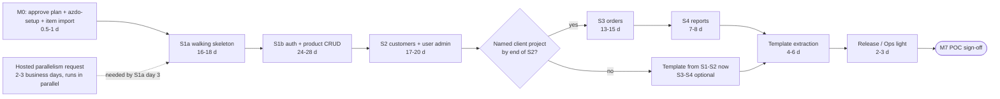

# Delivery plan: Orders API

| Field | Value |
|---|---|
| Date | 2026-10-27 |
| Status | Approved 2026-10-27 (decisions DL-D1..DL-D6, section 9) |
| Owner | Product owner / developer |
| Inputs | [summary](../00-summary.md) · [concept](../01-concept/concept.md) · [PRD](../02-requirements/prd.md) §5, §14-18 · [endpoint list](../02-requirements/endpoint-list.md) · user stories [01](../02-requirements/user-stories/01-auth-and-admin-users.md), [02](../02-requirements/user-stories/02-products-and-customers.md), [03](../02-requirements/user-stories/03-orders-reports-and-platform.md) · [pre-mortem](../02-requirements/pre-mortem.md) · [architecture](../04-architecture/architecture.md) §9 · [solution structure](../04-architecture/solution-structure.md) §8-14 · [architecture review](../04-architecture/architecture-review.md) · [threat model](../05-security/threat-model.md) · [test strategy](../07-quality/test-strategy.md) §5-6 |
| Tracker | Azure DevOps Boards (`azdo-setup` not yet run) |

## 1. Approach

### Options

| Option | Good | Bad |
|---|---|---|
| **A. Kanban with slice milestones** | Fits one person: no sprint ceremonies, WIP limit stops "mostly done" work (F1 warning sign), slices give demo points | Needs discipline on time-boxes, because there is no sprint end to force a check |
| B. Scrum, 2-week sprints | Regular demo rhythm; velocity chart | Planning, review and retro for one person are overhead. Slices do not fit 2-week boundaries |
| C. Scrumban (Kanban plus fixed 2-week reviews) | Regular check-ins | Adds a second cadence next to the slice ends |

**Recommendation: A.** Kanban, with one milestone per slice and a weekly self-review. The time-box and the cut rule do the job sprints would do.

### Board and WIP

| Column | Azure DevOps state (Agile) | WIP limit | Entry rule |
|---|---|---|---|
| Backlog | New | – | Created from this plan |
| Ready | New (board column) | 5 | Board DoR met (§6) |
| In progress | Active | **1** | Pull the top Ready item of the current slice |
| Review | Resolved | 2 | PR open; fresh-context agent review running or findings being fixed |
| Done | Closed | – | Board DoD met (§6) |

A swimlane called **Expedite** holds blocking Bugs: never-quarantine test failures and a broken `main`. They jump the queue. Spikes have their own time-box of 0.5 to 1 day. When the time-box runs out, stop and decide.

### Cadence

| When | What | Time |
|---|---|---|
| Start of day | Check the board, pull one item | 5 min |
| Weekly (fixed day) | Self-review: days used vs time-box, items Done, DoD %, suite time, quarantined tests, risk triggers (§4). Short written update to the product owner | 30 min |
| Slice start | Confirm the slice items are Ready; re-check cut candidates | 30 min |
| Slice end | Demo to the product owner: run the `.http` files, show the CI run, the authz matrix and the traceability report. Sign off the exit criteria. Retro-lite, then re-forecast the next slices from actual days per point | 60 min |

### Fresh-context agent reviews (P5)

| Trigger | Agent | Input | Output |
|---|---|---|---|
| Every PR (one story per PR) | `dotnet-code-reviewer`, new session | PR diff, story ACs, PRD §15 DoD checklist (not the chat history) | Summary pasted into the PR. No open High finding at merge |
| PR touches `Auth/`, `AdminUsers/`, `CustomersMe*/`, `Identity/`, `BuildingBlocks/Security/`, erasure or logging | `dotnet-security-reviewer` as well | Same, plus the threat-model rows for that area | Same |
| Slice exit S1a → S1b and S2 → S3 (the riskiest hand-overs) | `devils-advocate` (or the `pre-mortem` skill) | Slice outcome plus the next slice's items | Go / change list before the next slice starts |
| Medium or Low findings not fixed in the PR | – | – | New item tagged `review-finding` (a Bug if it is a defect) |

Review is a board column, so it counts against WIP. Keep PRs small so a review fits in one fresh context.

## 2. Roadmap and milestones

### Now / Next / Later

| Horizon | Scope | Outcome |
|---|---|---|
| **Now** (firm scope) | S1a walking skeleton, S1b auth and product CRUD | A secure, tested base: tokens, products, cache, CI, all platform conventions |
| **Next** (outcomes) | S2 customers, own-data rules and user admin; S3 orders | Customers safely manage their own data and orders. Stock never oversells |
| **Later** (outcomes) | S4 reports; template extraction; release and operations (light); stretch only if time-boxes held | The POC is feature-complete and reusable as a `dotnet new` template |

### Milestones (exit checks the product owner can see)

| # | Milestone | Exit check |
|---|---|---|
| M0 | Plan approved, board ready | Epics E1-E8 visible in Azure DevOps Boards; a pipeline can run (hosted parallelism available) |
| M1 | S1a done | Fresh clone → `docker compose up` → create and get a product with an audit row; pipeline green on `main` |
| M2 | S1b done | In the `.http` files: register → confirm → login → refresh → product CRUD; k6 run 1 recorded |
| M3 | S2 done | A customer manages their own profile and gets 404 on others (BOLA green); erasure leaves 0 PII; TemplateStrip green; **named client project decided** |
| M4 | S3 done | 20 parallel orders on stock 5 give exactly 5 successes, 20 loop runs in a row |
| M5 | S4 done (POC feature-complete) | Reports correct with deleted data present; NFR-01 met; ApiFiles stage green |
| M6 | Template v0.1 | `dotnet new` → template suites green; bootstrap trial measured |
| M7 | POC sign-off | Fresh clone ≤ 15 min; North Star 100% of endpoints at DoD |

### Estimation method

- Every item has a T-shirt size. Story Points: XS = 1, S = 2, M = 4, L = 8. **1 point ≈ 0.25 developer-day without agents.**
- Assumption: agents cut that to about **0.2 day per point** (factor 0.8). This is the least certain number in the plan. Recalibrate it at the S1a exit from actual days ÷ points, then re-forecast S1b to S4.
- Best = likely × 0.7. Worst = likely × 1.6, or × 1.8 for S1a and S1b, which carry the Docker, Windows, CI, Identity and token unknowns.
- **Time-box** = likely up to about likely + 15%.
- **Contingency:** no time buffer. Scope is the buffer: stretch (about 6 days, not planned), Should/Could (US-216, US-217, P-108) and the cut candidates per slice below. If the agent factor is worse than planned (> 0.3 day per point after S1a), the product owner reviews scope before S1b.

| Slice | Points | Best | Likely | Worst | **Time-box (working days)** | Early-warning cut (> 2 days over the upper bound) | Hard cut (2× the lower bound) |
|---|---|---|---|---|---|---|---|
| S1a | 80 | 11 | 16 | 29 | **16-18** | day 20 | day 32 |
| S1b | 122 | 17 | 24 | 43 | **24-28** | day 30 | day 48 |
| S2 | 87 | 12 | 17 | 27 | **17-20** | day 22 | day 34 |
| S3 | 66 | 9 | 13 | 21 | **13-15** | day 17 | day 26 |
| S4 | 34 | 5 | 7 | 11 | **7-8** | day 10 | day 14 |
| Template | 22 | 3 | 4.5 | 7 | **4-6** | day 8 | day 8 |
| Release/Ops light | 8 | 1 | 2 | 3 | **2-3** | day 5 | day 4 |
| **Total** | 419 | 58 | 83.5 | 141 | **83-98** | | |

**Cut rule (P6, pre-mortem, architecture review R-2).**
1. Stretch items are never pulled into a slice. They are built only after M6, and only if time is left.
2. More than 2 days over the time-box upper bound: drop that slice's Should/Could items and its listed cut candidates. Re-tag them `cut` and move them under E8.
3. 2× the time-box: apply the pre-mortem kill or pivot criteria. If S1 is not at 100% DoD, cut stretch and reduce S4 to one view plus one function. If there is no named client project by the end of S2, extract the template from S1-S2. If the suite is over 5 minutes at a slice end, add no new endpoints until it is back under.

Plan items are in §5 (P-xxx).

### S1a Walking skeleton (E1)

| Part | Content |
|---|---|
| Goal | Prove the whole chain on one thin slice: fresh clone → compose → product create/get with audit, cache and authz → CI green |
| Endpoints / stories | EP-23, EP-24, EP-56, EP-57 · US-101, US-102, US-218, US-219, US-291 |
| Enablers | Solution and root files (P-001), compose chain (P-002), resilience (P-019), test fixture (P-012), architecture rules A1-A5, A10, A11 (P-013), OpenAPI drift (P-014), CI (P-009 to P-011), docs (P-005, P-006) |
| Spikes | SP-1 compose on a fresh Windows clone · SP-2 Identity and audit in one transaction · SP-3 HybridCache with Valkey down · SP-4 `EFCore.NamingConventions` on EF Core 10 · SP-5 test-time checks (pause/unpause, global fake clock). At most 4 days in total |
| Security and tests | ST-01 matrix skeleton, ST-12 grant snapshot, ST-20 CI gates · follow-ups: compose hardening (P-003), DB roles, grants and timeouts (P-004), supply-chain gates (P-010) · resilience tests (503 < 5 s, 10 × 409 keep the breaker closed, forced transient retry) |
| Exit ([TS §6](../07-quality/test-strategy.md) S1a) | Pipeline green on `main`; first suite time recorded; each architecture rule seen failing once. Also: EP-23/24/56/57 at full DoD; fresh-clone `compose up` with 0 manual steps; spike results written into the ADRs |
| Time-box | **16-18 days.** 80 points of mostly one-off platform work. Checkpoints: day 5, EP-24 works through compose; day 8, EP-24 at full DoD on `main`. If day 8 is missed, the early-warning rule applies |
| Cut candidates | SP-5 folds into P-012; README stays minimal |

### S1b Auth and product CRUD (E2)

| Part | Content |
|---|---|
| Goal | Secure own-token auth and full product CRUD on the shared conventions. Token tests first |
| Endpoints / stories | EP-01 to EP-09, EP-22, EP-25 to EP-27 · US-001 to US-009, US-100, US-103 to US-105, US-290, US-292 |
| Enablers | JWT issuer and key ring (P-026), refresh store and the one stored procedure (P-027, satisfies P9), stamp check (P-028), password policy (P-029), enumeration defenses (P-030), seed Admin (P-031), fake email sender (P-032), observability (P-048) |
| Tests | A6-A9 (P-049), DoD meta-tests (P-050), traceability report (P-051), API files and Postman generation (P-052), **k6 run 1** (P-053), security review gate (P-054) |
| Security tests | ST-04, ST-05, ST-06 (partial), ST-07 (partial), ST-08, ST-09, ST-10, ST-11 (products), ST-14, ST-15, ST-16 (partial), ST-17 (confirm) |
| Exit (TS §6 S1b) | All S1 endpoints meet the DoD; suite ≤ 3 min; `.http` run passes locally; security review of `JwtTokenIssuer` and `RefreshTokenStore` with no open High; NFR-01 recorded |
| Time-box | **24-28 days.** The largest slice (122 points). The own token code is the top risk (T-09, R-Q2), and ST-08 timing tests are noisy. Order of work: P-026/027 → ST-04/05 → US-004/005 → the rest. Checkpoint day 12: P-026, P-027, US-004, US-005, ST-04 and ST-05 Done |
| Cut candidates (product owner approval) | Observability metrics beyond traceId logs and security-event IDs → S4; Aspire dashboard profile → later |

### S2 Customers, own-data rules and user admin (E3)

| Part | Content |
|---|---|
| Goal | Customer self-service with ownership rules, password recovery, Admin user management, erasure; prove the template strip early |
| Endpoints / stories | EP-10 to EP-19, EP-29 to EP-33, EP-35 to EP-37 · US-010 to US-019, US-107 to US-111, US-113 to US-115 |
| Enablers and pipeline | `OwnedBy(ICurrentUser)` helper (P-082), TemplateStrip stage (P-086), A12, A13 and C10 (P-087), weekly scheduled pipeline and Renovate (P-088) |
| Security tests | ST-02, ST-03, ST-13, ST-19 (new); extensions to ST-06, ST-07, ST-08, ST-14, ST-17 (P-093) |
| Exit (TS §6 S2) | DoD 100%; BOLA green; erasure finds 0 matches; TemplateStrip green. Plus the named-client-project decision (pre-mortem F2 kill criterion) |
| Time-box | **17-20 days.** 18 endpoints, but the patterns from S1 now exist. The hard parts are erasure (US-111, US-115), the last-Admin rules (US-014, US-017) and the strip job |
| Cut candidates | Renovate → Release/Ops. US-016, US-017, US-018 are kept on purpose (P10, brief); cutting them needs product-owner approval |

### S3 Orders (E4)

| Part | Content |
|---|---|
| Goal | Orders with line items, price snapshot, safe stock, status machine and the Pending cap |
| Endpoints / stories | EP-38 to EP-43, EP-45 to EP-48 · US-200 to US-205, US-207 to US-210 |
| Enablers | Order aggregate and status machine (P-094), stock locking and Pending cap (P-095) |
| Tests | Concurrency suite (P-106), sample-data seeder (P-107), optional Stryker run (P-108) |
| Security tests | ST-18 (new, lock wait); extensions to ST-02, ST-03, ST-15 (poisoned price), ST-16 (lines, Pending cap) (P-110) |
| Exit (TS §6 S3) | Concurrency tests pass 20 runs in a loop; suite ≤ 5 min; DoD 100% |
| Time-box | **13-15 days.** 66 points; the hardest domain logic; concurrency tests may need several loop runs |
| Cut candidates | US-203 (EP-41, Admin replaces items) → stretch, as the pre-mortem suggested; P-108 |

### S4 Reports and Dapper reads (E5)

| Part | Content |
|---|---|
| Goal | View, functions and Dapper reads with deleted data handled; final quality gates |
| Endpoints / stories | EP-50 to EP-55 · US-212 to US-217 (US-216 Could, US-217 Should) |
| Tests | **k6 run 2** with DB timeout tuning (P-117), ApiFiles stage (P-118), ST extensions to ST-09, ST-11, ST-16, ST-18, ST-19 (P-119) |
| Exit (TS §6 S4) | DoD 100%; NFR-01 met; NFR-02 recorded (Q-D4); ApiFiles green |
| Time-box | **7-8 days.** 34 points; SQL objects are already designed in the data model §4 |
| Cut order | US-216 → US-217 → sales `groupBy=week` → kill-criterion reduction to US-212 + US-213 only |

### Template extraction (E6) and Release/Operations light (E7)
- **Template:** 4-6 days; see §7.
- **Release/Ops light:** 2-3 days. Timed fresh-clone rebuild (NFR-15), release checklist and POC sign-off, light runbook, and a before-production register for the client project (threat model §7.2, retention §4.3).

## 3. Dependencies and critical path

One developer means the slices run one after another. Durations are working days. Day 1 is the next working day after approval.

Critical chains inside the slices:

| Slice | Chain |
|---|---|
| S1a | SP-1 → P-002 compose → P-012 fixture → P-018/P-020 audit + create → P-009 CI green |
| S1b | P-026 → P-027 → ST-04/ST-05 → US-004/US-005 → other auth stories → P-054 review gate |
| S2 | P-082 `OwnedBy` → US-113..115 → ST-02; US-111 → ST-13; P-086 TemplateStrip |
| S3 | P-094 → P-095 → US-200/US-207 → P-106 concurrency suite |

| Dependency | Type | Needed by | Owner |
|---|---|---|---|
| Azure DevOps organization and project, process = Agile, area paths (`azdo-setup`) | Tracker | Day 1 | Product owner |
| Repo hosting and branch policy on `main` (Q-D5) | Access | S1a day 3 (P-011) | Product owner |
| Azure Pipelines hosted parallelism. New organizations may need the free-grant request (2-3 business days). Free tier: 1 job, 1,800 min/month | Licence / approval | S1a day 3 (P-009) | Product owner. Submit on approval day |
| Docker Desktop on the Windows machine (licence terms by company size; Assumption) | Licence | Day 1 | Developer |
| Package versions marked **verify** (OTel instrumentation, TimeProvider.Testing, `nuget-license`, Aspire dashboard tag) | Data | S1a day 1 | Developer |
| Claude Code agent capacity (usage limits stopped agents twice already) | Tooling | Ongoing | Developer |
| Password blocklist file (permissive licence) | Data | S1b (P-029) | Developer |
| k6, httpyac, `openapi2postmanv2` installed locally | Tooling | S1b (P-052, P-053) | Developer |
| Named client project for the template (F2) | Decision | End of S2 | Product owner |
| Product-owner time for slice demos | People | Each slice end | Product owner |
| .NET 11 SDK GA (Assumption: November 2026) | External | Template (P-124) | Developer |

## 4. Risk register

L / I = likelihood / impact. "Dev" = developer; "PO" = product owner (possibly the same person).

| ID | Risk | L/I | Owner | Trigger | Response |
|---|---|---|---|---|---|
| F1 | Scope too big for one developer; motivation fades before orders | H/H | PO | Slice over its upper bound + 2 days; more than 3 items "mostly done"; S1a day 8 without EP-24 at DoD | Cut rule (§2); WIP 1; re-forecast at each slice end |
| F2 | Template never reused | H/H | PO | No named client project by end of S2 | Extract the template from S1-S2 right away; S3-S4 optional |
| F3 / A2 | Stock concurrency flaky; retries on retries | M/H | Dev | Concurrency test fails in the suite or in a loop | `FOR UPDATE` in product ID order, one retry layer (ADR-0007, ADR-0011); never quarantine; block merge |
| F5 / A3 | Identity saves outside the audit transaction | M/M | Dev | More than 2 workarounds; SP-2 fails | SP-2 in S1a week 1; one `IdentityDbContext`; `ChangeTracker.Clear()` per attempt |
| F6 | Reviews become self-graded or are skipped | H/M | Dev | PR merged without a reviewer summary | Branch policy; Review column; summary required in the DoD |
| F7 / A4 | FastEndpoints goes bugfix-only or 9.0 breaks APIs | M/M | Dev | No release for 3+ months, or a bugfix-only announcement | Pin 8.3.x; write the exit ADR; no new FastEndpoints-only features |
| F8 | Fresh clone needs manual steps | H/M | Dev | First fresh-clone run needs a README step | SP-1 on day 1; P-125 timed rebuild |
| F9 | Suite slow or flaky | M/M | Dev | > 3 min at end of S1; > 5 min at a slice end; > 3 quarantined tests | Time budgets (TS §5); stop new endpoints until back under |
| F10 / A1 | Cache adds little; invalidation fails while Valkey is down | M/L | Dev | Hit ratio < 50%; k6 run 1 shows no gain; SP-3 shows 5xx | Keep the pattern for the template and record the finding; short L2 TTL |
| F4 | Erasure misses PII | M/H | Dev | ST-13 finds a match | P1 PII-free audit; one PII marker list; fix before S2 exit |
| F11 | Special-case rules spread | M/M | PO | More than 2 "exception to…" ADRs | Customer restore stays stretch; challenge new exceptions at slice exit |
| A5 | Tables grow forever | L/M (POC) | PO | Before any production use | Before-production register (P-128) |
| A6 | DB grants drift | L/H | Dev | ST-12 snapshot differs | Grant snapshot test in CI from S1a |
| T-09 | Locked or demoted user keeps access | M/H | Dev | ST-06 row fails | Stamp check (P-028); never quarantine ST-06 |
| T-05 / T-01 | Password brute force (EP-09, login) | M/H | Dev | ST-07 or ST-09 fail | `auth-strict`, lockout, blocklist, 220k iterations (P-029) |
| T-29 / T-23 | Compose exposes API, DB or Valkey | M/H | Dev | Port published on `0.0.0.0`; Valkey without a password | P-003 in S1a |
| T-12 | BOLA regression | M/H | Dev | New `/me/{id}` route without an ST-02 case | ST-02 fails automatically; `OwnedBy` helper |
| T-34 | Supply-chain compromise spread by the template | M/H | Dev | Trivy or vulnerable-package finding | P-010 gates; Renovate; digest pins |
| T-30 | Development behaviour ships in the template | M/H | Dev | ST-10 or TemplateStrip fails | ST-10; TemplateStrip from S2 |
| T-02/03 | Enumeration by timing; the test is noisy on CI | M/M | Dev | ST-08 flaky | Loop locally; median threshold; weekly 30-call run (Q-D1) |
| T-15 | Admin compromise (no MFA) | M/H prod | PO | Before production | Before-production register; ST-19 events |
| D1 | CI minutes or parallelism not available (free tier 1,800 min/month) | M/M | PO | Grant not approved by S1a day 3; usage > 70% of minutes | Request on approval day; run TemplateStrip and the weekly jobs only on `main` or on a schedule; self-hosted agent as fallback |
| D2 | Key person: the developer is also PO, tester and ops | H/M | PO | Availability < 80% for 2 weeks | Track effort days, not calendar; re-forecast; product owner reviews dates |
| D3 | Claude usage limits or agent drift stall work | M/M | Dev | Agent run stopped twice in a week; reviewer misses known defects | Resume, don't restart; keep PRs small; weekly spot-check of a review against the DoD |
| D4 | Agent factor (0.2 day per point) is wrong | M/H | PO | S1a actual > 0.3 day per point | Re-forecast S1b to S4 at S1a exit; apply cut candidates early |
| D5 | Doc inconsistencies break the traceability gate | H/L | Dev | Traceability report errors | P-006 before build |

F12 (no CI) is closed by P-009 to P-011 and replaced by D1.

## 5. Backlog structure for Azure DevOps Boards

### Process template

| Option | Good | Bad |
|---|---|---|
| **Agile** | Epic → Feature → User Story → Task; separate Bug type; `Resolved` state maps to the Review column; Story Points field; familiar to client teams | One more state than needed |
| Scrum | Epic → Feature → PBI → Task; Bug; Effort field | States (Approved, Committed) and Impediments assume sprints |
| Basic | Simplest | No Feature level; no separate Bug type, so the flaky-test policy loses its type |

**Recommendation: Agile.** Our stories are already called US-xxx, the flaky-test policy needs the Bug type, and Feature is the natural home for areas inside a slice. Set "Working with bugs" to **managed with requirements**, so Bugs appear on the board and count toward WIP.

### Hierarchy

| Option | Good | Bad |
|---|---|---|
| **Epic per slice; Feature per area inside the slice** | Epic = milestone, with time-box and exit criteria; the cut rule works at Epic level; easy re-forecast | An area (for example Auth) appears in several Epics |
| Epic per area | Mirrors the code folders | Slices and time-boxes become hard to see; cutting is spread across Epics |

**Recommendation: Epic per slice.** Areas go in **area paths**:

`Demo-API\Platform`, `\Auth`, `\AdminUsers`, `\Products`, `\Customers`, `\Orders`, `\Reports`, `\Template`, `\Delivery`.

Platform, Auth, AdminUsers and Products are the parts the template keeps, so a query by area shows what the template inherits.

- **Iterations: none.** Kanban, one team, default iteration at the root. Slice views come from the Epic and the slice tag. Option B (one iteration per slice, no dates) is fine if the product owner wants iteration filters later.
- **Tasks:** none in the import. The developer adds Tasks only when a story needs them. The DoD checklist lives in the story description.
- **Plan ID:** put `Plan ID: P-xxx` (or E-x / F-x.y) as the first line of each description, so a re-run of the import does not create duplicates.

### Tag scheme

Separate tags with `;`. Assumption: hyphens are fine in Azure DevOps tags; `azdo-setup` checks this.

| Group | Tags |
|---|---|
| Slice | `S1a`, `S1b`, `S2`, `S3`, `S4`, `Template`, `RelOps`, `Stretch` |
| Trace | `US-xxx`, `EP-xx`, `ST-xx`; `FR-xxx` only when no story exists |
| Kind | `enabler`, `spike`, `security-followup`, `security-test`, `test-infra`, `ci`, `docs`, `perf`, `api-files`, `review`, `template` |
| Priority | `should`, `could`, `optional`, `stretch` (Must has no tag) |
| Later states | `cut` (moved by the cut rule), `review-finding`, `flaky`, `quarantine`, `blocking` |

### How the special work appears

| Work | Type and placement |
|---|---|
| Enablers (US-290/291/292 and others) | User Story tagged `enabler`, under the Feature of its slice |
| Spikes | User Story tagged `spike`; time-box in the title; result written into an ADR or note |
| Security follow-ups (threat model) | User Story tagged `security-followup` in S1a/S1b |
| ST-xx work | User Story tagged `security-test; ST-xx` in the slice where the test is first built. Later growth is grouped in one "extensions" item per slice, carrying all the ST tags. ST-01 matrix rows grow with every endpoint story's DoD |
| Test infrastructure, CI | User Story tagged `test-infra` or `ci` |
| Flaky tests | **Bug** titled `Flaky: <TestClass.Method>`, tags `flaky; quarantine; <slice>`, parent = the Feature of the test's area, repro = CI run link. Opened within 1 working day. **At most 3 open**: a 4th blocks new pulls. Close only after 20 green local loop runs. Never-quarantine tests (ST-01/02/04/05/06, concurrency, audit) get a Bug tagged `blocking` in the Expedite lane instead |
| Review findings not fixed in the PR | Bug (defect) or User Story, tagged `review-finding` |
| Cut items | Keep the item, add `cut`, re-parent under E8 / F8.1 |

### Source legend (paths relative to `docs/product/06-delivery/`)

| Code | Link |
|---|---|
| PRD | [../02-requirements/prd.md](../02-requirements/prd.md) |
| US1 | [../02-requirements/user-stories/01-auth-and-admin-users.md](../02-requirements/user-stories/01-auth-and-admin-users.md) |
| US2 | [../02-requirements/user-stories/02-products-and-customers.md](../02-requirements/user-stories/02-products-and-customers.md) |
| US3 | [../02-requirements/user-stories/03-orders-reports-and-platform.md](../02-requirements/user-stories/03-orders-reports-and-platform.md) |
| PM | [../02-requirements/pre-mortem.md](../02-requirements/pre-mortem.md) |
| SS | [../04-architecture/solution-structure.md](../04-architecture/solution-structure.md) |
| DM | [../04-architecture/data-model.md](../04-architecture/data-model.md) |
| AR | [../04-architecture/architecture-review.md](../04-architecture/architecture-review.md) |
| ADR-nnnn | `../04-architecture/adr/nnnn-*.md` |
| TM | [../05-security/threat-model.md](../05-security/threat-model.md) |
| TS | [../07-quality/test-strategy.md](../07-quality/test-strategy.md) |

### Complete item list

Sizes: XS = 1, S = 2, M = 4, L = 8 Story Points. The `Demo-API` area root is shortened to the leaf name.

| ID | Type | Title | Parent | Area | Tags | Slice | Size | Source |
|---|---|---|---|---|---|---|---|---|
| E1 | Epic | S1a Walking skeleton | – | Demo-API | S1a | S1a | – | SS §14; TS §6 |
| E2 | Epic | S1b Auth and product CRUD | – | Demo-API | S1b | S1b | – | SS §14; TS §6 |
| E3 | Epic | S2 Customers, own-data rules and user admin | – | Demo-API | S2 | S2 | – | PRD §5; TS §6 |
| E4 | Epic | S3 Orders, stock and statuses | – | Demo-API | S3 | S3 | – | PRD §5; TS §6 |
| E5 | Epic | S4 Reports and Dapper reads | – | Demo-API | S4 | S4 | – | PRD §5; TS §6 |
| E6 | Epic | Template extraction (P7) | – | Template | Template | Template | – | PRD §17 P7; SS §13 |
| E7 | Epic | Release and operations (light) | – | Delivery | RelOps | RelOps | – | 00-summary phases 10-11 |
| E8 | Epic | Stretch (cut first) | – | Demo-API | Stretch; stretch | Stretch | – | PRD §5 |
| F1.1 | Feature | Repo, solution and local run | E1 | Platform | S1a | S1a | – | SS §2-3, §10 |
| F1.2 | Feature | CI pipeline and supply-chain gates | E1 | Platform | S1a; ci | S1a | – | SS §11; TM §5 |
| F1.3 | Feature | Test and architecture foundations | E1 | Platform | S1a; test-infra | S1a | – | TS §2-3; SS §8-9 |
| F1.4 | Feature | Product create/get and health end to end | E1 | Products | S1a | S1a | – | SS §14 |
| F2.1 | Feature | Token and identity foundations | E2 | Auth | S1b | S1b | – | ADR-0008 |
| F2.2 | Feature | Auth endpoints | E2 | Auth | S1b | S1b | – | US1 |
| F2.3 | Feature | Product CRUD completion | E2 | Products | S1b | S1b | – | US2 |
| F2.4 | Feature | Platform conventions and observability | E2 | Platform | S1b | S1b | – | US3; ADR-0013 |
| F2.5 | Feature | DoD meta-tests, API files and performance run 1 | E2 | Platform | S1b; test-infra | S1b | – | TS §4, §7 |
| F2.6 | Feature | Security tests S1b | E2 | Platform | S1b; security-test | S1b | – | TS §2; TM §6 |
| F3.1 | Feature | Password recovery | E3 | Auth | S2 | S2 | – | US1 |
| F3.2 | Feature | Admin user and role management | E3 | AdminUsers | S2 | S2 | – | US1 |
| F3.3 | Feature | Customers (Admin) | E3 | Customers | S2 | S2 | – | US2 |
| F3.4 | Feature | Customer self-service (/me) | E3 | Customers | S2 | S2 | – | US2; ADR-0014 |
| F3.5 | Feature | Template strip check and pipeline upkeep | E3 | Template | S2; ci | S2 | – | SS §13; AR R-5 |
| F3.6 | Feature | Security tests S2 | E3 | Platform | S2; security-test | S2 | – | TS §2 |
| F4.1 | Feature | Order domain and stock locking | E4 | Orders | S3 | S3 | – | ADR-0007 |
| F4.2 | Feature | Orders (Admin) | E4 | Orders | S3 | S3 | – | US3 |
| F4.3 | Feature | Orders self-service (/me) | E4 | Orders | S3 | S3 | – | US3 |
| F4.4 | Feature | Order concurrency, load data and security tests | E4 | Orders | S3; test-infra | S3 | – | TS §2, §6 |
| F5.1 | Feature | Reports and audit-log query | E5 | Reports | S4 | S4 | – | US3; DM §4 |
| F5.2 | Feature | Final quality gates | E5 | Platform | S4 | S4 | – | TS §5-6 |
| F6.1 | Feature | dotnet new template and start guide | E6 | Template | Template; template | Template | – | SS §13 |
| F7.1 | Feature | Release and operations notes | E7 | Delivery | RelOps | RelOps | – | TM §7.2 |
| F8.1 | Feature | Stretch stories (cut first) | E8 | Demo-API | Stretch; stretch | Stretch | – | PRD §5 |
| P-001 | User Story | Enabler: Solution skeleton and root files (slnx, global.json, Directory.*.props, nuget.config source mapping, BannedSymbols, .gitattributes); verify flagged package versions | F1.1 | Platform | S1a; enabler | S1a | M | SS §2-3 |
| P-002 | User Story | Enabler: Compose chain secrets-init → postgres → migrator → api, Dockerfile api and migrator targets | F1.1 | Platform | S1a; enabler | S1a | M | SS §10; ADR-0012 |
| P-003 | User Story | Security follow-up: Compose hardening (localhost-only ports, Valkey ACL password, per-service secret mounts 0440, generated POSTGRES_PASSWORD, log rotation, dp-keys volume) | F1.1 | Platform | S1a; security-followup | S1a | S | TM Follow-up actions, §3 items 2-3 |
| P-004 | User Story | Security follow-up: DB roles, grants and timeouts (demoapi_migrator/demoapi_app, DELETE only on asp_net_user_roles, append-only audit_logs, statement/lock/idle timeouts, audit action CHECK incl. SessionsRevoked) | F1.1 | Platform | S1a; security-followup | S1a | M | TM Follow-up actions, §3 items 14-15; DM §5; ADR-0006 |
| P-005 | User Story | Docs: README quick start and CLAUDE.md (first version) | F1.1 | Platform | S1a; docs | S1a | XS | SS §12 |
| P-006 | User Story | Docs: Requirements cleanup before build (C7, C9; US-292 duplicate AC8/AC9 IDs; US-291 AC7 grant text; PRD §9 Q4 and concept §9 audit-redaction text) | F1.1 | Delivery | S1a; docs | S1a | S | AR C7, C9 |
| P-007 | User Story | Spike SP-1: Compose chain on a fresh Windows clone (time-box 1 day) | F1.1 | Platform | S1a; spike | S1a | S | AR §3; SS §14 |
| P-008 | User Story | Spike SP-4: EFCore.NamingConventions on EF Core 10, fallback own convention (time-box 0.5 day) | F1.1 | Platform | S1a; spike | S1a | XS | SS §3, §14 |
| P-009 | User Story | CI: Azure Pipelines Build and Test stages (locked restore, format check, warnings as errors, TRX, coverage and time-budget warnings) | F1.2 | Platform | S1a; ci | S1a | M | SS §11; TS §5 |
| P-010 | User Story | CI: Supply-chain gates (gitleaks full history, nuget-license, vulnerable packages, CycloneDX SBOM, Trivy image scan, digest pins, pinned ubuntu-24.04) | F1.2 | Platform | S1a; ci; security-followup; security-test; ST-20 | S1a | M | TM §5; TS §5 |
| P-011 | User Story | CI: Branch policy on main (PR + green build, no direct push) and work-item linking | F1.2 | Platform | S1a; ci | S1a | XS | TS §10 Q-D5 |
| P-012 | User Story | Test infra: Test projects and shared fixture (Testcontainers PostgreSQL 18.6 + Valkey 9.1.2, role script, migrator, Respawn, app role, ApiFactory, TestUsers, log capture, trait attributes) | F1.3 | Platform | S1a; test-infra | S1a | L | TS §3; SS §9 |
| P-013 | User Story | Test infra: Architecture rules A1-A5, A10, A11 and BannedApiAnalyzers (each seen failing once) | F1.3 | Platform | S1a; test-infra | S1a | S | SS §8 |
| P-014 | User Story | Test infra: OpenAPI setup (Scalar in Development only), committed openapi/v1.json and drift test | F1.3 | Platform | S1a; test-infra | S1a | S | SS §9; ADR-0002 |
| P-015 | User Story | ST-01 Authz matrix skeleton from EndpointDataSource (EP-23, EP-24, EP-56, EP-57; fails on unlisted endpoints) | F1.3 | Platform | S1a; security-test; ST-01 | S1a | S | TS §2; TM §6 |
| P-016 | User Story | ST-12 DB grant snapshot and role attributes | F1.3 | Platform | S1a; security-test; ST-12 | S1a | S | TS §2; TM §3 item 14 |
| P-017 | User Story | Spike SP-5: Test-time checks (Testcontainers pause/unpause; global FakeTimeProvider vs resilience delays) (time-box 0.5 day) | F1.3 | Platform | S1a; spike | S1a | S | TS §3, Assumptions |
| P-018 | User Story | US-291 Enabler: Soft delete, audit interceptor and no hard delete (AC10 completed in S1b) | F1.4 | Platform | S1a; enabler; US-291 | S1a | L | US3 |
| P-019 | User Story | Enabler: Resilience (single EF retry layer, ITransactionRunner with ChangeTracker.Clear, connection-level DB breaker, Valkey 250 ms; tests 503 < 5 s, 10 × 409 keep breaker closed, forced transient retry) | F1.4 | Platform | S1a; enabler | S1a | L | ADR-0011; AR R-1, R-3 |
| P-020 | User Story | US-102 Create a product | F1.4 | Products | S1a; US-102; EP-24 | S1a | M | US2 |
| P-021 | User Story | US-101 Get a product (HybridCache + Valkey L2) | F1.4 | Products | S1a; US-101; EP-23 | S1a | M | US2; ADR-0009 |
| P-022 | User Story | US-218 Liveness check | F1.4 | Platform | S1a; US-218; EP-56 | S1a | XS | US3 |
| P-023 | User Story | US-219 Readiness check | F1.4 | Platform | S1a; US-219; EP-57 | S1a | S | US3 |
| P-024 | User Story | Spike SP-2: Identity + audit interceptor in one transaction (forced rollback, ChangeTracker.Clear retry) (time-box 1 day) | F1.4 | Auth | S1a; spike | S1a | M | AR §3; PM F5 |
| P-025 | User Story | Spike SP-3: HybridCache with Valkey (L2) down (time-box 0.5 day) | F1.4 | Products | S1a; spike | S1a | S | AR §3; PM F10 |
| P-026 | User Story | Enabler: JWT issuer, key ring with kid and bearer validation (HS256 allow-list, typ at+jwt, iss/aud/exp, 30 s skew) | F2.1 | Auth | S1b; enabler | S1b | M | ADR-0008 |
| P-027 | User Story | Enabler: Refresh-token store (hash, rotation, family, 30-day cap, reuse revocation committed before 401) and revoke_refresh_tokens procedure (P9) | F2.1 | Auth | S1b; enabler | S1b | L | ADR-0008; DM §4.2 #7 |
| P-028 | User Story | Enabler: Per-request security-stamp check (sst claim, 30 s in-process cache, fails closed) | F2.1 | Auth | S1b; enabler | S1b | M | PRD §18 S-D1; TM §3 R1 |
| P-029 | User Story | Enabler: Password policy (15-128, local blocklist, PBKDF2 220,000 iterations, rehash on login) | F2.1 | Auth | S1b; enabler; FR-003 | S1b | S | PRD FR-003; TM T-01 |
| P-030 | User Story | Enabler: Enumeration defenses (equal work, response floor, password checked before confirmed/locked) | F2.1 | Auth | S1b; enabler | S1b | M | PRD §18 S-D6; TM §3 SEC-3 |
| P-031 | User Story | Enabler: Seed Admin at startup from configuration (no user story exists) | F2.1 | Auth | S1b; enabler; FR-021 | S1b | S | PRD FR-021 |
| P-032 | User Story | Enabler: Fake email sender with configured link base URL | F2.1 | Auth | S1b; enabler; FR-020 | S1b | XS | PRD FR-020 |
| P-033 | User Story | US-001 Register as a customer | F2.2 | Auth | S1b; US-001; EP-01 | S1b | L | US1 |
| P-034 | User Story | US-002 Confirm email | F2.2 | Auth | S1b; US-002; EP-02 | S1b | S | US1 |
| P-035 | User Story | US-003 Resend confirmation link | F2.2 | Auth | S1b; US-003; EP-03 | S1b | S | US1 |
| P-036 | User Story | US-004 Log in | F2.2 | Auth | S1b; US-004; EP-04 | S1b | M | US1 |
| P-037 | User Story | US-005 Refresh tokens with rotation and reuse detection | F2.2 | Auth | S1b; US-005; EP-05 | S1b | M | US1 |
| P-038 | User Story | US-006 Log out one session | F2.2 | Auth | S1b; US-006; EP-06 | S1b | S | US1 |
| P-039 | User Story | US-007 Log out all sessions | F2.2 | Auth | S1b; US-007; EP-07 | S1b | S | US1 |
| P-040 | User Story | US-008 Get current user | F2.2 | Auth | S1b; US-008; EP-08 | S1b | XS | US1 |
| P-041 | User Story | US-009 Change own password | F2.2 | Auth | S1b; US-009; EP-09 | S1b | M | US1 |
| P-042 | User Story | US-100 List products | F2.3 | Products | S1b; US-100; EP-22 | S1b | M | US2 |
| P-043 | User Story | US-103 Update a product | F2.3 | Products | S1b; US-103; EP-25 | S1b | M | US2 |
| P-044 | User Story | US-104 Soft delete a product | F2.3 | Products | S1b; US-104; EP-26 | S1b | S | US2 |
| P-045 | User Story | US-105 Restore a product | F2.3 | Products | S1b; US-105; EP-27 | S1b | S | US2 |
| P-046 | User Story | US-290 Enabler: Paging, sorting, filtering and ProblemDetails convention | F2.4 | Platform | S1b; enabler; US-290 | S1b | M | US3 |
| P-047 | User Story | US-292 Enabler: Rate limiting, security headers and CORS (reports concurrency checked in S4) | F2.4 | Platform | S1b; enabler; US-292 | S1b | M | US3; ADR-0010 |
| P-048 | User Story | Enabler: Observability (OTel traces and metrics, logs with traceId, email masking, query strings out of logs, security-event IDs, Aspire dashboard profile) | F2.4 | Platform | S1b; enabler; security-followup | S1b | M | ADR-0013; TM §4.4, T-26, T-28 |
| P-049 | User Story | Test infra: Architecture rules A6-A9 incl. EndpointDoDTests | F2.5 | Platform | S1b; test-infra | S1b | M | SS §8 |
| P-050 | User Story | Test infra: AuditCoverageTests, EndpointPolicyTests and ApiFilesCoverageTests | F2.5 | Platform | S1b; test-infra | S1b | M | TS §4 |
| P-051 | User Story | Test infra: Traceability report (AC IDs vs test tags, CI artifact, 0 uncovered Must ACs per slice) | F2.5 | Platform | S1b; test-infra | S1b | S | TS §7 |
| P-052 | User Story | API files: .http structure per feature and Postman collection generated from OpenAPI (environments without secrets) | F2.5 | Platform | S1b; api-files | S1b | S | SS §9; AR R-4 |
| P-053 | User Story | Perf: k6 run 1 (NFR-01 cached, uncached, Valkey down) recorded in 07-quality/perf-results.md | F2.5 | Platform | S1b; perf | S1b | S | TS §2 |
| P-054 | User Story | Review gate: Fresh-context security review of JwtTokenIssuer and RefreshTokenStore (no open High) | F2.5 | Auth | S1b; review | S1b | S | TS §6 |
| P-055 | User Story | ST-04 JWT negative tests | F2.6 | Auth | S1b; security-test; ST-04 | S1b | S | TS §2; TM §6 |
| P-056 | User Story | ST-05 Refresh tests (rotation, reuse commits before 401, parallel race, 30-day cap) | F2.6 | Auth | S1b; security-test; ST-05 | S1b | S | TS §2, §7 |
| P-057 | User Story | ST-06 Security-stamp tests (password change, logout-all) | F2.6 | Auth | S1b; security-test; ST-06 | S1b | S | TS §2 |
| P-058 | User Story | ST-07 Lockout tests (5 failures, EP-09 counts, automatic lockout keeps sessions) | F2.6 | Auth | S1b; security-test; ST-07 | S1b | S | TS §2 |
| P-059 | User Story | ST-08 Enumeration tests (same status, body, headers; timing floor; 10 calls per path) | F2.6 | Auth | S1b; security-test; ST-08 | S1b | M | TS §2; Q-D1 |
| P-060 | User Story | ST-09 Rate-limit tests (each policy, shared auth-strict bucket, 429 before 401, X-Forwarded-For ignored; verify TestServer client IP) | F2.6 | Platform | S1b; security-test; ST-09 | S1b | M | TS §2-3 |
| P-061 | User Story | ST-10 Production-environment tests (headers, HSTS, CORS, /scalar and /openapi 404, no stack trace) | F2.6 | Platform | S1b; security-test; ST-10 | S1b | S | TS §2 |
| P-062 | User Story | ST-11 Injection tests for products sort and search | F2.6 | Products | S1b; security-test; ST-11 | S1b | S | TS §2 |
| P-063 | User Story | ST-14 Log hygiene tests (no password, JWT, refresh token, unmasked email) | F2.6 | Platform | S1b; security-test; ST-14 | S1b | S | TS §2 |
| P-064 | User Story | ST-15 Cache tests (scope by role, includeDeleted bypass, search lists not cached) | F2.6 | Products | S1b; security-test; ST-15 | S1b | S | TS §2 |
| P-065 | User Story | ST-16 Limits tests (413/415, pageSize, 1024-char password) | F2.6 | Platform | S1b; security-test; ST-16 | S1b | S | TS §2 |
| P-066 | User Story | ST-17 Confirm-token lifetime (24 h) and key-ring restart tests | F2.6 | Auth | S1b; security-test; ST-17 | S1b | S | TS §2 |
| P-067 | User Story | US-010 Request a password reset | F3.1 | Auth | S2; US-010; EP-10 | S2 | S | US1 |
| P-068 | User Story | US-011 Reset password with a token | F3.1 | Auth | S2; US-011; EP-11 | S2 | M | US1 |
| P-069 | User Story | US-012 List users | F3.2 | AdminUsers | S2; US-012; EP-12 | S2 | M | US1 |
| P-070 | User Story | US-013 Get a user | F3.2 | AdminUsers | S2; US-013; EP-13 | S2 | S | US1 |
| P-071 | User Story | US-014 Lock a user | F3.2 | AdminUsers | S2; US-014; EP-14 | S2 | M | US1 |
| P-072 | User Story | US-015 Unlock a user | F3.2 | AdminUsers | S2; US-015; EP-15 | S2 | S | US1 |
| P-073 | User Story | US-016 Assign the Admin role | F3.2 | AdminUsers | S2; US-016; EP-16 | S2 | S | US1 |
| P-074 | User Story | US-017 Remove the Admin role | F3.2 | AdminUsers | S2; US-017; EP-17 | S2 | M | US1 |
| P-075 | User Story | US-018 List roles | F3.2 | AdminUsers | S2; US-018; EP-18 | S2 | XS | US1 |
| P-076 | User Story | US-019 Create an Admin user | F3.2 | AdminUsers | S2; US-019; EP-19 | S2 | M | US1 |
| P-077 | User Story | US-107 Admin creates a customer | F3.3 | Customers | S2; US-107; EP-29 | S2 | M | US2 |
| P-078 | User Story | US-108 List customers | F3.3 | Customers | S2; US-108; EP-30 | S2 | M | US2 |
| P-079 | User Story | US-109 Get a customer | F3.3 | Customers | S2; US-109; EP-31 | S2 | S | US2 |
| P-080 | User Story | US-110 Update a customer | F3.3 | Customers | S2; US-110; EP-32 | S2 | S | US2 |
| P-081 | User Story | US-111 Delete and anonymize a customer | F3.3 | Customers | S2; US-111; EP-33 | S2 | L | US2 |
| P-082 | User Story | Enabler: OwnedBy(ICurrentUser) helper and /me pattern | F3.4 | Customers | S2; enabler | S2 | S | ADR-0014; TM T-12 |
| P-083 | User Story | US-113 Read own profile | F3.4 | Customers | S2; US-113; EP-35 | S2 | S | US2 |
| P-084 | User Story | US-114 Update own profile | F3.4 | Customers | S2; US-114; EP-36 | S2 | S | US2 |
| P-085 | User Story | US-115 Erase own account | F3.4 | Customers | S2; US-115; EP-37 | S2 | M | US2 |
| P-086 | User Story | CI: TemplateStrip stage (delete sample-domain folders, apply Customer-leak edits, build and test the copy) | F3.5 | Template | S2; ci; template | S2 | L | SS §11, §13; AR R-5 |
| P-087 | User Story | Test infra: Architecture rules A12, A13 and C10 test (Admin get of a deleted customer incl. email) | F3.5 | Platform | S2; test-infra | S2 | S | SS §8; AR C10 |
| P-088 | User Story | CI: Weekly scheduled pipeline (ST-08 at 30 calls per path) and Renovate updates | F3.5 | Platform | S2; ci; ST-08 | S2 | S | TS §5; TM §5 |
| P-089 | User Story | ST-02 BOLA tests for /me routes (EP-35 to EP-37; fails on an uncovered /me/{id} route) | F3.6 | Customers | S2; security-test; ST-02 | S2 | S | TS §2 |
| P-090 | User Story | ST-03 Mass-assignment tests and per-role DTO snapshots | F3.6 | Platform | S2; security-test; ST-03 | S2 | M | TS §2 |
| P-091 | User Story | ST-13 Erasure test (every PII field, all tables, captured logs, Valkey keys → 0 matches) | F3.6 | Customers | S2; security-test; ST-13 | S2 | M | TS §2; TM §4.2 |
| P-092 | User Story | ST-19 Security-event tests (role assign, Admin create, lockout, refresh reuse) | F3.6 | Platform | S2; security-test; ST-19 | S2 | S | TS §2 |
| P-093 | User Story | Security tests S2 extensions: ST-06 (lock, role remove, erase), ST-07 (EP-37, reset), ST-08 (forgot), ST-14 (PII), ST-17 (reset 1 h, single use) | F3.6 | Platform | S2; security-test; ST-06; ST-07; ST-08; ST-14; ST-17 | S2 | M | TS §2, §6 |
| P-094 | User Story | Enabler: Order aggregate, line items, status machine, OrderStatusHistory and Touch() for ETags | F4.1 | Orders | S3; enabler | S3 | M | ADR-0007; SS §6 |
| P-095 | User Story | Enabler: Stock locking with SELECT … FOR UPDATE in product ID order inside ITransactionRunner, and the Pending-order cap | F4.1 | Orders | S3; enabler; FR-084; FR-096 | S3 | M | ADR-0007; PRD FR-084, FR-096 |
| P-096 | User Story | US-200 Admin creates an order for a customer | F4.2 | Orders | S3; US-200; EP-38 | S3 | L | US3 |
| P-097 | User Story | US-201 Admin lists orders | F4.2 | Orders | S3; US-201; EP-39 | S3 | M | US3 |
| P-098 | User Story | US-202 Admin gets an order with items and history | F4.2 | Orders | S3; US-202; EP-40 | S3 | S | US3 |
| P-099 | User Story | US-203 Admin replaces items of a Pending order (first cut candidate in S3) | F4.2 | Orders | S3; US-203; EP-41 | S3 | L | US3; PM §2 |
| P-100 | User Story | US-204 Admin moves an order to the next status | F4.2 | Orders | S3; US-204; EP-42 | S3 | M | US3 |
| P-101 | User Story | US-205 Admin cancels an order | F4.2 | Orders | S3; US-205; EP-43 | S3 | M | US3 |
| P-102 | User Story | US-207 Customer places an own order | F4.3 | Orders | S3; US-207; EP-45 | S3 | M | US3 |
| P-103 | User Story | US-208 Customer lists own orders | F4.3 | Orders | S3; US-208; EP-46 | S3 | S | US3 |
| P-104 | User Story | US-209 Customer gets an own order | F4.3 | Orders | S3; US-209; EP-47 | S3 | S | US3 |
| P-105 | User Story | US-210 Customer cancels an own Pending order | F4.3 | Orders | S3; US-210; EP-48 | S3 | S | US3 |
| P-106 | User Story | Test: Concurrency suite (about 9 scenarios; 20 local loop runs before merge) | F4.4 | Orders | S3; test-infra | S3 | L | TS §2 |
| P-107 | User Story | Test data: Sample-data seeder (1,000 products, 1,000 customers, 10,000 orders) for k6 | F4.4 | Orders | S3; perf | S3 | S | TS §3 |
| P-108 | User Story | Optional: Stryker.NET one-off mutation run on Domain (skip if xUnit v3 is not supported) | F4.4 | Orders | S3; test-infra; optional | S3 | S | TS §10 Q-D3 |
| P-109 | User Story | ST-18 Timeout tests (lock wait ends within budget) | F4.4 | Orders | S3; security-test; ST-18 | S3 | S | TS §2 |
| P-110 | User Story | Security tests S3 extensions: ST-02 (EP-47, EP-48), ST-03 (customerId, status, unitPrice), ST-15 (poisoned Valkey price ignored), ST-16 (lines, quantity, Pending cap) | F4.4 | Orders | S3; security-test; ST-02; ST-03; ST-15; ST-16 | S3 | M | TS §2, §6 |
| P-111 | User Story | US-212 Order summary report (view) | F5.1 | Reports | S4; US-212; EP-50 | S4 | M | US3; DM §4.2 #1 |
| P-112 | User Story | US-213 Customer order history (function) | F5.1 | Reports | S4; US-213; EP-51 | S4 | M | US3; DM §4.2 #2 |
| P-113 | User Story | US-214 Sales report by date range | F5.1 | Reports | S4; US-214; EP-52 | S4 | L | US3; DM §4.2 #3 |
| P-114 | User Story | US-215 Low-stock report | F5.1 | Reports | S4; US-215; EP-53 | S4 | S | US3; DM §4.2 #4 |
| P-115 | User Story | US-216 Top products report | F5.1 | Reports | S4; US-216; EP-54; could | S4 | S | US3; DM §4.2 #5 |
| P-116 | User Story | US-217 Query the audit log | F5.1 | Reports | S4; US-217; EP-55; should | S4 | M | US3; DM §4.2 #6 |
| P-117 | User Story | Perf: k6 run 2 (NFR-01 + NFR-02) and DB timeout and report-concurrency tuning | F5.2 | Platform | S4; perf | S4 | M | TS §2; TM §3 item 15 |
| P-118 | User Story | CI: ApiFiles stage (httpyac .http run and generated Postman collection against a running API) | F5.2 | Platform | S4; ci; api-files | S4 | S | SS §11; TS §5 |
| P-119 | User Story | Security tests S4 extensions: ST-09 (reports concurrency 429), ST-11 (Dapper SQL architecture rule), ST-16 (report range), ST-18 (slow query), ST-19 (audit-log query) | F5.2 | Reports | S4; security-test; ST-09; ST-11; ST-16; ST-18; ST-19 | S4 | M | TS §2, §6 |
| P-120 | User Story | Template: dotnet new package (template.json, sourceName DemoApi, kept parts per strip path, single Initial migration) | F6.1 | Template | Template; template | Template | L | SS §13; PRD §17 P7 |
| P-121 | User Story | Template: "Start a new API" guide (strip steps, Customer leaks, option to merge Domain + Application) | F6.1 | Template | Template; template; docs | Template | M | SS §13, §15 |
| P-122 | User Story | Template: Template suites green from dotnet new; TemplateStrip job switched to dotnet new install | F6.1 | Template | Template; template; ci | Template | M | TS §6 |
| P-123 | User Story | Template: Bootstrap trial and "hours to bootstrap" baseline | F6.1 | Template | Template; template | Template | M | PRD §17 P7; PM F2 |
| P-124 | User Story | Spike SP-6: .NET 11 compatibility check (build and tests on the .NET 11 SDK, no retarget) | F6.1 | Template | Template; spike | Template | S | PM §5 |
| P-125 | User Story | Release: Fresh-clone rebuild timed (≤ 15 min, 0 manual steps) and final README | F7.1 | Delivery | RelOps | RelOps | S | PRD NFR-15; SS §12 |
| P-126 | User Story | Release: Release checklist and POC sign-off (North Star 100%, test-strategy §6 minimums) | F7.1 | Delivery | RelOps; review | RelOps | S | TS §6; PRD §15 |
| P-127 | User Story | Ops: Light runbook (health, logs, regenerating dev secrets, HS256 key rotation) | F7.1 | Delivery | RelOps; docs | RelOps | S | TM §3 item 1; ADR-0013 |
| P-128 | User Story | Docs: Before-production register (threat model §7.2 items 1-12, retention plan §4.3) for the client project | F7.1 | Delivery | RelOps; docs; security-followup | RelOps | S | TM §7.2, §4.3; ARCH §9 A5 |
| P-129 | User Story | US-020 Revoke a user's sessions | F8.1 | AdminUsers | Stretch; stretch; could; US-020; EP-20 | Stretch | S | US1 |
| P-130 | User Story | US-021 Send a password-reset link for a user | F8.1 | AdminUsers | Stretch; stretch; could; US-021; EP-21 | Stretch | S | US1 |
| P-131 | User Story | US-106 Adjust product stock | F8.1 | Products | Stretch; stretch; could; US-106; EP-28 | Stretch | M | US2 |
| P-132 | User Story | US-112 Restore a customer (incl. restored-customer lock type and email change, D14) | F8.1 | Customers | Stretch; stretch; could; US-112; EP-34 | Stretch | L | US2; PRD §17 P2 |
| P-133 | User Story | US-206 Admin soft deletes a Cancelled order | F8.1 | Orders | Stretch; stretch; could; US-206; EP-44 | Stretch | S | US3 |
| P-134 | User Story | US-211 Customer edits items of an own Pending order | F8.1 | Orders | Stretch; stretch; could; US-211; EP-49 | Stretch | L | US3 |
| P-135 | User Story | Idempotency-Key on order create (no user story exists) | F8.1 | Orders | Stretch; stretch; could; FR-095 | Stretch | M | PRD FR-095 |

### Totals

| Type | Count |
|---|---|
| Epic | 8 |
| Feature | 25 |
| User Story | 135 (128 core + 7 stretch) |
| Task | 0 (added on demand) |
| Bug | 0 (created by the flaky-test and review rules) |
| **Total** | **168** |

| User Story breakdown | Count |
|---|---|
| US-xxx stories (54 in S1-S4, 6 stretch) | 60 |
| Enablers without a US ID | 14 |
| Security follow-ups (P-003, P-004; P-010, P-048 and P-128 also tagged) | 2 |
| CI / pipeline | 6 |
| Test infrastructure | 9 |
| Security-test (ST) items | 22 |
| Spikes | 6 |
| Perf and API files | 4 |
| Review gate | 1 |
| Docs | 2 |
| Template | 4 |
| Release / Ops | 4 |
| Stretch without a story (FR-095) | 1 |
| **Total** | **135** |

| Slice | Stories | Points |
|---|---|---|
| S1a | 25 | 80 |
| S1b | 41 | 122 |
| S2 | 27 | 87 |
| S3 | 17 | 66 |
| S4 | 9 | 34 |
| Template | 5 | 22 |
| RelOps | 4 | 8 |
| Stretch | 7 | 30 |

Suggested shared queries: "Current slice (tag)", "Quarantined tests (≤ 3)", "Open review findings", "Cut items".

## 6. Definition of Ready and Done on the board

The PRD [§14 DoR](../02-requirements/prd.md) and [§15 DoD](../02-requirements/prd.md) apply. These rules are board-specific only.

**Ready (Backlog → Ready)**
- Parent Feature, area path, Story Points and the full tag set (slice + kind + trace IDs) are set.
- The description starts with `Plan ID: P-xxx` and links the source document.
- Dependencies in §3 for this item are met.
- Spikes state the question, the time-box and where the answer is recorded (ADR or note).

**Done (Review → Done)**
- PR linked to the item (`AB#<id>`) and merged through the branch policy; CI green on `main`.
- The fresh-context reviewer summary is in the PR (security reviewer too, for the paths in §1); no open High finding. Unfixed findings are new items tagged `review-finding`.
- From S1b on, the CI traceability artifact shows the story's ACs as covered.
- Any quarantine Bug raised for this work is linked.
- **Feature Done:** all children are Closed, or tagged `cut` and moved to E8.
- **Epic Done:** the [test-strategy §6](../07-quality/test-strategy.md) minimum is met, the demo is held, and actual days vs the time-box are written in the Epic description.

## 7. Template extraction plan (P7)

| Topic | Plan |
|---|---|
| When | Early proof: the TemplateStrip CI stage at the end of S2 (P-086). Extraction: after S4 (E6). If there is no named client project by the end of S2, extraction moves to right after S2 and S3-S4 become optional |
| Contents | SharedKernel, BuildingBlocks, Auth, AdminUsers, Products (sample slice), health, all test infrastructure and suites, compose, `azure-pipelines.yml`, README, CLAUDE.md, ADRs. Removed: Customers, CustomersMe, Orders, CustomersMeOrders, Reports, AuditLogs query, plus the 6 Customer leaks ([SS §13](../04-architecture/solution-structure.md)). Migrations collapsed into one `Initial` migration |
| Package | `.template.config/template.json`, `sourceName: DemoApi`. Assumption: one option to leave out the Products sample. Version `0.1.0`. Where it is published is an open question (§8 Q4) |
| TemplateStrip job | From S2: copy the repo, delete the sample-domain folders, apply the leak edits, build, then run unit, architecture and integration tests on the copy. Runs on pushes to `main` (not on every PR) to save CI minutes. After extraction: `dotnet new install ./` → `dotnet new demoapi -n Probe` → build and test |
| Guide | "Start a new API": install, create, rename roles, add the first feature with the DoD checklist, when to merge Domain + Application for small apps |
| Metric: hours to bootstrap | Time from `dotnet new` to a new API with one own-domain CRUD endpoint at full DoD, CI green and `compose up` working. Measured in a dry run (P-123), then on the named client project. Target (Assumption): ≤ 8 hours. Baseline: the product owner's estimate for the last client project's setup |

## 8. Questions for the product owner

| # | Question | Recommendation |
|---|---|---|
| Q1 | Is the developer full-time on this? | Plan in effort days, as here. If availability is under 80%, track calendar time separately and re-forecast weekly |
| Q2 | Approve the time-boxes (83-98 days in total) and the two-level cut rule (early warning at upper bound + 2 days; hard cut at 2× the time-box)? | **Yes.** Recalibrate the agent factor at the S1a exit |
| Q3 | Agile process, Epic per slice, no iterations (Kanban)? | **Yes.** Bugs managed with requirements |
| Q4 | Which client project will reuse the template, and where is the template published (local nupkg, Azure Artifacts feed)? | Name the project before S2 starts. Use an Azure Artifacts feed if the client project uses Azure DevOps |
| Q5 | Is the repo in Azure Repos or GitHub? Can the hosted-parallelism request be sent today? | **Azure Repos** (native branch policies and `AB#` links). Send the request on approval day |

## 9. Delivery decisions (approved 2026-10-27)

| ID | Decision |
|---|---|
| DL-D1 | Plan in effort days, assuming one developer full-time; if availability drops below 80%, track calendar time and re-forecast weekly |
| DL-D2 | Time-boxes 83-98 working days and the two-level cut rule approved; agent factor recalibrated at the S1a exit |
| DL-D3 | Azure DevOps Agile process, Epic per slice, area paths per area, no iterations (Kanban), bugs managed with requirements |
| DL-D4 | Client project named before S2 starts; template published to an Azure Artifacts feed if that project uses Azure DevOps |
| DL-D5 | Code in Azure Repos (branch policies, `AB#` links); free hosted-parallelism request sent on approval day |
| DL-D6 | No extra devils-advocate pass on this plan; the S1a-exit recalibration covers the estimate risk. Doc issues (P-006) fixed on 2026-10-27: US-292 AC10/AC11 renumbered, US-291 AC7 DELETE grant, PRD §9 Q4 and concept audit-redaction text |

## Assumptions
- Assumption: one developer at 100% availability; the product owner is available for a 60-minute demo at each slice end.
- Assumption: agents bring the effort to about 0.2 day per Story Point. Not yet measured.
- Assumption: Azure DevOps tags accept hyphens; the free parallelism grant is approved within 2-3 business days.
- Assumption: Docker Desktop licence terms are met for this organization.
- Assumption: .NET 11 reaches GA around November 2026.
- Assumption: the threat-model follow-ups for ADR-0008, ADR-0014 and the PRD are done (the ADR files and PRD §18 exist). The compose, data-model and pipeline follow-ups are planned in S1a (P-003, P-004, P-010).

## Open questions
- [ ] Baseline for "hours to bootstrap" from the last client project.
- [ ] Security owner and compliance needs of the named client project (from the summary).

## Next step
1. Stress-test this plan with `devils-advocate` (or the `pre-mortem` skill), focusing on the S1b size and the agent factor.
2. After approval, `azdo-boards-manager` runs `azdo-setup` (Agile process, area paths, board columns, bug setting) and then `azdo-plan-to-work-items`, using §5 as the preview.

## Sources
- [Microsoft Learn: About default processes and process templates](https://learn.microsoft.com/en-us/azure/devops/boards/work-items/guidance/choose-process)
- [Microsoft Learn: Configure and pay for parallel jobs (free grant, request form)](https://learn.microsoft.com/en-us/azure/devops/pipelines/licensing/concurrent-jobs?view=azure-devops)
- [Microsoft Learn: Azure Pipelines overview (free tier 1,800 min/month)](https://learn.microsoft.com/azure/devops/pipelines/overview)
