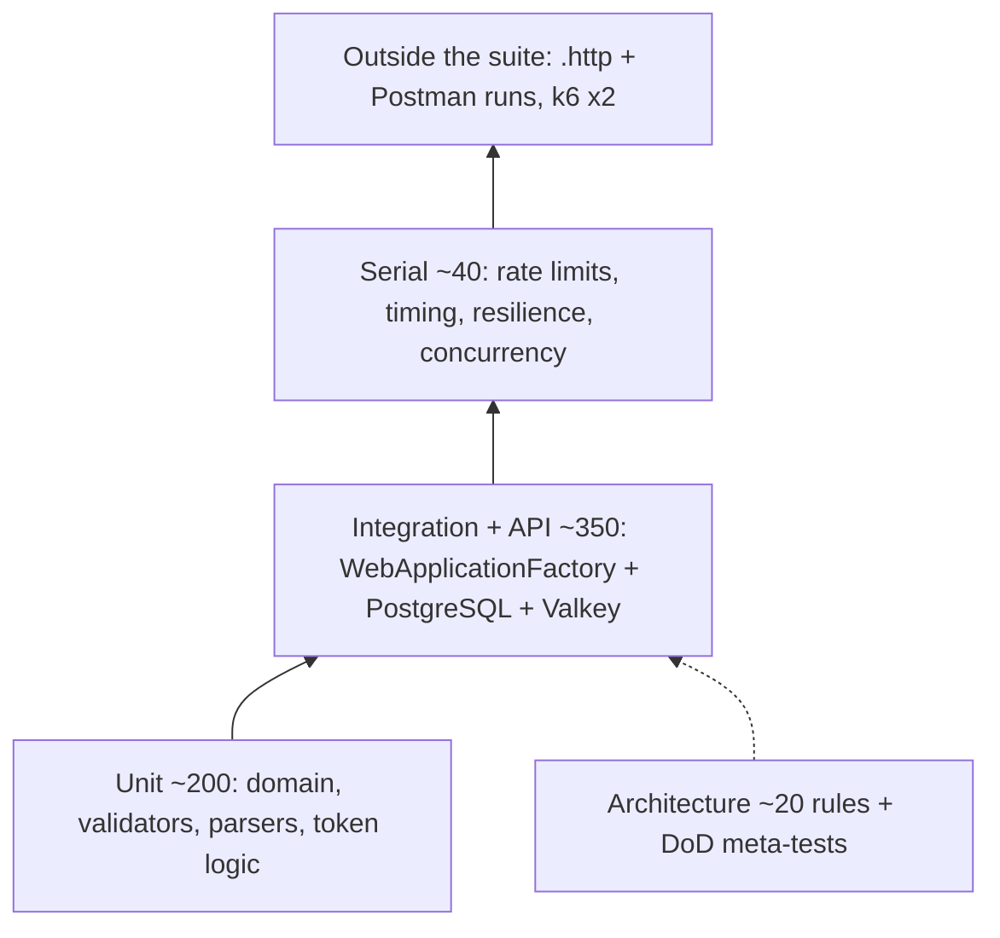

# Test strategy: Orders API

| Field | Value |
|---|---|
| Date | 2026-10-27 |
| Status | Approved 2026-10-27 (decisions Q-D1..Q-D6, section 10) |
| Owner | Product owner / developer (one developer with Claude) |
| Inputs | [PRD](../02-requirements/prd.md) §7, §15-18 · [permission matrix](../02-requirements/permission-matrix.md) · [user stories](../02-requirements/user-stories/) · [pre-mortem](../02-requirements/pre-mortem.md) · [architecture](../04-architecture/architecture.md) · [solution structure](../04-architecture/solution-structure.md) §8, §9, §11, §14 · [data model](../04-architecture/data-model.md) · [endpoint catalog](../04-architecture/endpoint-catalog.md) · [architecture review](../04-architecture/architecture-review.md) · ADR [0006](../04-architecture/adr/0006-soft-delete-audit-and-no-delete-role.md), [0007](../04-architecture/adr/0007-stock-concurrency-and-etags.md), [0008](../04-architecture/adr/0008-jwt-and-refresh-tokens.md), [0010](../04-architecture/adr/0010-rate-limiting.md), [0011](../04-architecture/adr/0011-resilience.md), [0014](../04-architecture/adr/0014-authorization-model.md) · [threat model](../05-security/threat-model.md) §6 |

Scope: 51 core endpoints (stretch endpoints are tested only when built), local Docker, Azure Pipelines. Out of scope: UI, accessibility, visual regression, design QA (no UI, NFR-21), contract tests with Pact (one team owns both sides), DAST (planned before production, threat model §7.2 item 11), UAT (no client users this phase).

## 1. Quality goals and the risks that drive testing

Goals: G1 100% authz and BOLA tests · G4 100% of writes audited, no hard delete · NFR-16 suite ≤ 5 min · NFR-17 architecture rules at 100% · North Star: 100% of the slice's endpoints meet the DoD.

| # | Risk (source) | Impact / likelihood | Test focus |
|---|---|---|---|
| R-Q1 | BOLA/BFLA regressions (T-12, T-13) | H / M | Generated authz matrix (ST-01), BOLA (ST-02), mass assignment (ST-03) |
| R-Q2 | Own token code is wrong: forged JWT, refresh reuse, stale access after lock (T-07..T-10, T-09 = threat #1) | H / M | ST-04..ST-06, ST-17; token tests written first in S1b |
| R-Q3 | Stock or Pending-cap races (F3, T-16, FR-084, FR-096) | H / M | Concurrency tests (ADR-0007 list), deterministic, loop-run before merge |
| R-Q4 | Brute force, enumeration, lockout abuse (T-01..T-05) | H / M | ST-07, ST-08, ST-09 |
| R-Q5 | Missing audit row, hidden hard delete, grants drift (G4, F5, T-20) | H / M | Audit-row test on every write endpoint plus a coverage meta-test; ST-12 grant snapshot; banned APIs |
| R-Q6 | PII left after erasure or written to logs (F4, T-36, T-26, T-11) | H / M | ST-13, ST-14 |
| R-Q7 | Development behaviour shipped in the template (T-29, T-30) | H / M | ST-10 (`Production` environment), TemplateStrip job |
| R-Q8 | 503 not reached in 5 s; breaker tripped by 409s; retry leaves duplicates (NFR-03, C1, C3, C4) | M / M | Resilience tests |
| R-Q9 | Suite slow or flaky (F9) | M / M | Time budgets (§5), Serial collection, FakeTimeProvider, flaky-test policy |
| R-Q10 | Self-graded reviews (F6) | M / H | DoD automated where possible (§4), fresh-context agent reviews |
| R-Q11 | Contract drift between code, OpenAPI, `.http` and Postman | M / M | OpenAPI drift test, `.http` coverage check, ApiFiles stage |
| R-Q12 | Supply chain (T-34, T-35) | H / M | ST-20 gates |
| R-Q13 | Slow reads (NFR-01/02) | M / L | k6, two runs only |

## 2. Test pyramid and levels

| Level | Scope | Tools | Runs where | Target |
|---|---|---|---|---|
| **Unit** | Domain rules (status machine: all 25 from→to pairs; totals and money rounding; stock ≥ 0; `Order.Touch`), validators (FR-040, D5 limits, 2-decimal money, offset dates), `SortParser`/paging, PII marker list, JWT claim building, refresh expiry calculation (`FakeTimeProvider`). Handlers only when they have logic beyond EF; no mocked `DbContext` | xUnit v3, NSubstitute, Shouldly, Bogus, FakeTimeProvider | Local, CI Test stage (no Docker) | ~150-250 tests; Domain line coverage ≥ 80% (warning) |
| **Integration** | Command and query handlers through HTTP against real PostgreSQL 18.6 and Valkey 9.1.2: happy path, key errors, audit row, soft delete, cache invalidation, ETag 428/412, Dapper views and functions with deleted rows present (FR-106), C10 | WebApplicationFactory, Testcontainers (shared, assembly fixture), Respawn, app role `demoapi_app` | Local, CI | Every Must AC that is not covered by a generated test; 100% of write endpoints assert their audit row |
| **API / contract** | ProblemDetails shape and `traceId` (checked on every error response through one helper), 413/415/unknown route sweep, camelCase, enums, `Z` dates, 201 + `Location`, `Cache-Control` per route, per-role DTO snapshots, OpenAPI drift (`/openapi/v1.json` vs committed `api-tests/openapi/v1.json`, normalized JSON) | WebApplicationFactory, Shouldly | Local, CI | One sweep per convention, not per endpoint; drift test = 1 |
| **Authz matrix + BOLA** | ST-01: every endpoint from `EndpointDataSource` × Anonymous / Customer / Admin, compared with an expected table copied from the permission matrix. Denied cells must return exactly 401/403 (with ProblemDetails). Allowed cells must not return 401/403. Any endpoint missing from the table, or any table row with no endpoint, fails. ST-02: every `/me/{id}` route called with Customer B's ID by Customer A → 404 with the same body as "missing"; `/me` routes without an ID return only the caller's data, and a `customerId` in the body or query is ignored | xUnit `[Theory]` with `MemberData` built from `EndpointDataSource` | Local, CI | 51 × 3 = 153 rows (more when stretch is built); BOLA for 7 core `/me` endpoints (EP-35..37, 45..48) |
| **Architecture** | A1-A14 ([solution structure §8](../04-architecture/solution-structure.md)), added when the code they guard first appears. Plus: no direct `Polly` use (ADR-0011), no `ExecuteSql*` outside migrations (ADR-0006), Dapper SQL is constant or built from allow-listed fragments (ST-11), only Products uses `IAppCache` (FR-130), DoD meta-tests (§4) | ArchUnitNET, BannedApiAnalyzers, WebApplicationFactory (no DB) for A9 | Local, CI | 100% pass (NFR-17); each rule seen failing once |
| **Concurrency** | 20 parallel orders on stock 5 → exactly 5 × 201, final stock 0; 10 parallel creates with 4 Pending → exactly 1 × 201; cancel vs replace on one order; erase vs create for one customer; two confirms → 204 + 409; two replaces with the same ETag → 200 + 412; two Admins lock each other → one 409; parallel refresh with one token → one 200, family revoked (ST-05); mixed operations run without deadlock | `Task.WhenAll` over `HttpClient`; Serial collection | Local, CI | ~9 scenarios. Each must pass 20 local runs in a loop before merge |
| **Resilience** | DB paused → first request 503 ProblemDetails in < 5 s; after the breaker opens → 503 + `Retry-After` in < 100 ms; recovery without restart (US-219 AC5). ≥ 10 duplicate SKUs → 409s, then the next valid create → 201 (breaker closed, C1). Forced transient failure on the register commit → exactly one user, one customer and one audit set (C3). Reuse revocation persists after the 401, read through a fresh context (C4). Valkey paused → product reads 200, no 5xx, writes succeed, `ready` = Degraded. Authenticated call with DB down → never 200 (stamp check fails closed) | Dedicated PostgreSQL and Valkey containers (pause/unpause), test `DbConnectionInterceptor` | Local, CI (Serial) | ~7 scenarios |
| **Security** | ST-01..ST-20 (table below) | As listed | Local, CI | Each ST has ≥ 1 test class tagged `[Security("ST-xx")]` |
| **Performance / load** | NFR-01 (product reads cached / uncached / Valkey down) and NFR-02 (other reads, writes, reports at 1,000 / 1,000 / 10,000 seed) | k6 against compose (Release build), local only | Run 1 at the end of S1b (NFR-01); run 2 after S4 (NFR-01 + NFR-02, plus DB timeout and report-concurrency tuning) | k6 thresholds = NFR targets; 50 VUs, 2 min, after a 30 s warm-up; results saved in `07-quality/perf-results.md` |
| **`.http` and Postman** | Hand-written `.http` request per endpoint with happy-path status assertions; Postman collection generated from the committed OpenAPI (`openapi2postmanv2`), environments without secrets | httpyac CLI, Postman CLI or Newman | Locally at the end of each slice; CI `ApiFiles` stage after S4 | 100% of built endpoints (NFR-23); 0 failures; no 5xx |

### Security tests (threat model §6)

| ST | Level | First slice (completed in) | Note |
|---|---|---|---|
| ST-01 Authz matrix | Authz | S1a (grows each slice) | Fails on unlisted endpoints |
| ST-02 BOLA | Authz | S2 (S3 for `/me/orders`) | Fails if a new `/me/{id}` route has no case |
| ST-03 Mass assignment, DTO snapshots | API | S2 (S3) | `customerId`, `status`, `unitPrice`, `isDeleted`, `role` have no effect |
| ST-04 JWT negatives | Integration | S1b | Tokens hand-built: `alg none`, wrong `typ`/`iss`/`aud`/`kid`, expired + 31 s, previous key accepted |
| ST-05 Refresh | Integration + concurrency | S1b | 30-day family cap via `FakeTimeProvider` |
| ST-06 Stamp check | Integration | S1b (password change, logout-all) → S2 (lock, role remove, erase) | One row per trigger |
| ST-07 Lockout | Integration | S1b → S2 (EP-37, reset) | Automatic lockout keeps sessions |
| ST-08 Enumeration | Serial | S1b → S2 (forgot) | Same status/body/headers; floor; median difference < 50 ms; 10 calls per path (30 weekly) |
| ST-09 Rate limits | Serial | S1b → S4 (reports concurrency) | Each policy once, shared `auth-strict` bucket, 429 before 401, `X-Forwarded-For` ignored, startup guard |
| ST-10 Production environment | API | S1b | Headers, HSTS, no `Server`, CORS, `/scalar` and `/openapi` → 404, no stack trace |
| ST-11 Injection | Integration + architecture | S1b → S4 (Dapper rule) | `% _ \ ' ;--` and Unicode in `sort`/`search` |
| ST-12 Grant snapshot | Integration | S1a | `42501` on DELETE/UPDATE `audit_logs`/TRUNCATE/CREATE; role attributes |
| ST-13 Erasure | Integration | S2 | Unique marker PII values; search all text/jsonb columns, captured logs, Valkey keys |
| ST-14 Log hygiene | Integration (captured logs) | S1b → S2 | No password, `eyJ…`, 43-char refresh token, unmasked email, phone, search term |
| ST-15 Cache | Integration | S1b → S3 (poisoned price ignored) | Scope by role, `includeDeleted` bypass, `search` lists not cached |
| ST-16 Limits | API | S1b → S3 → S4 | 413/415, `pageSize`, 1024-char password, lines/qty, Pending cap, report range |
| ST-17 Token lifetimes | Integration | S1b (confirm) → S2 (reset) | "Restart" = new factory on the same key-ring folder |
| ST-18 Timeouts | Serial | S3 (lock wait) → S4 (slow query) | ProblemDetails within budget |
| ST-19 Security events | Integration (captured logs) | S2 → S4 | Role assign, Admin create, lockout, refresh reuse, audit-log query |
| ST-20 CI gates | Pipeline | S1a | Secret scan, vulnerable packages, licence, SBOM, image scan |

## 3. Test data and environments

**Seed users** (fixed GUIDs, re-inserted after every Respawn reset by `TestUsers`):

| User | Role | Purpose |
|---|---|---|
| Admin1 | Admin, confirmed | Default Admin caller |
| Admin2 | Admin, confirmed | Last-Admin and self rules; two Admins racing |
| Customer A | Customer, confirmed, Customer record A | Default Customer caller |
| Customer B | Customer, confirmed, Customer record B | BOLA target: "other customer" |
| Unconfirmed, locked, deleted users | Built per test by builders | Login and refresh edge cases |

- Password hashes are computed once per run and inserted directly. Non-auth tests get tokens minted by the real `JwtTokenIssuer`, so `sst` matches the database and the stamp check still runs. Only auth tests log in through the API.
- **Bogus** (threat model §4.5): every `Faker` uses `.UseSeed(n)`, where `n` comes from the test name. This is deterministic and safe in parallel; do not use the global `Randomizer.Seed`. Emails on `example.com`/`example.org`/`.invalid` with a unique suffix. Phones from fictional ranges in E.164, for example `+1202555 01xx`. SKUs `T-{n}`. No production data ever. `.http`, Postman and OpenAPI examples are fake; environments hold no tokens.
- **Reset:** Respawn between test classes, run as `demoapi_migrator` (the app role cannot DELETE), excluding `__EFMigrationsHistory` and `asp_net_roles` ([data model §7](../04-architecture/data-model.md)). Inside a class, tests use unique data and never depend on order.
- **Time control:** the business clock (`IDateTimeProvider`) is backed by a `FakeTimeProvider` in tests. The framework `TimeProvider` is replaced only in the classes that move Identity time (confirm/reset expiry, lockout end). Response floors are 0 ms in the default test configuration and real only in ST-08. Assumption: if `TimeProvider` is registered globally, the resilience pipeline and response floors use the fake clock, and frozen delays would hang (verify in S1a). JWT expiry tests use hand-built tokens with a past `exp`, not the fake clock.
- **Client IP:** the default test configuration uses high rate limits. Rate-limit tests give each test its own client IP through a test-only middleware, so buckets never collide. Assumption: `TestServer` leaves `RemoteIpAddress` null (verify in S1b).
- **Logs:** an in-memory logger provider captures logs for ST-14, ST-19 and the `traceId` check.

| Environment | Purpose | Data | Notes |
|---|---|---|---|
| Unit | Pure logic | In memory | No Docker |
| Integration (local and CI) | Integration, API, authz, security | Testcontainers PostgreSQL `18.6-trixie` and Valkey `9.1.2-alpine`; same role script as compose; migrations applied once by the migrator role; app connects as `demoapi_app` | Shared containers; dedicated containers only for resilience |
| `Production` factory | ST-10 | Same containers | `UseEnvironment("Production")` |
| Compose (Development) | `.http`, Postman, k6 | Dev seed; S3/S4 sample data (`Seed:SampleData`) for k6 | Localhost only |
| CI | Gates | Microsoft-hosted `ubuntu-24.04` with Docker (pinned, threat model §5) | Same Testcontainers tests |

## 4. Definition of Done: how each item is proven

| DoD item (PRD §15) | Automated proof | Agent review |
|---|---|---|
| DTOs, validator, explicit auth rule | A9 `EndpointDoDTests` (policy, validator, OpenAPI summary); A12 no entities in responses | `dotnet-code-reviewer` checks the DTO fields are settable-only |
| Authz for 3 roles; BOLA on `/me` | ST-01 matrix (fails on an unlisted endpoint); ST-02 (fails on a `/me/{id}` route with no case) | — |
| ProblemDetails with `traceId`; field errors | ProblemDetails helper on every error assertion; matrix checks ProblemDetails on all 401/403; sweep tests | — |
| Audit row on writes; no hard delete | `AuditCoverageTests`: write endpoints from `EndpointDataSource` minus a documented exemption list (resend, refresh, logout, logout-all, forgot) must each have a test tagged `[Audit("EP-xx")]`; ST-12; banned APIs | Reviewer checks the exemption list did not grow without a reason |
| OpenAPI, `.http`, Postman | OpenAPI drift test; A9 summary/description; `ApiFilesCoverageTests` parses `api-tests/http/**/*.http` (`# @name EP-xx`) against the endpoint list; Postman is generated, so it covers everything by construction; ApiFiles stage after S4 | Reviewer reads the OpenAPI descriptions for plain English |
| Unit and integration tests pass | CI Test stage | Reviewer checks that each AC has a tagged test with real assertions (not status-only on writes) |
| Rate-limit policy and cache rule as catalogued | `EndpointPolicyTests`: each endpoint's rate-limit policy name (from endpoint metadata) equals the catalog table; architecture rule: only Products uses `IAppCache` | — |
| Fresh-context code review; architecture tests green; build green; no secrets | Branch policy on `main`: PR + green build required; gitleaks | `dotnet-code-reviewer` on the PR diff + DoD checklist; summary pasted into the PR; no open High findings at merge |
| Security review when auth, PII or tokens are touched | — | `dotnet-security-reviewer` when the diff touches `Auth/`, `AdminUsers/`, `CustomersMe*/`, `Identity/`, `BuildingBlocks/Security/`, erasure or logging (PR checklist line) |

## 5. CI quality gates, flaky tests, time budget, coverage

| Stage (azure-pipelines.yml) | Fails on | Warns on |
|---|---|---|
| Build | Compiler/analyzer warning, `dotnet format` drift, lock-file drift, unknown package source, high/critical vulnerable package | Moderate vulnerable package |
| Test | Any failed unit, architecture, integration or meta-test (unit + architecture run first, to fail fast) | Test stage > 5 min; coverage below target; quarantined tests present |
| SecretScan | Any gitleaks finding (full history) | — |
| Licence | Any package outside the allow-list (NFR-18) | — |
| Supply chain (from S1a, threat model §5) | Trivy critical/high with a fix available | Unfixed critical/high; SBOM is always published |
| TemplateStrip (from end of S2) | Stripped copy does not build or a test fails | — |
| ApiFiles (after S4) | Any `.http` or Postman request fails, or any 5xx | — |
| Scheduled weekly | — (reports only) | ST-08 at 30 calls per path; Renovate PRs |

**Flaky-test policy.** No automatic test retries in CI, because retries hide real races (F3). A test that fails and then passes with no code change is flaky. Fix it, or within one working day tag it `[Trait("Category","Quarantine")]` and log a Bug in Azure DevOps Boards. Quarantined tests still run in a non-gating step. At most 3 at a time. **Never quarantine** ST-01/02/04/05/06, concurrency or audit tests: these block the merge until fixed. `Thread.Sleep` is banned; waits poll with a timeout.

**Time budget (local, warm Docker, images cached; NFR-16 ≤ 300 s).**

| Part | Budget |
|---|---|
| Unit | ≤ 15 s |
| Architecture + DoD meta-tests | ≤ 20 s |
| Integration, parallel (incl. ~20 s container start and migrations) | ≤ 150 s |
| Serial collection (`DisableParallelization`): rate limits ~20 s, ST-08 ~15 s, resilience ~40 s, concurrency ~15 s | ≤ 90 s |
| Headroom | ≥ 25 s |

Early warning: more than 3 min at the end of S1 (pre-mortem F9). More than 5 min at the end of a slice means no new endpoints until it is back under (pre-mortem kill criterion).

**Coverage.** Collected in CI and published as a trend. Warning only: Domain ≥ 80% line, Application ≥ 70%. No overall target and no 100% goal. **Mutation testing:** not in CI. Optional one-off Stryker.NET run on `DemoApi.Domain` at the end of S3 (status machine, totals), only if it then supports xUnit v3; otherwise skip it. Assumption: xUnit v3 support is not verified.

## 6. Slice-by-slice plan

| Slice | Tests that land | Minimum to call the slice done |
|---|---|---|
| **S1a** walking skeleton | Test projects; assembly fixture (containers, role script, migrator, Respawn, app role); `ApiFactory`; `TestUsers`; unit tests for `Product` and its validator; integration tests for EP-23/24 incl. audit row, cache invalidation, 409; matrix skeleton (fails on unlisted endpoints) with EP-23/24/56/57; health incl. Valkey down = Degraded; A1-A5, A10, A11; OpenAPI drift; ST-12; resilience: DB down → 503 < 5 s, 10 × 409 leave the breaker closed, forced rollback and forced transient retry (spike 2); HybridCache with L2 down (spike 3); CI Build, Test, SecretScan, Licence, supply chain | Pipeline green on `main`; first suite time recorded; each architecture rule seen failing once |
| **S1b** auth | Token tests first: ST-04, ST-05 incl. race and C4, ST-06 (partial), ST-07 (partial), ST-08; rest of product CRUD (428/412, soft delete, restore, partial unique SKU); US-290 conventions; ST-09, ST-10, ST-11 (products), ST-14, ST-15, ST-16 (partial), ST-17 (confirm); A6-A9; `AuditCoverageTests`, `EndpointPolicyTests`, `ApiFilesCoverageTests`; FR-021 startup-failure test; **k6 run 1** | All S1 endpoints meet the DoD; suite ≤ 3 min; `.http` run passes locally; security review of `JwtTokenIssuer` and `RefreshTokenStore` with no open High findings; NFR-01 recorded |
| **S2** customers + users | ST-02 for EP-35..37; ST-03; ST-06 (complete) and ST-07 (complete); ST-13 erasure; ST-17 reset 1 h; ST-19 (partial); last-Admin race; role removal audited (DELETE grant only on `asp_net_user_roles`); C10; A12, A13; TemplateStrip stage | DoD 100%; BOLA green; erasure finds 0 matches; TemplateStrip green |
| **S3** orders | Status machine (unit, 25 pairs); totals and snapshot price (unit + integration); all concurrency scenarios; ST-02 for EP-47/48; ST-15 poisoned price; ST-16 lines and cap; ST-18 lock wait; order ETag changes on every write; optional mutation run | Concurrency tests pass 20 runs in a loop; suite ≤ 5 min; DoD 100% |
| **S4** reports | Each view, function and the procedure with deleted orders, lines, customers and products present (FR-106); sales periods incl. empty periods and UTC edges; low-stock threshold; audit-log query is read-only and logs a security event (ST-19); Dapper SQL rule (ST-11); ST-16 range; reports concurrency 429 (ST-09); ST-18 slow query; **k6 run 2**; ApiFiles stage | DoD 100%; NFR-01 met; NFR-02 recorded (§9 Q4); ApiFiles green |
| Template extraction | Stripped template runs its own unit, architecture and integration suites | Template suite green from `dotnet new` |

## 7. Traceability

- **Tags** (small custom xUnit v3 trait attributes): `[Story("US-102","AC6")]`, `[Endpoint("EP-24")]`, `[Security("ST-01")]`, `[Audit("EP-24")]`, `[Trait("Category","Serial"|"Slow"|"Quarantine")]`.
- **Names:** one class per endpoint (`Products/CreateProductTests`); methods `<Action>_<condition>_<result>`, for example `Create_with_duplicate_active_sku_returns_409`.
- **Generated rows count:** 401/403 ACs map to the ST-01 matrix rows for that endpoint. Per-endpoint rate-limit ACs map to `EndpointPolicyTests` plus one ST-09 test per policy. ACs marked "Not applicable" in the stories need no test.
- **Report:** a test reads the AC IDs from the story files (`- AC\d+`) and the tags from the test assembly, then writes `traceability.md` as a CI artifact. Gate at slice done: 0 uncovered ACs for the slice's Must stories.

| Story · AC | Test (level) | ST |
|---|---|---|
| US-005 AC1 rotation | `Refresh_valid_token_rotates_in_same_family` (integration) | ST-05 |
| US-005 AC3 reuse | `Refresh_reused_token_revokes_family_and_commits_before_401` (integration, fresh-context read) | ST-05 |
| US-005 AC4 family > 30 d | `Refresh_after_family_limit_returns_401` (integration, FakeTimeProvider) | ST-05 |
| US-005 AC6 race | `Parallel_refresh_one_succeeds_family_revoked` (concurrency) | ST-05 |
| US-005 AC7 rate limit | `EndpointPolicyTests[EP-05=refresh]` + `Refresh_policy_31st_call_returns_429` (serial) | ST-09 |
| US-102 AC1 create | `Create_returns_201_location_etag_uppercase_sku_and_audit_row` (integration) | — |
| US-102 AC2 validation | `CreateProductValidatorTests` (unit, theory per limit) + one 400 ProblemDetails integration test | — |
| US-102 AC3/AC4 401/403 | Matrix rows EP-24 × Anonymous / Customer | ST-01 |
| US-102 AC6/AC7 SKU | `Create_with_duplicate_active_sku_returns_409`, `Create_reusing_deleted_sku_returns_201` (integration) | — |
| US-102 AC8 rollback | Forced-failure interceptor: no product, no audit row (integration) | — |
| US-115 AC1/AC8 erase | `Erase_anonymizes_and_leaves_no_pii_in_any_table` (integration) | ST-13 |
| US-115 AC3 wrong password | `Erase_wrong_password_returns_400_and_counts_toward_lockout` | ST-07 |
| US-115 AC5 Admin → 403 | Matrix row EP-37 × Admin | ST-01 |
| US-115 AC7 open orders | `Erase_with_open_order_returns_409_nothing_changes` (S3 data builders) | — |
| US-115 AC9 old tokens | `Old_access_token_after_erase_returns_401`; refresh → 401; login → 401 | ST-06, ST-05 |
| US-200 AC1 create | `Admin_create_snapshots_prices_decrements_stock_audits_invalidates_cache` | — |
| US-200 AC8 stock | `Create_with_short_stock_returns_409_listing_ids` | — |
| US-200 AC9 concurrency | `Twenty_parallel_orders_on_stock_5_give_5_successes` (Serial) | — |
| US-200 AC12 cap | `Create_at_pending_cap_returns_409`, `Ten_parallel_creates_with_4_pending_give_1_success` | ST-16 |
| US-200 AC6 Customer → 403 | Matrix row EP-38 × Customer | ST-01 |
| US-219 AC1/AC2 | `Ready_healthy_within_1s`, `Ready_degraded_when_valkey_paused` (resilience) | — |
| US-219 AC3/AC5 | `Ready_503_when_postgres_paused_then_recovers` (resilience, dedicated container) | — |
| US-219 AC6 | `Ready_body_has_no_detail_in_production` (`Production` factory) | ST-10 |

## 8. Risks and over-testing check (what NOT to test)

- Framework internals: FluentValidation, EF mapping, FastEndpoints binding, StackExchange.Redis reconnects, JwtBearer beyond the ST-04 cases.
- Per-endpoint copies of cross-cutting rules: 413/415, ProblemDetails shape, security headers and rate limits are each tested once, plus the metadata tests.
- Unit tests for thin endpoints (≤ 30 lines) or EF-projection query handlers: integration tests cover them. No mocked `DbContext`.
- Every sort and filter combination: unit-test `SortParser`; test one multi-field sort with the ID tiebreaker per resource and the 400 on an unknown field.
- Stretch endpoints, until they are built.
- UI levels (Playwright, axe, visual, design QA), Pact, DAST/ZAP, load tests in CI or per slice, 100% coverage, mutation testing in CI.
- Assertions inside the Postman collection: it is a generated smoke run (no 5xx, happy path 2xx); the assertions live in the `.http` files and the suite.
- Residual risks: timing tests on shared CI agents can be noisy (keep the median threshold and loop locally before quarantine). k6 numbers are local indicators only (PRD §12).

## 9. Questions for the product owner

| # | Question | Recommendation |
|---|---|---|
| Q1 | Run ST-08 with 10 calls per path in every suite run and 30 calls in the weekly scheduled run? | **Yes**: keeps the 5-minute budget |
| Q2 | Coverage as a warning only (Domain ≥ 80%), with no hard gate? | **Yes**: the matrix and meta-tests prove the DoD better than a percentage |
| Q3 | Mutation testing only as an optional one-off on Domain at the end of S3? | **Yes**, or skip it if Stryker.NET does not support xUnit v3 then |
| Q4 | After S4, does NFR-02 (Should) block "done", or is it recorded as a finding? | **Record it**; fix only if a p95 is more than 2× its target. NFR-01 (Must) blocks |
| Q5 | Branch policy on `main` (PR + green build, no direct push) even for one developer? | **Yes**: it is the only automated proof that the reviews and gates ran (F6) |

## 10. Quality decisions (approved 2026-10-27)

| ID | Decision |
|---|---|
| Q-D1 | ST-08 timing test: 10 calls per path in every run, 30 in the weekly scheduled run |
| Q-D2 | Coverage is a warning only (Domain ≥ 80% line, Application ≥ 70%); no hard gate |
| Q-D3 | Mutation testing: optional one-off Stryker.NET run on Domain at the end of S3, skipped if xUnit v3 is not supported |
| Q-D4 | NFR-02 (Should) is recorded after S4, fixed only if a p95 is more than 2× its target; NFR-01 (Must) blocks |
| Q-D5 | Branch policy on `main`: PR + green build, no direct push |
| Q-D6 | Admin-account erasure is out of scope this phase (no erase path; threat model §4.1) |

## Assumptions
- Assumption: Testcontainers for .NET 4.16 supports container pause/unpause for the resilience tests (verify in S1a; fallback: stop/start a dedicated container).
- Assumption: `TestServer` leaves `RemoteIpAddress` null; a test-only middleware sets it.
- Assumption: Microsoft.Extensions.Resilience and Identity read `TimeProvider` from DI; a globally registered fake clock would freeze their delays (verify in S1a/S1b).
- Assumption: suite timings in §5 are estimates; measure them at the end of S1a.
- Assumption: k6 (AGPL-3.0) is a local build tool, not shipped, so it is outside the NFR-18 package check (same reasoning as Renovate). Latest version seen: v1.7.1; check before use.
- Assumption: the Azure Pipelines free hosted grant (1 parallel job) is enough for about one CI run per PR.

## Open questions
- None; see section 10.

## Sources
- [xUnit.net v3 and Microsoft Testing Platform](https://xunit.net/docs/getting-started/v3/microsoft-testing-platform) · [xunit.v3.core 4.0.0](https://packages.nuget.org/packages/xunit.v3.core/4.0.0)
- [Grafana k6 v1.7.1 release notes](https://grafana.com/docs/k6/latest/release-notes/v1.7.1/) · [k6 v1.0 (SemVer, 2-year support)](https://grafana.com/docs/k6/latest/release-notes/v1.0.0/)
- [openapi-to-postmanv2 (OpenAPI 3.1, `openapi2postmanv2` CLI)](https://npmjs.com/package/openapi-to-postmanv2)
- [httpyac CLI](https://classic.yarnpkg.com/en/package/httpyac)
- [FixedWindowRateLimiterOptions (no TimeProvider)](https://learn.microsoft.com/en-us/dotnet/api/system.threading.ratelimiting.fixedwindowratelimiteroptions?view=net-10.0)
